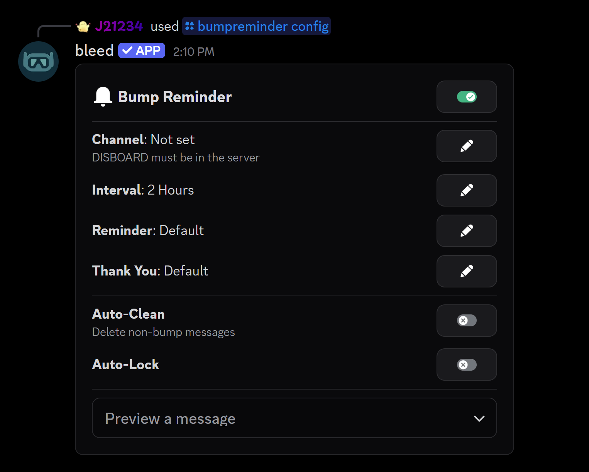

## Why use bump reminders?

Receiving reminders to bump your server on **DISBOARD** can help you increase your server's visibility and attract new members.
You can set up the **DISBOARD** bot by clicking [here](https://discord.com/oauth2/authorize?scope=identify+guilds+guilds.join&response_type=code&approval_prompt=auto&client_id=302050872383242240&redirect_uri=https%3A%2F%2Fdisboard.org%2Fsite%2Foauth-callback).

## Setting up bump reminders

Once you've invited the **DISBOARD** bot, use `/bumpreminder config` to turn bump reminders on, pick the channel, set the reminder interval (defaults to **2 Hours**), customize or preview your reminder and thank-you messages, and toggle auto-clean or auto-lock.

<CodeGroup>

```javascript Syntax
/bumpreminder config
```

</CodeGroup>
<br />
<Frame>
  
</Frame>

## Customizing bump reminders

### Changing the reminder message

You can set, preview, or clear the reminder message from `/bumpreminder config`.
This is the message that will be sent at your configured interval (every **two hours** by default) when it's time to `/bump` the server.

<Info>
  The reminder message can be raw text, [components](/resources/scripting/components), or [embeds](/resources/scripting/embeds)
  with dynamic [variables](/resources/scripting/variables).
</Info>
<Tip>
  This message is usually used to ping a role or user. Enable the **pingable** option when setting it so the role or user is notified.
</Tip>

<CodeGroup>

```text Text Example
@bump please bump the server
```

```text Embed Example
{embed}$v{message: @bump}$v{title: bump}$v{description: please bump the server}
```

</CodeGroup>

### Changing the thank you message

You can set, preview, or clear the message sent after someone bumps the server from `/bumpreminder config`.

<Info>
  The thank-you message can be raw text, [components](/resources/scripting/components), or [embeds](/resources/scripting/embeds)
  with dynamic [variables](/resources/scripting/variables).
</Info>

<CodeGroup>

```text Text Example
thank you for bumping the server {user.mention}!
```

```text Embed Example
{embed}$v{message: thank you for bumping the server {user.mention}}$v{description: you have helped the server grow!}
```

</CodeGroup>

### Locking the channel

If you don't want members to send messages until it's time to bump the server, toggle auto-lock on in `/bumpreminder config`.

### Cleaning up the channel

If you don't want messages which aren't `/bump` to stay in the channel, toggle auto-clean on in `/bumpreminder config`.
