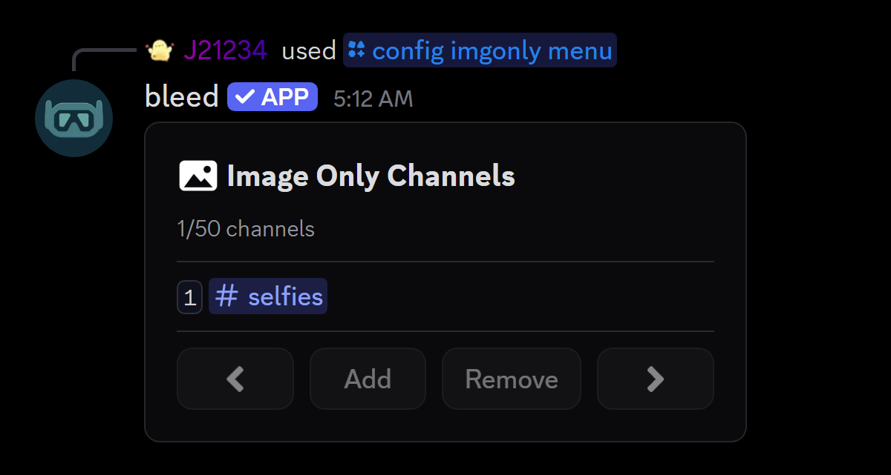
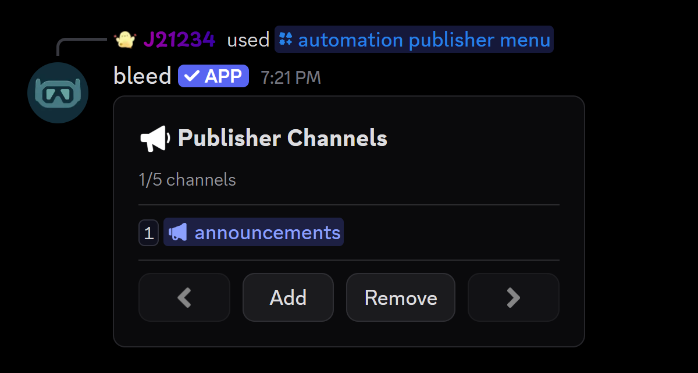
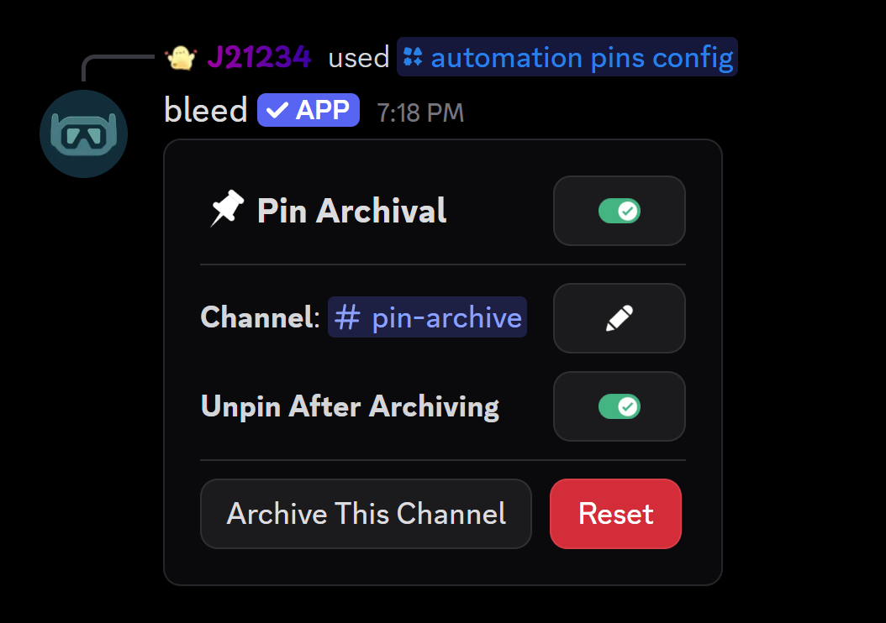

## Image-only channels

An image-only channel, also called a gallery channel, only allows messages with images. You can have up to **50** image-only channels.

<CodeGroup>
```javascript Syntax
/config imgonly add channel:<channel>
/config imgonly remove channel:<channel>
/config imgonly menu
```

```javascript Example
/config imgonly add channel:#selfies
```
</CodeGroup>
<br />
<Frame>
  
</Frame>

<Tip>
  Image-only channels work well with [reacting to every message](/configuration/reaction-triggers#reacting-to-every-message) for channels like `#selfies`.
</Tip>

## Auto-publishing announcements

bleed can automatically publish messages sent in an announcement channel, so they're shared to every server following it. You can have up to **5** publisher channels.

<Info>
  The channel must be an **announcement** channel.
</Info>

<CodeGroup>
```javascript Syntax
/automation publisher add channel:<channel>
/automation publisher remove channel:<channel>
/automation publisher menu
```

```javascript Example
/automation publisher add channel:#announcements
```
</CodeGroup>
<br />
<Frame>
  
</Frame>

## Pin archival

Discord only allows **50** pinned messages per channel. Pin archival copies pinned messages into an archive channel so you don't lose them.

Use the `/automation pins config` command to set it up.

| Setting | Description |
| --- | --- |
| **Channel** | The channel pinned messages are archived to. |
| **Unpin After Archiving** | When on, messages are unpinned after they're archived. |
| **Archive This Channel** | Archives the current channel's pins now. |
| **Reset** | Resets your pin archival settings. |

<CodeGroup>
```javascript Syntax
/automation pins config
```
</CodeGroup>
<br />
<Frame>
  
</Frame>
