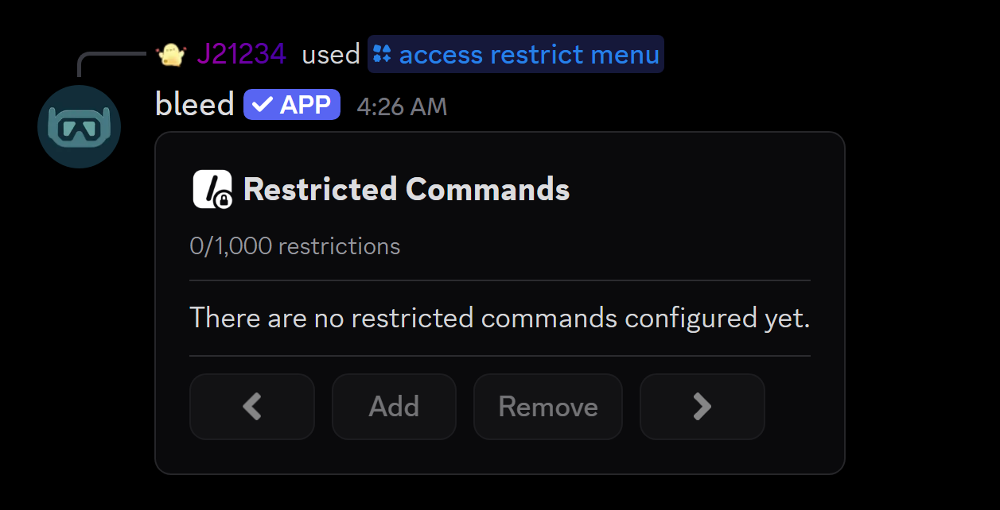
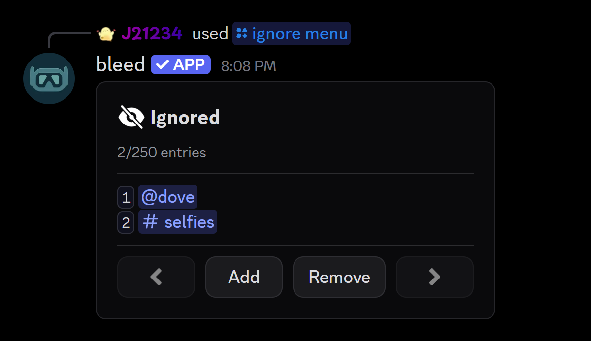

## Disabling commands

You can turn a command off in a channel, for a member, or everywhere.

<Info>
  Set `setting` to `Off` to disable the command, or `On` to enable it again.
</Info>

<CodeGroup>
```javascript Syntax
/access command set command:<command> setting:<On|Off> channel:<channel> member:<member>
/access command all command:<command> setting:<On|Off>
/access command list
```

```javascript Example
/access command set command:ban setting:Off channel:#general
/access command all command:snipe setting:Off
```
</CodeGroup>

## Disabling modules

A module is a group of commands, such as **music** or **fun**. Disabling a module turns off every command in it.

<CodeGroup>
```javascript Syntax
/access module set module:<module> setting:<On|Off> channel:<channel>
/access module all module:<module> setting:<On|Off>
/access module list
```

```javascript Example
/access module all module:fun setting:Off
```
</CodeGroup>

<Tip>
  You can also turn bleed's automatic features on or off with [events](/resources/events).
</Tip>

## Restricting commands to a role

You can give a role exclusive access to a command, so only members with that role can use it. You can have up to **1,000** restrictions.

<CodeGroup>
```javascript Syntax
/access restrict add command:<command> role:<role>
/access restrict remove command:<command> role:<role>
/access restrict menu
```

```javascript Example
/access restrict add command:ban role:@Moderator
```
</CodeGroup>
<br />
<Frame>
  
</Frame>

## Copying channel settings

You can copy a channel's disabled modules, events, filters and commands to another channel using the `/access copy` command.

<CodeGroup>
```javascript Syntax
/access copy old_channel:<channel> new_channel:<channel>
```

```javascript Example
/access copy old_channel:#general new_channel:#general-2
```
</CodeGroup>

## Ignoring members and channels

bleed ignores commands from ignored members and in ignored channels. You can have up to **250** ignored entries.

<Callout icon="shield" color="#658A95" iconType="regular">
  These commands require the **Administrator** permission.
</Callout>

<CodeGroup>
```javascript Syntax
/ignore add member:<member> | channel:<channel>
/ignore remove member:<member> | channel:<channel>
/ignore menu
```

```javascript Example
/ignore add channel:#counting
/ignore add member:@jonathan
```
</CodeGroup>
<br />
<Frame>
  
</Frame>
