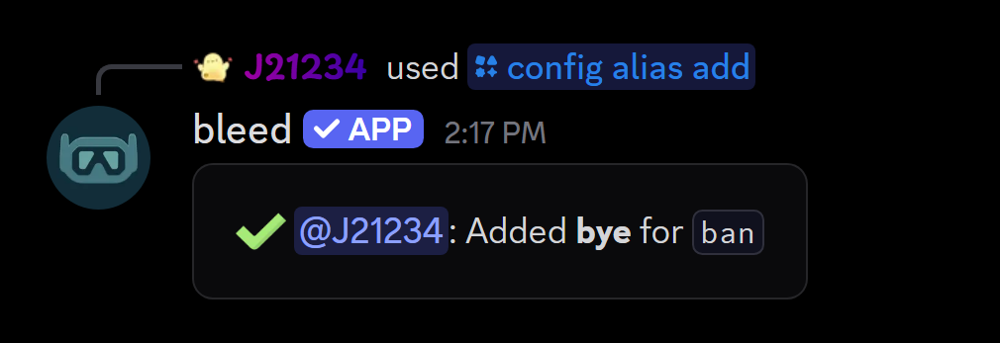
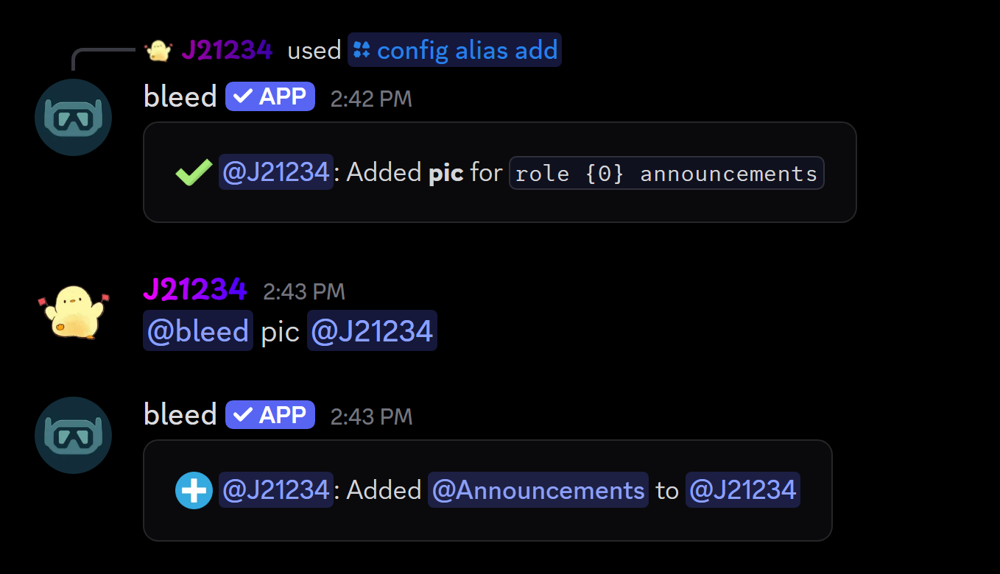
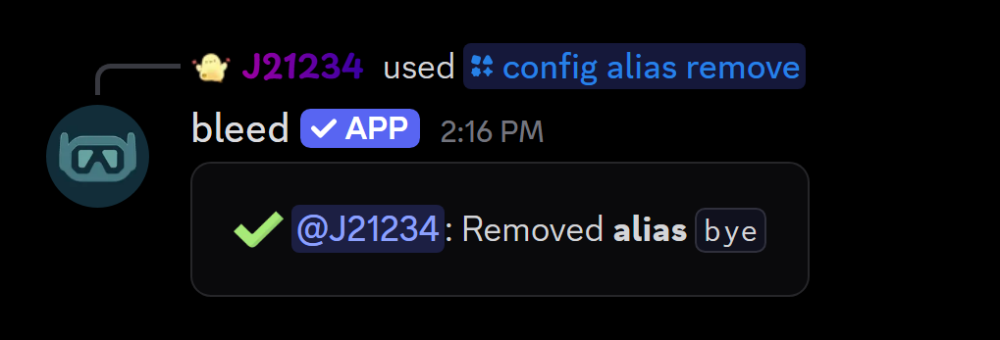
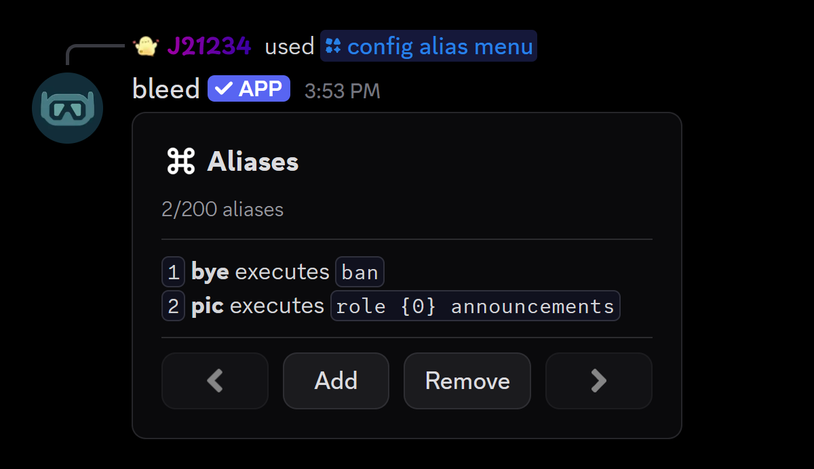

## Overview

Command aliases allow you to create custom commands that run other commands. This can be useful for creating shorter or more memorable commands for your server. For example, you could create an alias that runs the `role` command with a specific role.

## Creating an alias

You can create an alias using the `/config alias add` command. The `command` option accepts a prefix or slash command to run, with `{0}`, `{1}`, etc. for arguments passed after the shortcut.

<Info>
  Run an alias by mentioning bleed before the shortcut, such as `@bleed bye @jonathan`.
</Info>

<CodeGroup>

```javascript Syntax
/config alias add shortcut:<shortcut> command:<command>
```

```javascript Example
/config alias add shortcut:bye command:ban
```

</CodeGroup>
<br />
<Frame>
    
</Frame>

### Predefined arguments

You're able to use predefined arguments in your aliases, however, if you want to use the user's input as an argument, you have to use `{}`.
Keep in mind that the first argument is `{0}`, the second argument is `{1}`, and so on, it doesn't start at `{1}`.

```javascript
/ban user:@jonathan reason:harassing members
// {0} would be @jonathan
// {1} would be harassing members
```

Below is an example of an alias that uses predefined arguments:

```javascript
/config alias add shortcut:shh command:timeout {0} 10m
@bleed shh @jonathan
```

This alias would run the `/timeout add` command with the first argument being `@jonathan` from the user's input and the second argument being `10m` as predefined.

### Making a command to grant image permissions

If you're interested in creating a command that grants image permissions to a user, you can use the following alias which invokes the `/role add` command with the predefined image role.

```javascript
/config alias add shortcut:pic command:role {0} @image-role
@bleed pic @jonathan
```

<Frame>
  
</Frame>

## Removing an alias

You can remove an alias using the `/config alias remove` command.

<CodeGroup>

```javascript Syntax
/config alias remove shortcut:<shortcut>
```

```javascript Example
/config alias remove shortcut:bye
```

</CodeGroup>
<br />
<Frame>
    
</Frame>

## Related commands

<AccordionGroup>
  <Accordion title="Managing aliases">
    You can use the `/config alias menu` command to view, add, or remove up to **200** aliases in your server.
    <CodeGroup>
    ```javascript Syntax
    /config alias menu
    ```
    </CodeGroup>
    <Frame>
      
    </Frame>
  </Accordion>
</AccordionGroup>
