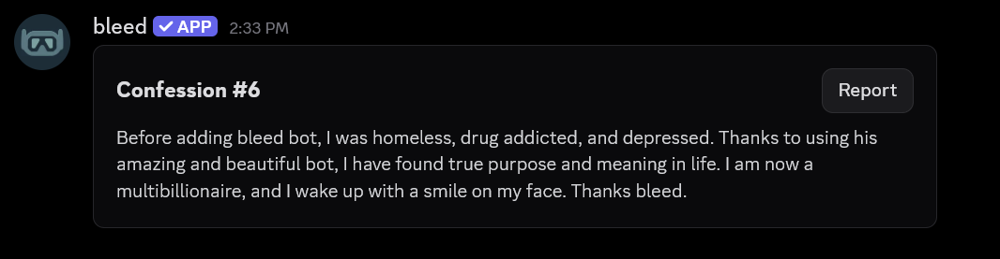
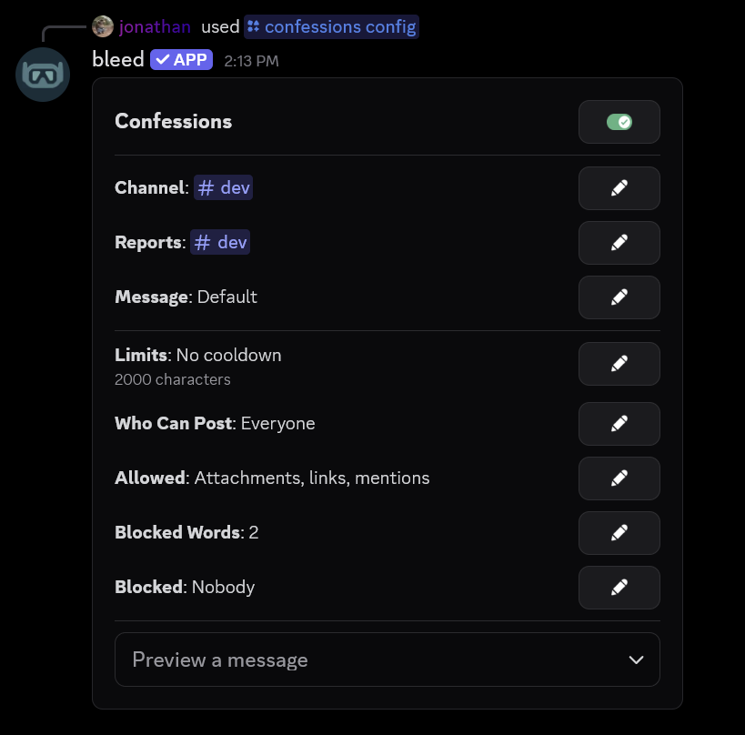
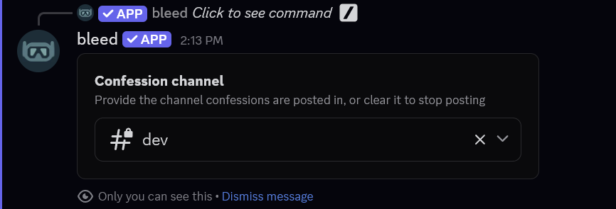
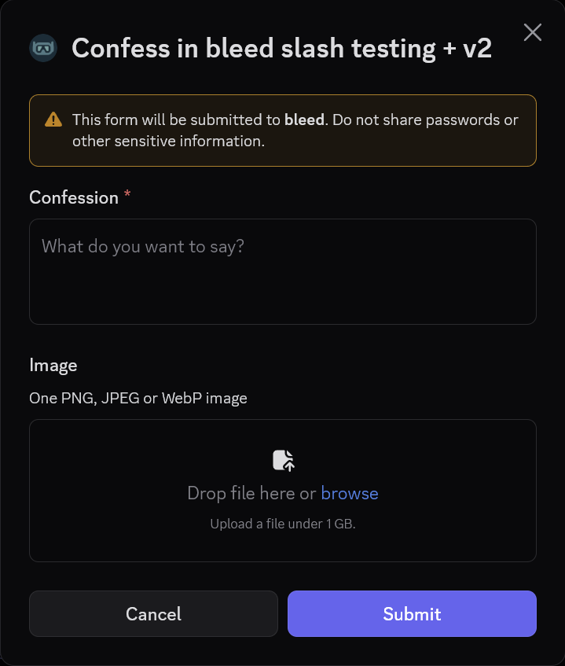
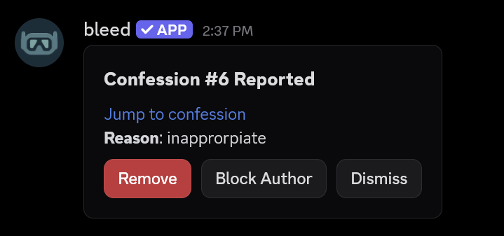

## What are confessions?

Confessions are anonymous messages that members can post to a confessions channel using the `/confess` command. Each confession is posted by bleed with a number, such as **Confession #12**, and staff are never able to see who wrote it.

<Frame>
  
</Frame>

<Info>
  Confessions are only available via slash commands.
</Info>

## Getting started

Use `/confessions config` to view the current configuration of confessions. The buttons on this message
allow you to change the configuration of confessions, as these settings cannot be changed with commands.

<Frame>
  
</Frame>

Before members can post a confession, it's important to set the confession channel and enable confessions with the toggle at the top of the message.
Otherwise, the `/confess` command will not work. Confessions are disabled by default.

## Setting the confession channel

You can use the **Channel** button to set which channel confessions will be posted to.

<Frame>
  
</Frame>

## Posting a confession

Members can post a confession using the `/confess` command. This command will open a Discord modal where they can enter their confession and attach an image, if attachments are allowed.

<Info>
  The `/confess` command can also be used in direct messages with bleed. The `server` parameter will show the servers you share with bleed that have confessions enabled.
</Info>

<CodeGroup>
```javascript Syntax
/confess server:<server>
```

```javascript Example
/confess
```

</CodeGroup>
<br />
<Frame>
  
</Frame>

## Blocking members

You can block a member from posting confessions using the `/confessions block` command. You can also block the author of a confession by using its number, without revealing who they are.

<Info>
  If you no longer want to block the member, you can use the `/confessions unblock` command. Alternatively, you can use the **Blocked** button on the `/confessions config` message to view and unblock members.
</Info>

<CodeGroup>
```javascript Syntax
/confessions block confession:<number>|member:<member> length:<Forever|1 day|7 days|30 days>
```

```javascript Examples
/confessions block confession:12 length:7 days
/confessions block member:@jonathan
```

</CodeGroup>
<br />
<Frame>
  
</Frame>

## Customizing confessions

### Setting the reports channel

You can use the **Reports** button to set a channel where reported confessions will be sent. Once a reports channel is set, every confession will have a **Report** button, where members can optionally give a reason.

<Info>
  When a confession is reported, staff can use the **Remove**, **Block Author** or **Dismiss** buttons on the report.
</Info>

<Frame>
  
</Frame>

### Changing the limits

You can use the **Limits** button to change the cooldown between confessions and the maximum length of a confession.

<Info>
  By default, the cooldown is **5 minutes** and the maximum length is **2,000** characters.
</Info>

### Restricting who can post

You can use the **Who Can Post** button to require a role, a minimum account age, or a minimum amount of time spent in the server.

<Info>
  If you set more than one role, members will only need **one** of them.
</Info>

### Allowing attachments, links and mentions

You can use the **Allowed** button to toggle if attachments, links and mentions are allowed in confessions. All three are disabled by default.
### Blocking words

You can use the **Blocked Words** button to block words and phrases from confessions. Enter one word or phrase on each line.

### Customizing the message displayed

You can use the **Message** button to customize the message that is sent to the confessions channel.

<Info>
  The message can be raw text, [components](/resources/scripting/components) or [embeds](/resources/scripting/embeds). If you no longer want a custom message, you can leave it empty to reset it.
</Info>

<AccordionGroup>
    <Accordion title="Viewing the variables">
        The following variables can be used in the message.

        | Variable              | Output                                                  |
        | --------------------- | ------------------------------------------------------- |
        | `{confession.number}` | The confession's number                                 |
        | `{confession.text}`   | The confession's text                                   |
        | `{confession.date}`   | The confession's date, shown in each member's time zone |
        | `{guild.name}`        | The guild's name                                        |
        | `{guild.id}`          | The guild's ID                                          |
        | `{guild.count}`       | The guild's member count                                |
        | `{guild.icon}`        | The guild's icon URL                                    |

        <Warning>
        Member variables such as `{user.name}` cannot be used, since confessions are anonymous.
        </Warning>
    </Accordion>
    <Accordion title="Placing the Report button">
        In a components message, use `{controls}` to place the **Report** button, or `{controls: 1 && side}` to place it beside a block of text. Attached images will be placed by bleed automatically.
    </Accordion>
    <Accordion title="Viewing the default message">
        The default message uses the following script.
        <CodeGroup>
            ```javascript Default
            {container}
            {content: ### Confession #{confession.number}}
            {controls: 1 && side}
            {content: {confession.text}}
            {/container}
            ```
        </CodeGroup>
    </Accordion>

</AccordionGroup>

## Deleting a confession

You can use the `/confessions delete` command to delete a confession by its number.

<CodeGroup>
```javascript Syntax
/confessions delete confession:<number>
```

```javascript Example
/confessions delete confession:12
```

</CodeGroup>
