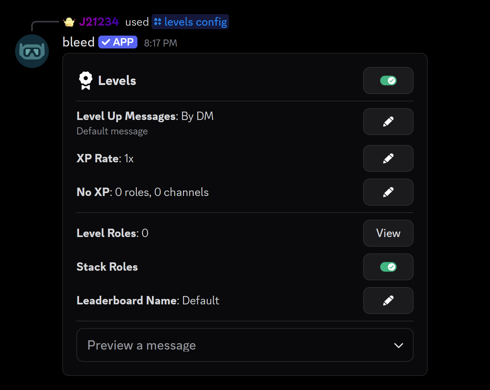

## Getting started

Use `/levels config` to enable leveling and configure level-up messages, XP rate, ignored roles and channels (**No XP**), level roles (**View**, up to **100**), role stacking, and the leaderboard name. Make sure **Levels** is enabled before expecting XP to be tracked for members.

<CodeGroup>
```javascript Syntax
/levels config
```
</CodeGroup>

<Frame>
  
</Frame>

## Ignoring channels and roles

You can ignore channels and roles (such as `#spam` or `@jailed`) that you don't want gaining XP from `/levels config`.

## Setting up roles to reward

You can add, update, or remove roles awarded when members reach a certain level inside `/levels config`.

<Tip>If your server already has XP, you can use the `/levels sync` command to ensure that all users have the correct roles based on their XP.</Tip>

### Stacking reward roles

Stacking roles means that users will keep all the roles they've earned when they reach a new level, instead of only having the role for their current level. By default, this feature is enabled, and you can toggle it in `/levels config`.

## Customizing level-up messages

You can set and preview the level-up message sent when a user achieves a new level inside `/levels config`.

<Info>
  The level-up message can be raw text, [components](/resources/scripting/components), or [embeds](/resources/scripting/embeds)
  with dynamic [variables](/resources/scripting/variables).
</Info>
<Warning>You must include the `{guild.name}` variable in your message if the message destination is set to **DM**.</Warning>
<CodeGroup>

```text Text Example
Congrats {user} on reaching level {level.new_rank} in {guild.name}!
```

```text Embed Example
{embed}$v{message: {user.mention}}$v{description: you have reached level {level.new_rank} in {guild.name}}
```

</CodeGroup>

### Setting where the message is sent

Select the pencil button beside **Level Up Messages** in `/levels config` to choose where messages are sent (**By DM** by default), pick a channel when using **In a Channel**, and customize the message (leave blank to return to the default).

Supported destination options:
- **By DM** - Sends the message in the user's direct messages.
- **Here** - Sends the message in the same channel where the user gained XP.
- **In a Channel** - Sends the message in a specified channel.
- **Off** - Entirely disables level-up messages.

## Changing a member's level

You can change a member's level to a specific level, set their XP to a specific amount, or remove some of their XP.

<CodeGroup>
```javascript Syntax
/levels setlevel member:<member> level:<level>
/levels setxp member:<member> amount:<amount>
/levels removexp member:<member> amount:<amount>
```

```javascript Example
/levels setlevel member:@J21234 level:5
/levels setxp member:@Keesh amount:10000
```

</CodeGroup>

## Changing the XP multiplier

You can change the XP multiplier (for example, `2.4`) inside `/levels config` to increase or decrease the amount of XP members receive.

## Related commands

<AccordionGroup>
  <Accordion title="Viewing a user's level and XP">
    Use the `/levels rank` command to view your own or another member's level and XP.
    <CodeGroup>
    ```javascript Syntax
    /levels rank member:<member>
    ```
    </CodeGroup>
  </Accordion>
  <Accordion title="Viewing the XP leaderboard">
    Use the `/levels leaderboard view` subcommand to view the highest XP earners in the server. You can rename the leaderboard title in `/levels config`.
  </Accordion>
  <Accordion title="Viewing the level rewards">
    Use the `/levels roles` subcommand to view all level rewards and the
    remaining XP needed to receive them.
  </Accordion>
  <Accordion title="Turning off your own level-up messages">
    Any member can use the `/levels messages` command to turn their own level-up messages on or off.
    <CodeGroup>
    ```javascript Syntax
    /levels messages setting:<On|Off>
    ```
    </CodeGroup>
  </Accordion>
  <Accordion title="Resetting XP">
    <Warning>These commands can only be used by the **server owner** and **cannot** be undone.</Warning>
    - `/levels cleanup` resets the level and XP of members who have left the server.
    - `/levels reset` resets the level and XP of every member.
  </Accordion>
</AccordionGroup>
