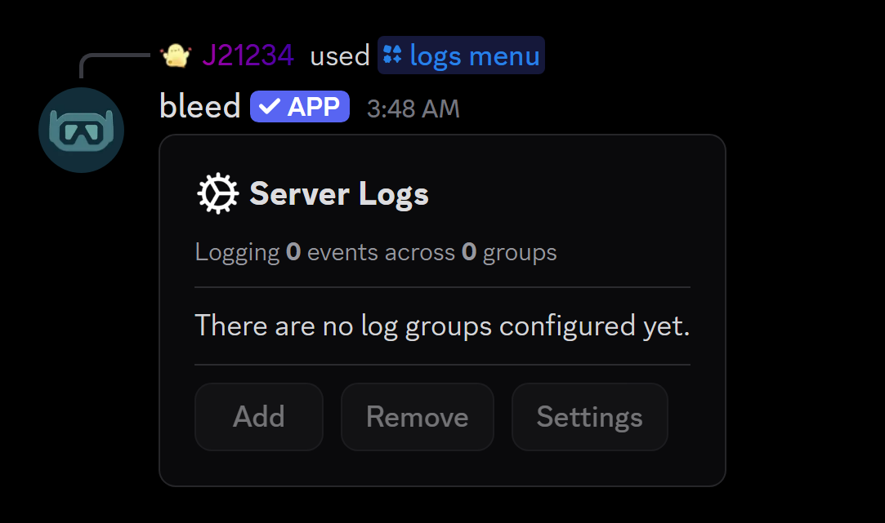
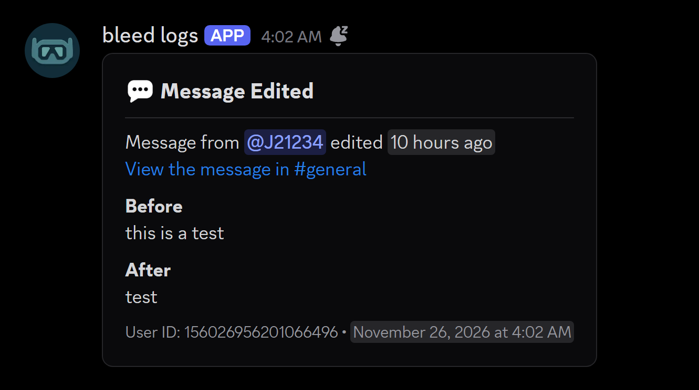
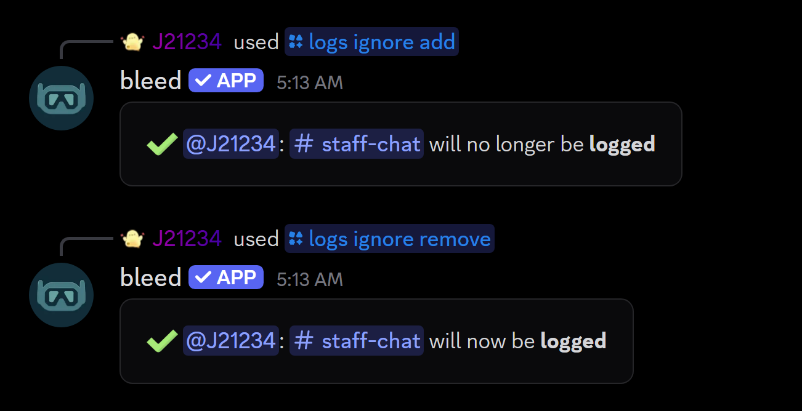

## Overview

Logging allows you to log events in your server. This can be useful for keeping track of what's happening in your server.

## Managing logging events

Use `/logs menu` to open **Server Logs**, where you can add or remove log groups, edit which events each channel receives, or open **Settings** to ignore bots, roles, members, and channels.

<Info>
  Select **Add** to create a log group for a channel, then use the pencil button beside a group to choose which events it logs (including messages, members, roles, channels, threads, invites, emojis, voice, AutoMod, moderation actions, and security modules).
</Info>

<Warning>
  Do not delete the webhook that bleed creates in your logging channels!
</Warning>

<CodeGroup>

```javascript Syntax
/logs menu
```

</CodeGroup>
<br />
<Frame>
  
</Frame>
<br />
<Frame>
  
</Frame>

<Tip>
  To log every event in its own post, use a forum channel with
  [`/logs forum`](#logging-to-a-forum).
</Tip>

## Ignoring a member or channel

You can ignore a member or channel from being logged using the `/logs ignore add` command.

<Info>
  Use `/logs ignore remove` to start logging a member or channel again, and
  `/logs ignore list` to view all ignored members and channels.
</Info>

<CodeGroup>

```javascript Syntax
/logs ignore add channel:<channel> | member:<member>
```

```javascript Example
/logs ignore add member:@jonathan
/logs ignore add channel:#staff-chat
```

</CodeGroup>
<br />
<Frame>
    
</Frame>

## Logging to a forum

You can use the `/logs forum` command to log to a forum channel. bleed makes a forum post for each kind of log event, all on one webhook. Provide comma-separated event names in `events`, or leave `events` empty to log all of them.

<CodeGroup>

```javascript Syntax
/logs forum channel:<forum channel> events:<events>
```

```javascript Example
/logs forum channel:#logs
```

</CodeGroup>

### Changing a log post's message

You can use the `/logs message` command to change the opening message of a log post. The message can be raw text, [components](/resources/scripting/components) or [embeds](/resources/scripting/embeds).

<CodeGroup>

```javascript Syntax
/logs message post:<post>
```

</CodeGroup>

## Changing the log colors

You can set, view, or reset the embed color for each kind of event in a logging channel from `/logs menu`.

