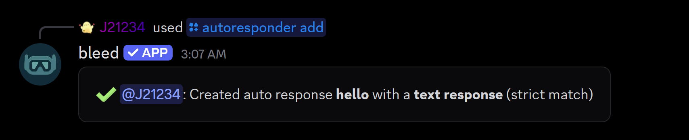
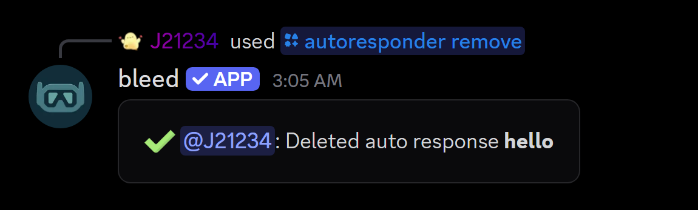
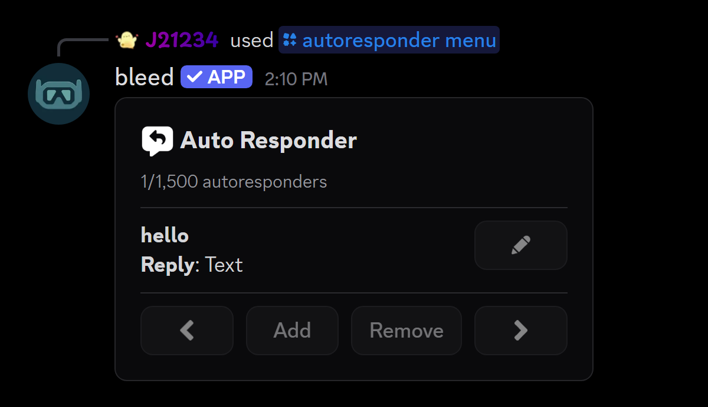

## Creating an auto responder

You can create an auto responder with the `/autoresponder add` command.

<Tip>
The response message can be raw text, [components](/resources/scripting/components), or [embeds](/resources/scripting/embeds) with dynamic [variables](/resources/scripting/variables).

This command will open a Discord modal where you can specify the content of the message.
</Tip>
<CodeGroup>

```javascript Syntax
/autoresponder add trigger:<trigger> reply:<True|False> delete:<True|False> ignore_command_check:<True|False> strict:<True|False> self_destruct:<number> ticket_form:<ticket_form_name>
```

```javascript Example
/autoresponder add trigger:welc reply:True delete:False ignore_command_check:False strict:False
/autoresponder add trigger:welc reply:False delete:False ignore_command_check:False strict:False self_destruct:10
```

</CodeGroup>
<br />
<Frame>
    
</Frame>

### Available parameters

The following parameters can be used to customize the response

<AccordionGroup>
  <Accordion title="Strict matching">
    Setting `strict:False` searches for the trigger anywhere in the message.
    For example, with `strict:False`, if the trigger is `hello`, it will respond to `hello there`. Setting `strict:True` only responds when the entire message matches the trigger.
  </Accordion>
  <Accordion title="Self destruct">
    The `self_destruct:` parameter schedules the response for deletion after a
    specified time (`0` to `60` seconds; `0` for never).
  </Accordion>
  <Accordion title="Delete trigger">
    The `delete:` parameter will delete the trigger message after the response is
    sent.
  </Accordion>
  <Accordion title="Reply to trigger">
    The `reply:` parameter will reply to the trigger message.
  </Accordion>
  <Accordion title="Ignore command check">
    The `ignore_command_check:` parameter will allow the responder to trigger even
    if it's a pre-existing command.
  </Accordion>
  <Accordion title="Ticket form">
    The `ticket_form:` parameter restricts the responder to only reply inside tickets created from the specified [ticket form](/configuration/tickets/forms) names, separated by spaces.
  </Accordion>
</AccordionGroup>

## Removing an auto responder

You can remove an auto responder with the `/autoresponder remove` command.

<Info>The `trigger` parameter will suggest your existing auto responders as you type.</Info>
<CodeGroup>
```javascript Syntax
/autoresponder remove trigger:<trigger>
```

```javascript Example
/autoresponder remove trigger:welc
```

</CodeGroup>
<br />
<Frame>
    
</Frame>

## Managing auto responders

Use `/autoresponder menu` to view, add, or remove up to **1,500** auto responders (or pass `tickets:True` for ticket auto responders). Select the pencil button beside an auto responder to edit its reply, self-destruct timer, trigger options, role assignment and removal, allowed members or channels (**Allowed For**), and ticket forms.

<Warning>
  Be careful not to mix up trigger restrictions and auto responder roles: **Allowed For** limits **who** or **which channels** can use a trigger, while **Role Assignment** and **Role Removal** grant or remove roles **when** a trigger matches.
</Warning>

<CodeGroup>
```javascript Syntax
/autoresponder menu tickets:<True|False>
```

```javascript Examples
/autoresponder menu
/autoresponder menu tickets:True
```
</CodeGroup>
<br />
<Frame>
  
</Frame>
