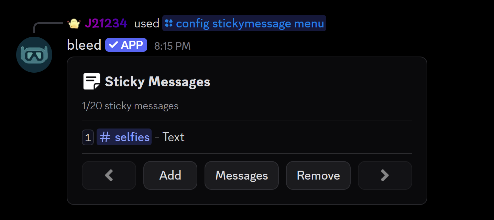

## What are sticky messages?

A sticky message stays at the bottom of a channel. When members send new messages, bleed sends the sticky message again so it's always easy to see. You can have up to **7** sticky messages.

## Adding a sticky message

You can add a sticky message using the `/config stickymessage add` command. Leave `channel` empty to use the current channel.

<Tip>
This command will open a Discord modal where you can enter your message. The message can be raw text, [components](/resources/scripting/components) or [embeds](/resources/scripting/embeds) with dynamic [variables](/resources/scripting/variables).
</Tip>

<CodeGroup>
```javascript Syntax
/config stickymessage add channel:<channel>
```

```javascript Example
/config stickymessage add channel:#selfies
Only post selfies in this channel!
```
</CodeGroup>

## Removing a sticky message

You can remove a sticky message using the `/config stickymessage remove` command.

<CodeGroup>
```javascript Syntax
/config stickymessage remove channel:<channel>
```

```javascript Example
/config stickymessage remove channel:#selfies
```
</CodeGroup>

## Managing sticky messages

You can use `/config stickymessage menu` to view, add, preview, or remove your sticky messages.

<CodeGroup>
```javascript Syntax
/config stickymessage menu
```
</CodeGroup>
<br />
<Frame>
  
</Frame>
