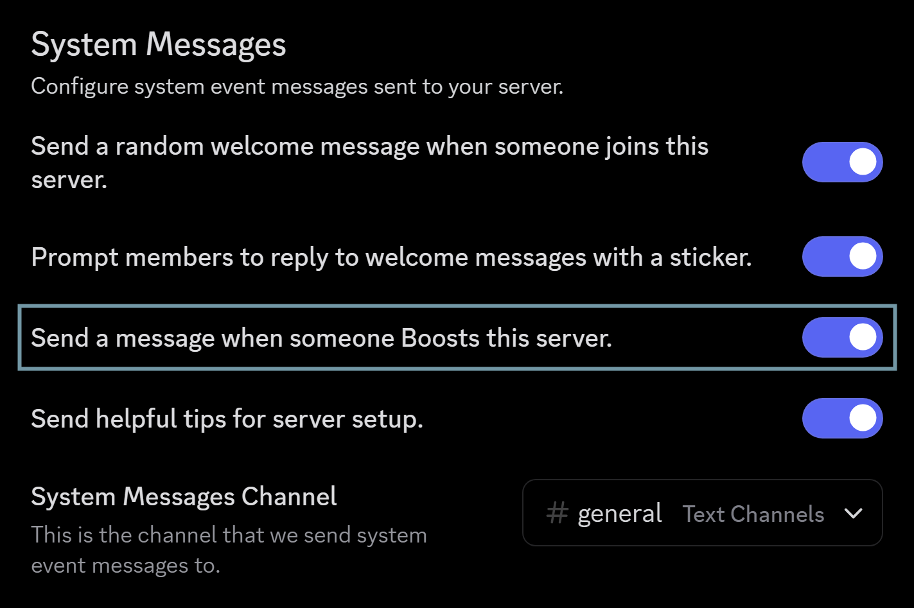
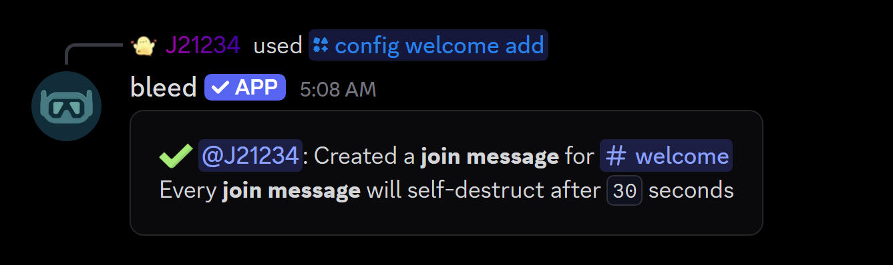
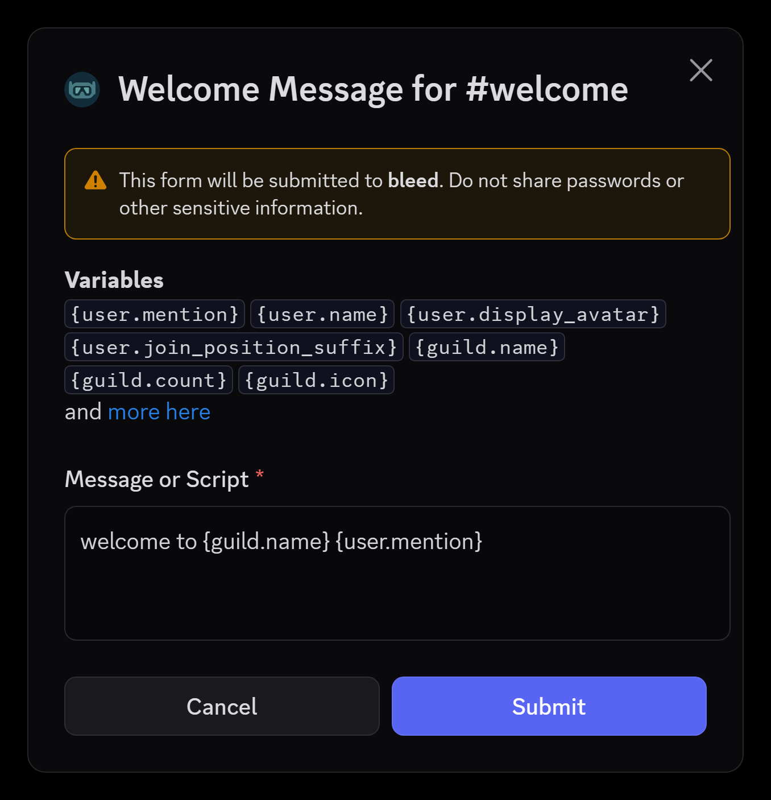
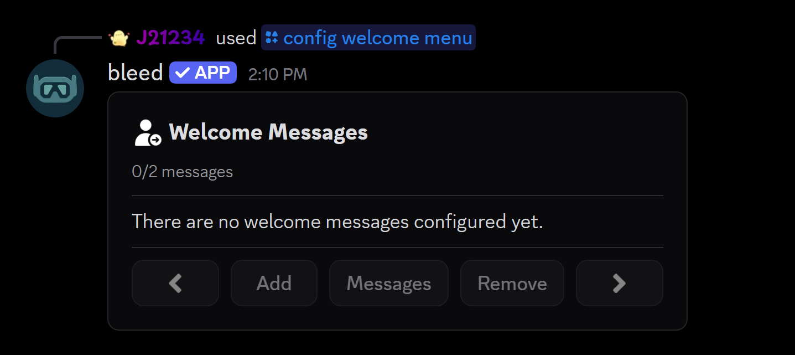

## Commands

There are three system message commands, each with the same subcommands.

- `welcome` - Dispatched whenever a user joins the server.
- `goodbye` - Dispatched whenever a user leaves the server.
- `boosts` - Dispatched whenever a user boosts the server.

<Tip>
  The `boost` event is only dispatched if the server has the **Discord System
  Message** enabled or whenever the user receives the **Server Booster** role
  which only occurs once.
  
</Tip>

<Info>
  The following examples use the `welcome` command, but the same syntax is
  applied for the other system message commands, such as `/config goodbye add`
  and `/config boosts add`. The `boosts` command does not have a `pingable`
  parameter.
</Info>

## Creating a system message

You can create a system message with the `/config welcome add` command.

<Tip>
The message can be raw text, [components](/resources/scripting/components), or [embeds](/resources/scripting/embeds) with dynamic [variables](/resources/scripting/variables).
</Tip>
<Info>
  - `channel` can be a text channel or thread.
  - `self_destruct` schedules the message for deletion after a specified time (up to `60` seconds, or `0` for never).
  - `pingable` allows the message to ping roles (available on `welcome` and `goodbye`).
</Info>

This command will open a Discord modal where you can specify the content of the message.
<CodeGroup>

```javascript Syntax
/config welcome add channel:<channel> self_destruct:<seconds> pingable:<True|False>
```

```javascript Example
/config welcome add channel:#welcome self_destruct:30 pingable:True
welcome to {guild.name} {user.mention}

/config welcome add channel:#welcome pingable:True
{embed}$v{message: {user.mention}}$v{description: welcome to {guild.name}}
```

</CodeGroup>
<Frame>
  
</Frame>
<Frame>
  
</Frame>

## Removing a system message

You can remove a system message with the `/config welcome remove` command.

<CodeGroup>

```javascript Syntax
/config welcome remove channel:<channel>
```

```javascript Example
/config welcome remove channel:#welcome
```

</CodeGroup>
<Frame>
  
</Frame>

## Related commands

<AccordionGroup>
  <Accordion title="Managing system messages">
    You can use `/config welcome menu`, `/config goodbye menu`, or `/config boosts menu` to view, add, preview, or remove system messages.
    <CodeGroup>
    ```javascript Syntax
    /config welcome menu
    /config goodbye menu
    /config boosts menu
    ```
    </CodeGroup>
    <Frame>
      
    </Frame>
  </Accordion>
</AccordionGroup>
