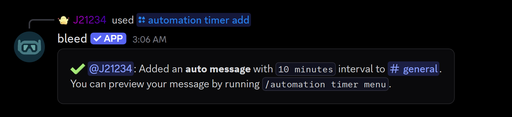
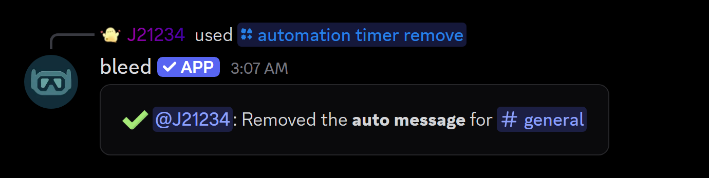
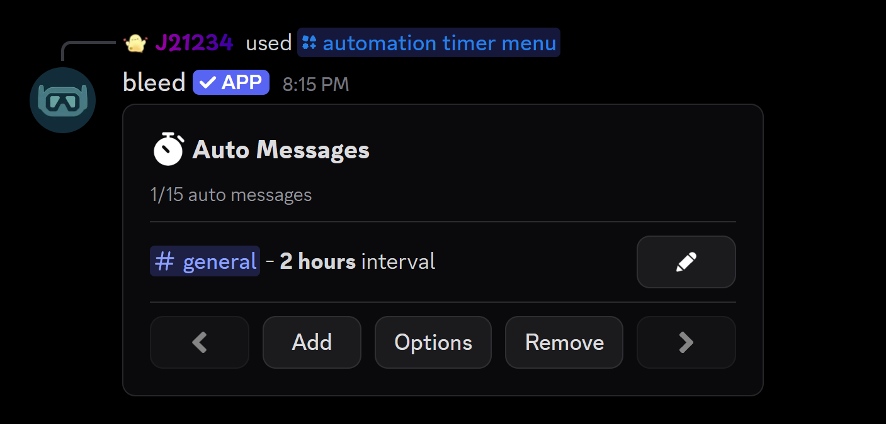

<Warning>
  You can only have **one** auto message per channel, and the interval must be
  at least **10 minutes**.
</Warning>

## Creating an auto message

You can create an auto message with the `/automation timer add` command.

<Info>
  The `interval` parameter is optional (defaults to `10 minutes` if left empty) and must use the proper format—you can learn more
  [here](/resources/syntax#formatting-a-duration).
</Info>
<Tip>
This command will open a Discord modal where you can enter your message. The message can be raw text, [components](/resources/scripting/components) or [embeds](/resources/scripting/embeds) with dynamic [variables](/resources/scripting/variables).
</Tip>
<CodeGroup>

```javascript Syntax
/automation timer add channel:<channel> interval:<interval>
```

```javascript Example
/automation timer add channel:#general interval:2h
Hello people! This is an auto message that will be sent every 2 hours.
```

</CodeGroup>
<br />
<Frame>
  
</Frame>

## Removing an auto message

You can remove an auto message with the `/automation timer remove` command.

<CodeGroup>
```javascript Syntax
/automation timer remove channel:<channel>
```

```javascript Example
/automation timer remove channel:#general
```

</CodeGroup>
<br />
<Frame>
  
</Frame>

## Related commands

<AccordionGroup>
  <Accordion title="Managing auto messages">
    You can use `/automation timer menu` to view, add, or remove up to **15** auto messages. Select **Options** to edit messages or toggle **Activity** so auto messages only post after new messages in the channel.
    <CodeGroup>
    ```javascript Syntax
    /automation timer menu
    ```
    </CodeGroup>
    <Frame>
      
    </Frame>
  </Accordion>
</AccordionGroup>
