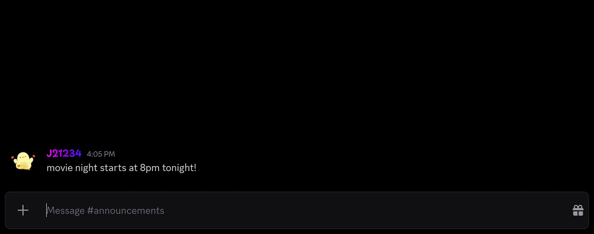
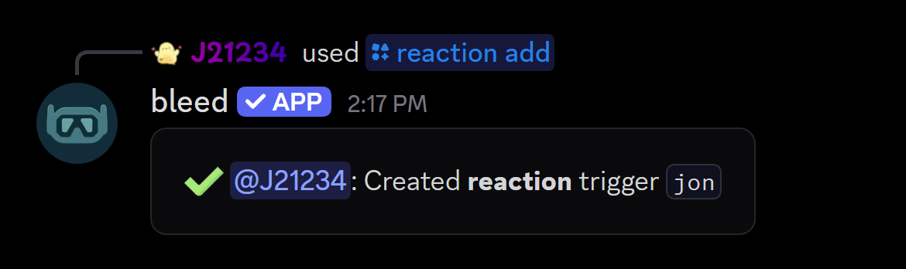
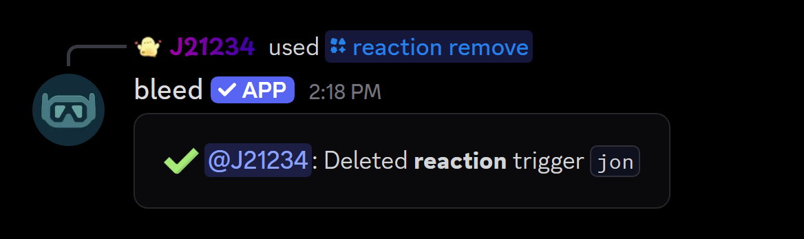
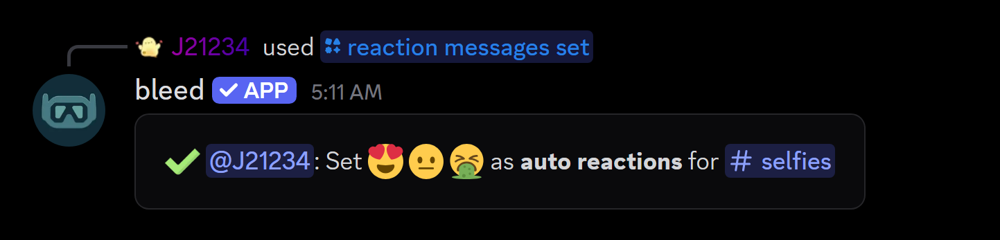
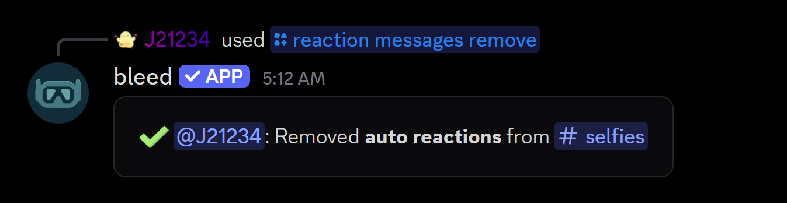
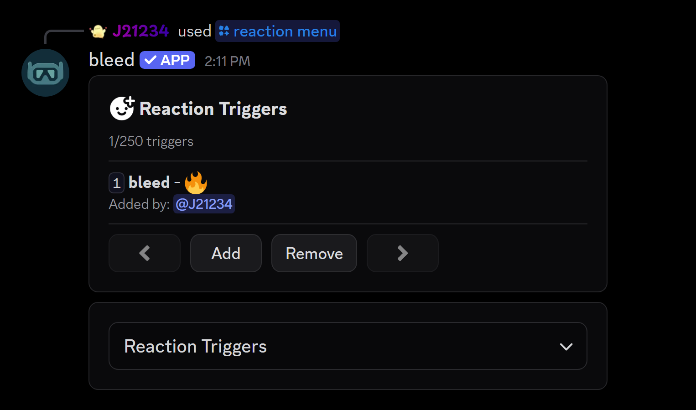
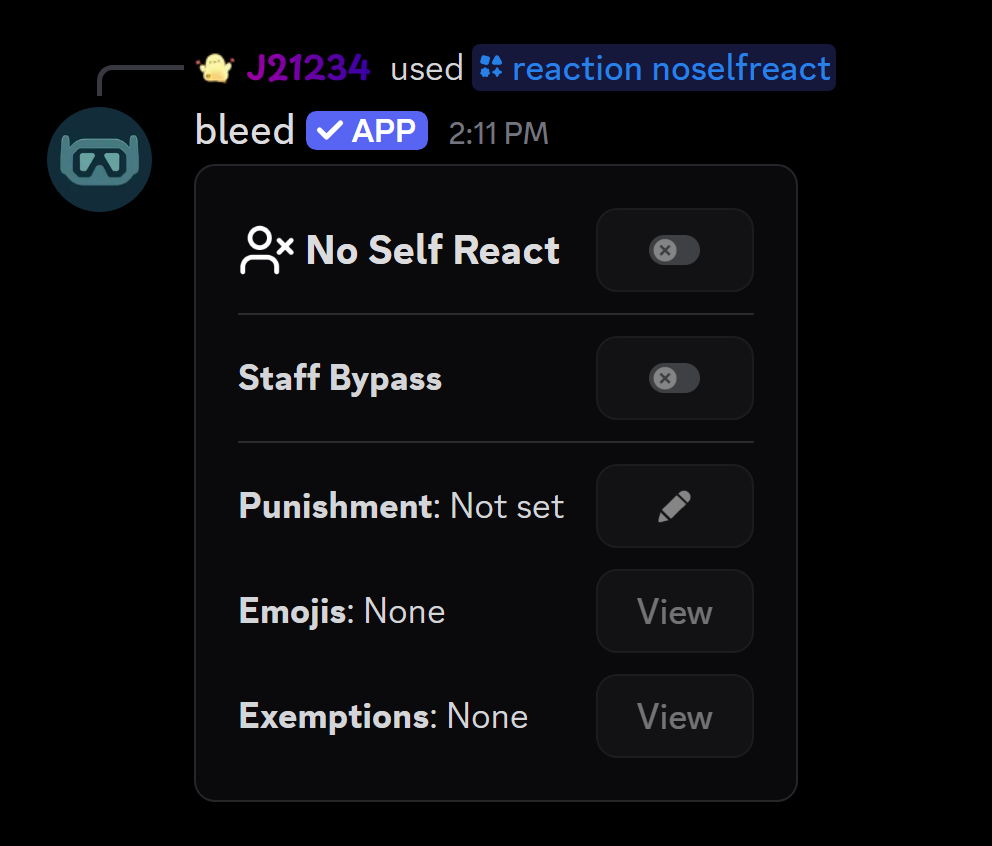

## Manually reacting to a message

You can use the `/reaction apply` command to react to a message with bleed.

<CodeGroup>

```javascript Syntax
/reaction apply message:<message-link> emojis:<emojis>
```

```javascript Example
/reaction apply message:https://discord.com/channels/.../... emojis:😍
```

</CodeGroup>
<br />
<Frame>
    
</Frame>

## Creating a reaction trigger

You can create a reaction trigger with the `/reaction add` command.

<Warning>
  Common words such as `hey` are not allowed as triggers, as they cause heavy
  load on the bot.
</Warning>

<CodeGroup>

```javascript Syntax
/reaction add emoji:<emoji> trigger:<trigger>
```

```javascript Example
/reaction add emoji:😍 trigger:jon
```

</CodeGroup>
<br />
<Frame>
    
</Frame>

## Removing a reaction trigger

You can remove a reaction trigger with the `/reaction remove` command.

<Info>The `trigger` parameter will suggest your existing reaction triggers as you type. You can leave `emoji` empty if the trigger only has one emoji.</Info>
<CodeGroup>

```javascript Syntax
/reaction remove trigger:<trigger> emoji:<emoji>
```

```javascript Example
/reaction remove trigger:jon emoji:😍
```

</CodeGroup>
<br />
<Frame>
    
</Frame>

## Reacting to every message

If you're interested in having reactions on every message, you can use the `/reaction messages set` command.
This is useful for channels like `#selfies` where messages can be voted on.

<Warning>
  The channel must have a slowmode of at least **one minute**. This works well alongside an
  [image-only](/configuration/channels#image-only-channels) channel.
</Warning>
<CodeGroup>

```javascript Syntax
/reaction messages set channel:<channel> first:<emoji> second:<emoji> third:<emoji>
```

```javascript Example
/reaction messages set channel:#selfies first:😍 second:😐 third:🤮
```

</CodeGroup>
<br />
<Frame>
    
</Frame>

### Removing all message reactions

You can use the `/reaction messages remove` command to remove all auto reactions from a channel.

<CodeGroup>

```javascript Syntax
/reaction messages remove channel:<channel>
```

```javascript Example
/reaction messages remove channel:#selfies
```

</CodeGroup>
<br />
<Frame>
    
</Frame>

## Related commands

<AccordionGroup>
    <Accordion title="Managing reaction triggers">
        You can use `/reaction menu` to view, add, or remove up to **250** reaction triggers, see who added each trigger, or switch to **Auto-React Channels** and **Previous Message Triggers** with the bottom selector.
        <CodeGroup>
        ```javascript Syntax
        /reaction menu
        ```
        </CodeGroup>
        <Frame>
            
        </Frame>
    </Accordion>
    <Accordion title="Managing auto-react channels">
        You can use `/reaction messages menu` (or the shared selector in `/reaction menu`) to view and manage up to **3** channels receiving automatic reactions.
        <CodeGroup>
        ```javascript Syntax
        /reaction messages menu
        ```
        </CodeGroup>
    </Accordion>
    <Accordion title="Previous-message triggers">
        You can react to the previous message when a trigger matches using `/reaction previousreact add` and `/reaction previousreact remove`, or manage up to **100** triggers with `/reaction previousreact menu` (or the shared selector in `/reaction menu`).
        <CodeGroup>
        ```javascript Syntax
        /reaction previousreact add emoji:<emoji> trigger:<trigger>
        /reaction previousreact remove trigger:<trigger> emoji:<emoji>
        /reaction previousreact menu
        ```

        ```javascript Example
        /reaction previousreact add emoji:💀 trigger:what
        ```
        </CodeGroup>
    </Accordion>
    <Accordion title="Preventing self-reactions">
        You can use `/reaction noselfreact` to open the **No Self React** configuration menu, where you can toggle **No Self React** and **Staff Bypass**, set a **Punishment**, and view configured **Emojis** and **Exemptions**.
        <CodeGroup>
        ```javascript Syntax
        /reaction noselfreact
        ```
        </CodeGroup>
        <Frame>
            
        </Frame>
    </Accordion>

</AccordionGroup>
