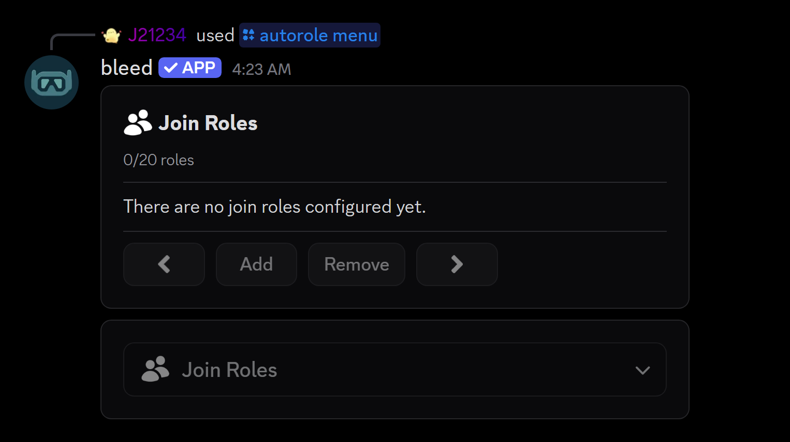

## What are join roles?

Join roles are given to every member who joins your server, such as a **Member** role. You can have up to **20** join roles.

<Warning>
  You can only add roles that are below your highest role, and bleed's role must be above them.
</Warning>

## Adding a join role

You can add a join role using the `/autorole add` command.

<CodeGroup>
```javascript Syntax
/autorole add role:<role>
```

```javascript Example
/autorole add role:@Member
```
</CodeGroup>

## Removing a join role

You can stop giving a role to new members using the `/autorole remove` command.

<CodeGroup>
```javascript Syntax
/autorole remove role:<role>
```

```javascript Example
/autorole remove role:@Member
```
</CodeGroup>

## Managing join roles

You can use `/autorole menu` to view, add, or remove your join roles.

<Tip>
  The selector at the bottom of the menu switches between **Join Roles**, **Sticky Roles**,
  [Reaction Roles](/configuration/roles/reaction), [Button Roles](/configuration/roles/button) and
  [Dropdown Roles](/configuration/roles/dropdown).
</Tip>

<CodeGroup>
```javascript Syntax
/autorole menu
```
</CodeGroup>
<br />
<Frame>
  
</Frame>

## Sticky roles

Sticky roles are given back to members when they rejoin the server, so leaving and rejoining can't be used to get rid of a role such as **Jailed**.

<Callout icon="key" color="#658A95" iconType="regular">Only the **server owner** can use these commands.</Callout>

<Info>
  You can add `member` to make a role sticky for one member.
</Info>

<CodeGroup>
```javascript Syntax
/autorole stickyrole add role:<role> member:<member>
/autorole stickyrole remove role:<role> member:<member>
/autorole stickyrole menu
```

```javascript Example
/autorole stickyrole add role:@Jailed
/autorole stickyrole add role:@Muted member:@jonathan
```
</CodeGroup>
