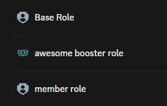
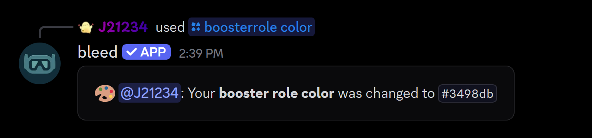
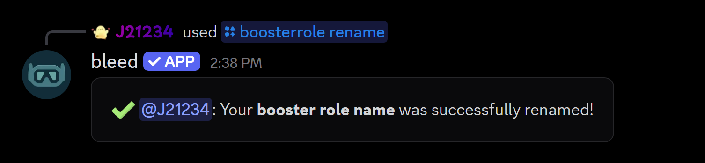
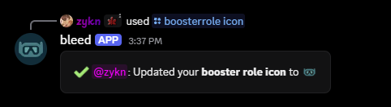
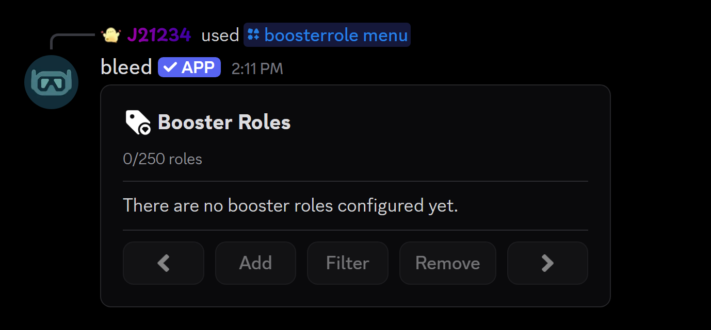

## What are booster roles?

Booster roles are unique roles that are given to members who have boosted your server. These roles can be fully customized by the members themselves.

## Setting the base role

In order for the booster roles to work, you must set a **Base Role** in `/settings config` under **Roles & Automation** → **Booster Roles**. All booster roles will be placed directly below this role. You can clear settings with `/boosterrole clear`, and manage active booster roles in `/boosterrole menu`.

<Tip>The base role should be a role which is above any roles with a color, otherwise the color won't be visible due to Discord's role hierarchy.</Tip>
<CodeGroup>
```javascript Syntax
/settings config
/boosterrole menu
/boosterrole clear setting:<Base Role|Icon>
```
</CodeGroup>
<br />
<Frame>
    
</Frame>

## Creating a booster role

You can create a booster role by using the `/boosterrole color` command.

<Info>The `color` parameter can be a hex code or a color name.</Info>
<Tip>You can also use `/boosterrole dominant` to use the most dominant color in your avatar, or `/boosterrole random` for a random color.</Tip>

<CodeGroup>
```javascript Syntax
/boosterrole color color:<color> second_color:<second_color> name:<name>
```

```javascript Example
/boosterrole color color:#3498DB second_color:#e74c3c name:my booster role
```

</CodeGroup>
<br />
<Frame>
    
</Frame>

## Customizing your booster role

### Changing the name

You can use the `/boosterrole rename` command to change the name of your booster role.

<CodeGroup>
```javascript Syntax
/boosterrole rename name:<name>
```

```javascript Example
/boosterrole rename name:bleed booster
```

</CodeGroup>
<br />
<Frame>
    
</Frame>

### Changing the icon

You can use the `/boosterrole icon` command to change the icon of your booster role.

<Info>The `url` can be an image link, an emoji or a custom emoji. Your server must be boost **Level 2** to use role icons.</Info>

<CodeGroup>
```javascript Syntax
/boosterrole icon url:<url>
```

```javascript Example
/boosterrole icon url:https://bleed.bot/bleed.png
```

</CodeGroup>
<br />
<Frame>
    
</Frame>

## Sharing your booster role

You can share your booster role with another member using the `/boosterrole share set` command, and view all members in your booster role with `/boosterrole share list`. If someone shared their booster role with you, you can leave it with the `/boosterrole share remove` command.

<CodeGroup>
```javascript Syntax
/boosterrole share set member:<member> setting:<On|Off>
/boosterrole share remove role:<role>
/boosterrole share list
```

```javascript Example
/boosterrole share set member:@jonathan setting:On
```
</CodeGroup>

<Info>
  Server managers can configure **Role Limit** (`0` to `250`, defaults to `250`), **Shared Roles Per Member** (defaults to `200`), and **Members Per Role** (defaults to `200`) in `/settings config` under **Roles & Automation** → **Booster Roles**.
</Info>

## Removing your booster role

If you no longer want your booster role, you can use the `/boosterrole remove` command.

## Automatically grant a role to boosters

You can reward your boosters with an automatic **Award Role** upon boosting your server in `/settings config` under **Roles & Automation** → **Booster Roles**.

## Related commands

<AccordionGroup>
  <Accordion title="Managing booster roles">
    Use `/boosterrole menu` to view, add, or remove up to **250** booster roles, or select **Filter** to manage up to **100** blocked words for booster role names. Base role, award role, and sharing limits are configured in `/settings config` under **Roles & Automation** → **Booster Roles**.
    <CodeGroup>
    ```javascript Syntax
    /boosterrole menu
    ```
    </CodeGroup>
    <Frame>
      
    </Frame>
  </Accordion>
  <Accordion title="Blocking words in booster role names">
    You can use the `/boosterrole filter add` command to stop a word from being used in booster role names.
    Use `/boosterrole filter remove` to allow it again, and `/boosterrole menu` to view every blocked word.
    <CodeGroup>
    ```javascript Syntax
    /boosterrole filter add word:<word>
    /boosterrole filter remove word:<word>
    ```

    ```javascript Example
    /boosterrole filter add word:owner
    ```
    </CodeGroup>
  </Accordion>
  <Accordion title="Linking an existing role">
    You can use the `/boosterrole link` command to make an existing role a member's booster role.
    <CodeGroup>
    ```javascript Syntax
    /boosterrole link member:<member> role:<role>
    ```

    ```javascript Example
    /boosterrole link member:@jonathan role:@jonathan's role
    ```
    </CodeGroup>
  </Accordion>
</AccordionGroup>
