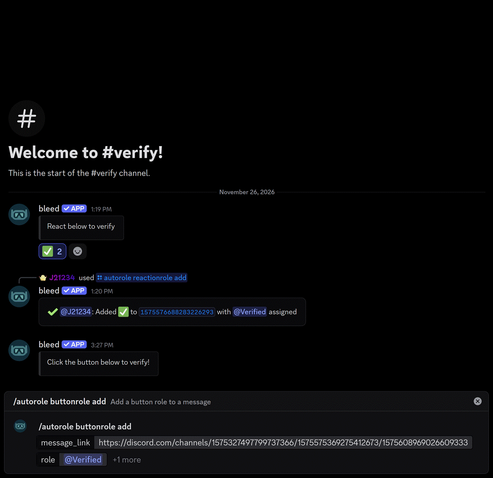
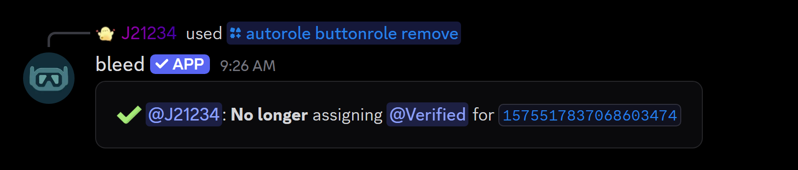
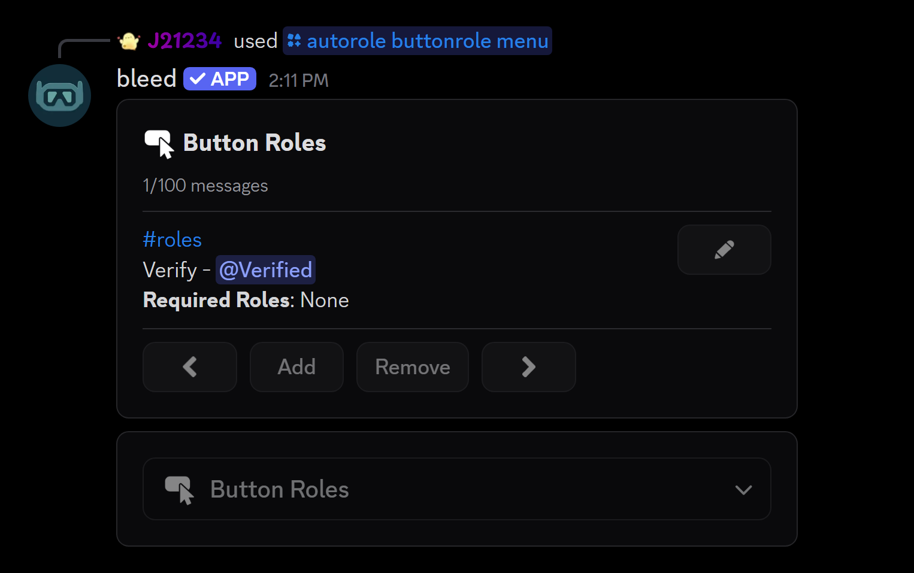

## What are button roles?

Button roles are roles that are assigned to members when they click a button on an existing message or embed. They can be useful for letting members choose unique roles or as a way to verify themselves.

## Creating a button role

You can create multiple button roles for a single message.

<Warning>
  Button roles can only be placed on messages, components, and embeds sent by bleed. Learn how to create a [component](/resources/scripting/components) or an [embed](/resources/scripting/embeds)!
</Warning>

This command will open a Discord modal where you can specify the button style, emoji, and label for the button role. Use `index` to choose the button's position on the message.
<CodeGroup>
```javascript Syntax
/autorole buttonrole add message_link:<message_link> role:<role> index:<index>
```

```javascript Example
/autorole buttonrole add message_link:.../channels/... role:@Member
```

</CodeGroup>
<br />
<Frame>
    
</Frame>

## Removing a button role

You can remove a specific button role by using the `/autorole buttonrole remove` command.

<Tip>
You can use the `/autorole buttonrole menu` command to view and manage all button roles in your server.
</Tip>

<CodeGroup>
```javascript Syntax
/autorole buttonrole remove message_link:<message_link> index:<button number>
```

```javascript Example
/autorole buttonrole remove message_link:.../channels/... index:1
```
</CodeGroup>
<br />
<Frame>
    
</Frame>

## Managing button roles

You can use `/autorole buttonrole menu` to view, add, or remove up to **100** button role messages, configure message options, or switch between self-role menus with the bottom selector.

<Warning>
  Resetting all button roles **cannot** be undone and will **permanently** remove **all** button roles from the
  server.
</Warning>

<CodeGroup>
```javascript Syntax
/autorole buttonrole menu
```
</CodeGroup>
<br />
<Frame>
  
</Frame>
