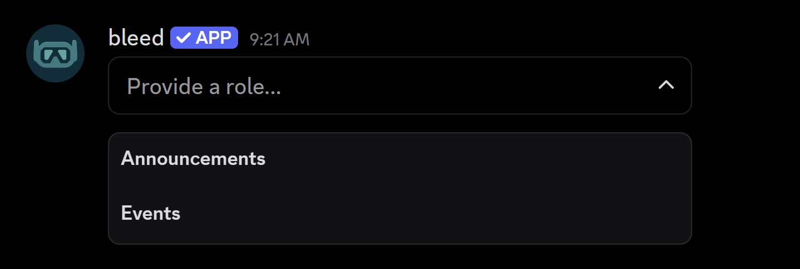
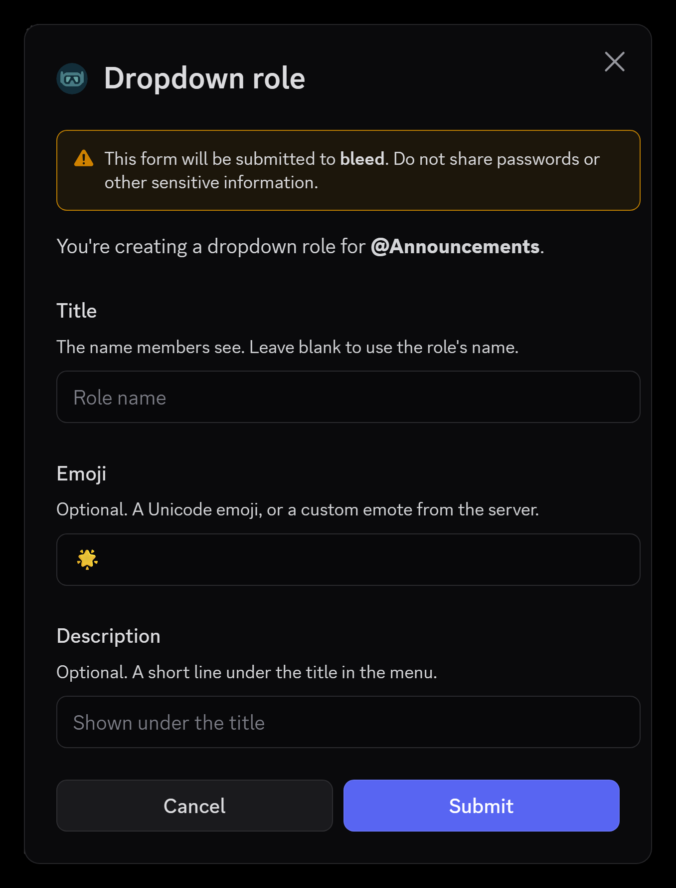
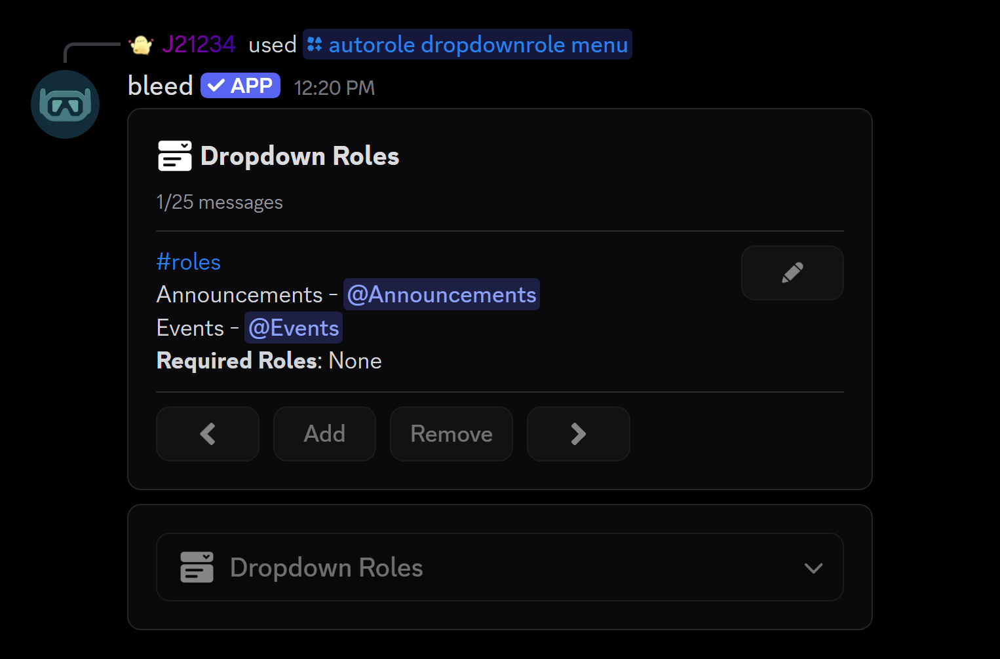

## What are dropdown roles?

Dropdown roles are roles that are assigned to members when they select an option from a dropdown menu. They can be useful for letting members choose multiple roles from a single message, such as ping roles for announcements, events and giveaways.

<Frame>
    
</Frame>

## Creating a dropdown role

You can create a dropdown role menu using the `/autorole dropdownrole create` command.

<Info>
  You must have the `Manage Server` and `Manage Roles` permissions to use this command. A dropdown can have up to **25** roles.
</Info>

This command will open a Discord modal where you can specify the title, emoji, and description for the role.
<CodeGroup>
```javascript Syntax
/autorole dropdownrole create channel:<channel> role:<role>
```

```javascript Example
/autorole dropdownrole create channel:#roles role:@Announcements
```

</CodeGroup>
<br />
<Frame>
    
</Frame>

## Adding a role to a dropdown

You can add more roles to an existing dropdown using the `/autorole dropdownrole add` command.

This command will open a Discord modal where you can specify the title, emoji, and description for the role.
<CodeGroup>
```javascript Syntax
/autorole dropdownrole add message_link:<message_link> role:<role>
```

```javascript Example
/autorole dropdownrole add message_link:.../channels/... role:@Events
```

</CodeGroup>
<br />
<Frame>
    
</Frame>

## Removing a dropdown role

You can remove a specific role from a dropdown by using the `/autorole dropdownrole remove` command.

<CodeGroup>
```javascript Syntax
/autorole dropdownrole remove message_link:<message_link> index:<1-25>
```

```javascript Example
/autorole dropdownrole remove message_link:.../channels/... index:1
```
</CodeGroup>
<br />
<Frame>
    
</Frame>

## Managing dropdown roles

You can view, add, or remove up to **25** dropdown role menus using `/autorole dropdownrole menu`, and switch between self-role menus using the bottom selector.

<CodeGroup>
```javascript Syntax
/autorole dropdownrole menu
```
</CodeGroup>
<br />
<Frame>
  
</Frame>

<AccordionGroup>
    <Accordion title="Editing a dropdown option">
        Change an option's title, emoji, or description on an existing dropdown.
    </Accordion>
    <Accordion title="Changing the placeholder">
        Change the text shown on the dropdown before a member selects a role.
    </Accordion>
    <Accordion title="Setting a limit">
        Set the minimum (`0`–`25`) and maximum (`1`–`25`) number of roles a member can select from the dropdown.
        <Info>The maximum cannot be higher than the number of roles on the dropdown.</Info>
    </Accordion>
    <Accordion title="Making a dropdown exclusive">
        Only allow members to hold **one** role from the dropdown.
        <Info>When this is enabled, selecting a role will **remove** the member's other roles from the dropdown.</Info>
    </Accordion>
    <Accordion title="Changing the message">
        Set or clear the text, [components](/resources/scripting/components), or [embed](/resources/scripting/embeds) displayed above the dropdown.
    </Accordion>
    <Accordion title="Setting required roles">
        Set the roles a member needs before they can use the dropdown, and choose whether they need **any** or **all** of them.
    </Accordion>
    <Accordion title="Removing or resetting dropdowns">
        Remove an entire dropdown and every role on it, or reset all dropdown roles from the server.
        <Warning>
          Resetting all dropdown roles **cannot** be undone and will **permanently** remove **all** dropdown roles from the server.
        </Warning>
    </Accordion>
</AccordionGroup>
