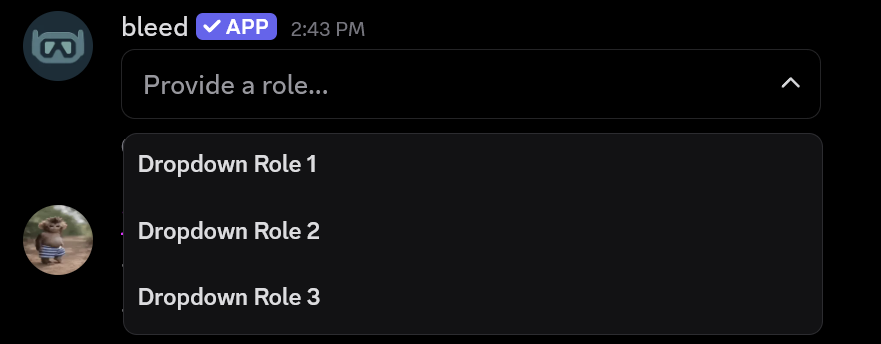
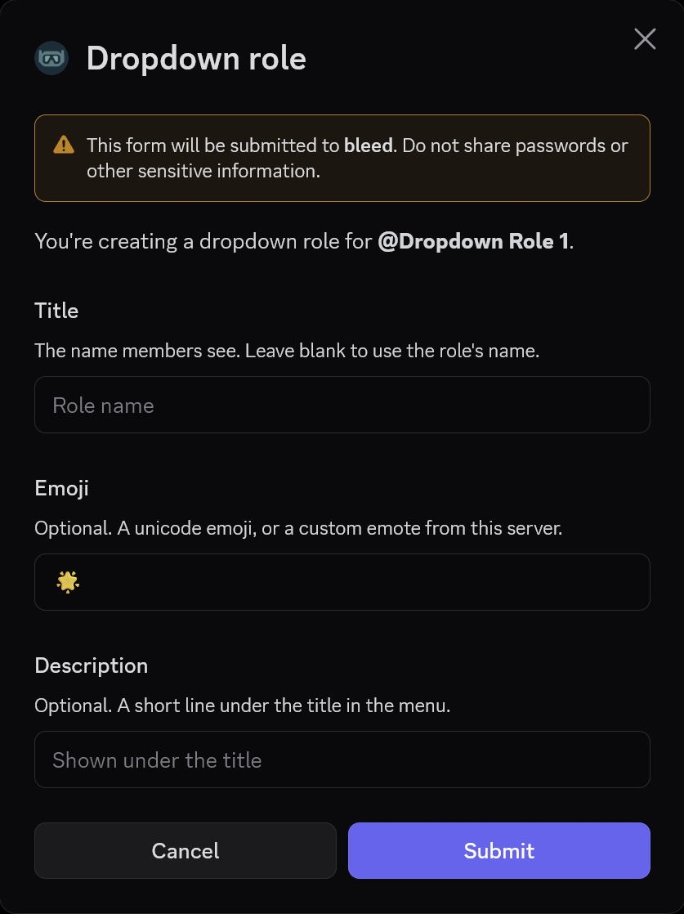
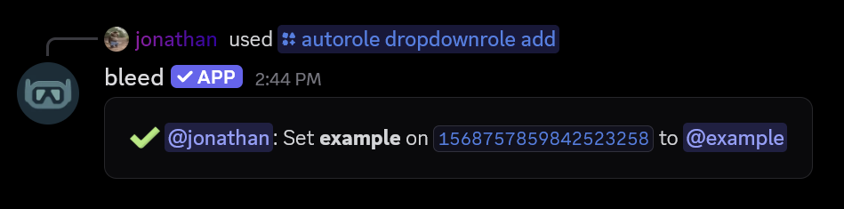
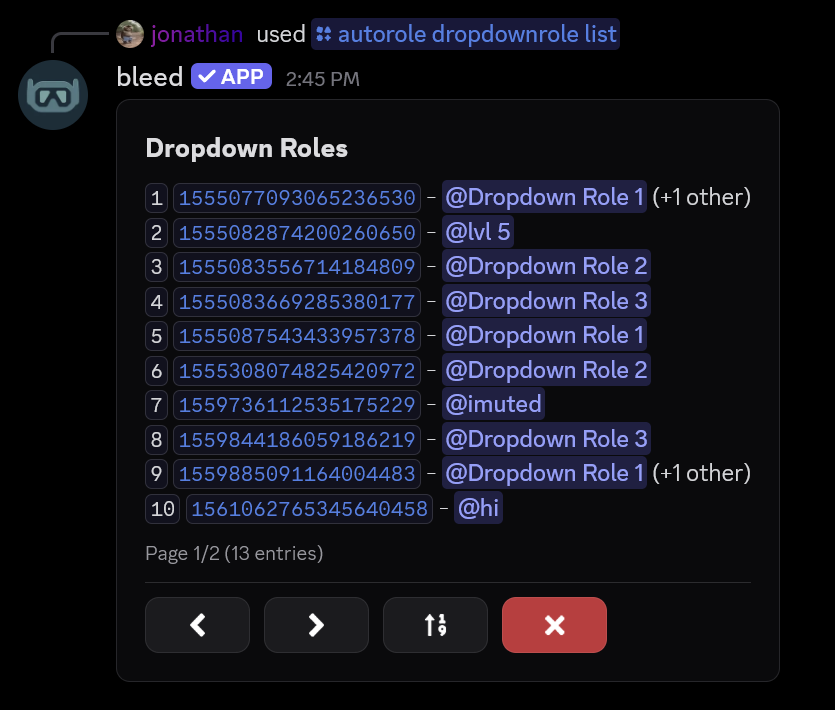
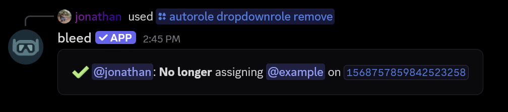
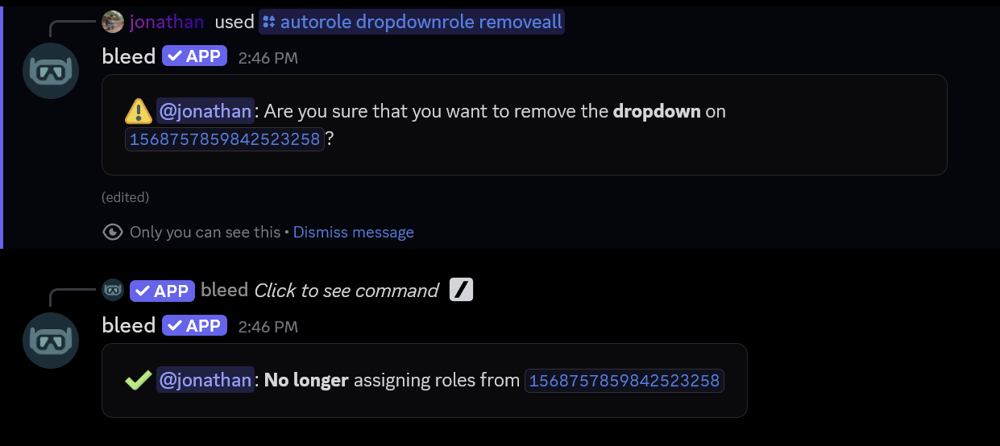
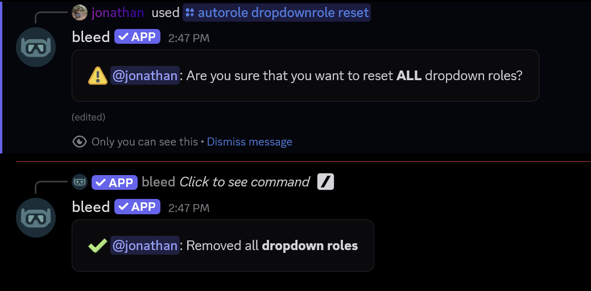

## What are dropdown roles?

Dropdown roles are roles that are assigned to members when they select an option from a dropdown menu. They can be useful for letting members choose multiple roles from a single message, such as pronouns or ping roles.

<Frame>
    
</Frame>

## Creating a dropdown role

You can create a dropdown role menu using the `/autorole dropdownrole create` command.

<Info>
  You must have the `Manage Roles` permission to use this command. A dropdown can have up to **25** roles.
</Info>

This command will open a Discord modal where you can specify the title, emoji, and description for the role.
<CodeGroup>
```javascript Syntax
/autorole dropdownrole create channel:<channel> role:<role>
```

```javascript Example
/autorole dropdownrole create channel:#general role:@in bird vc
```

</CodeGroup>
<br />
<Frame>
    
</Frame>

## Adding a role to a dropdown

You can add more roles to an existing dropdown using the `/autorole dropdownrole add` command.

This command will open a Discord modal where you can specify the title, emoji, and description for the role.
<CodeGroup>
```javascript Syntax
/autorole dropdownrole add message_link:<message_link> role:<role>
```

```javascript Example
/autorole dropdownrole add message_link:.../channels/... role:<role>
```

</CodeGroup>
<br />
<Frame>
    
</Frame>

## Editing a dropdown role

You can change a role's title, emoji or description using the `/autorole dropdownrole edit` command.

<Tip>
You can use the `/autorole dropdownrole list` command to see all dropdown roles in your server.
<Frame>
    
</Frame>
</Tip>

<CodeGroup>
```javascript Syntax
/autorole dropdownrole edit message_link:<message_link> index:<1-25>
```

```javascript Example
/autorole dropdownrole edit message_link:.../channels/... index:1
```

</CodeGroup>

## Related commands

<AccordionGroup>
    <Accordion title="Changing the placeholder">
        Use the `/autorole dropdownrole placeholder` command to change the text shown on the dropdown before a member selects a role.
        <Info>If you leave out the `text` parameter, this command will open a Discord modal where you can enter the placeholder.</Info>
        <CodeGroup>
        ```javascript Syntax
        /autorole dropdownrole placeholder message_link:<message_link> text:<text>
        ```

        ```javascript Example
        /autorole dropdownrole placeholder message_link:.../channels/... text:Select your roles
        ```
        </CodeGroup>
    </Accordion>
    <Accordion title="Setting a limit">
        Use the `/autorole dropdownrole limit` command to set how many roles a member can select from the dropdown.
        <Info>The maximum cannot be higher than the number of roles on the dropdown.</Info>
        <CodeGroup>
        ```javascript Syntax
        /autorole dropdownrole limit message_link:<message_link> minimum:<0-25> maximum:<1-25>
        ```

        ```javascript Example
        /autorole dropdownrole limit message_link:.../channels/... minimum:0 maximum:3
        ```
        </CodeGroup>
    </Accordion>
    <Accordion title="Making a dropdown exclusive">
        Use the `/autorole dropdownrole exclusive` command to only allow members to hold **one** role from the dropdown.
        <Info>When this is enabled, selecting a role will **remove** the member's other roles from the dropdown.</Info>
        <CodeGroup>
        ```javascript Syntax
        /autorole dropdownrole exclusive message_link:<message_link> setting:<On|Off>
        ```

        ```javascript Example
        /autorole dropdownrole exclusive message_link:.../channels/... setting:On
        ```
        </CodeGroup>
    </Accordion>
    <Accordion title="Changing the message">
        Use the `/autorole dropdownrole message` command to set the text or embed above the dropdown.
        <Info>This command will open a Discord modal where you can enter raw text, [components](/resources/scripting/components) or an [embed](/resources/scripting/embeds). If you no longer want a message, you can re-run the command and leave the modal empty.</Info>
        <CodeGroup>
        ```javascript Syntax
        /autorole dropdownrole message message_link:<message_link>
        ```

        ```javascript Example
        /autorole dropdownrole message message_link:.../channels/...
        ```
        </CodeGroup>
    </Accordion>
    <Accordion title="Setting required roles">
        Use the `/autorole dropdownrole required` command to set the roles a member needs before they can use the dropdown.
        <Info>This command will open a Discord modal where you can choose the roles, and whether members need **any** or **all** of them. If you no longer want to require roles, you can re-run the command without a role.</Info>
        <CodeGroup>
        ```javascript Syntax
        /autorole dropdownrole required message_link:<message_link>
        ```

        ```javascript Example
        /autorole dropdownrole required message_link:.../channels/...
        ```
        </CodeGroup>
    </Accordion>
</AccordionGroup>

## Removing a dropdown role

You can remove a specific role from a dropdown by using the `/autorole dropdownrole remove` command.

<CodeGroup>
```javascript Syntax
/autorole dropdownrole remove message_link:<message_link> index:<1-25>
```

```javascript Example
/autorole dropdownrole remove message_link:.../channels/... index:1
```
</CodeGroup>
<br />
<Frame>
    
</Frame>

### Removing a dropdown

Additionally, you can remove a dropdown and every role on it by using the `/autorole dropdownrole removeall` command.

<CodeGroup>
```javascript Syntax
/autorole dropdownrole removeall message_link:<message_link>
```

```javascript Example
/autorole dropdownrole removeall message_link:.../channels/...
```
</CodeGroup>
<br />
<Frame>
    
</Frame>

### Removing all dropdown roles from the server

You can remove all dropdown roles from the server by using the `/autorole dropdownrole reset` command.

<Warning>
  Please note that this **cannot** be undone & will **permanently** remove **all** dropdown roles from the
  server.
</Warning>

<CodeGroup>
```javascript Syntax
/autorole dropdownrole reset
```
</CodeGroup>
<Frame>
  
</Frame>
