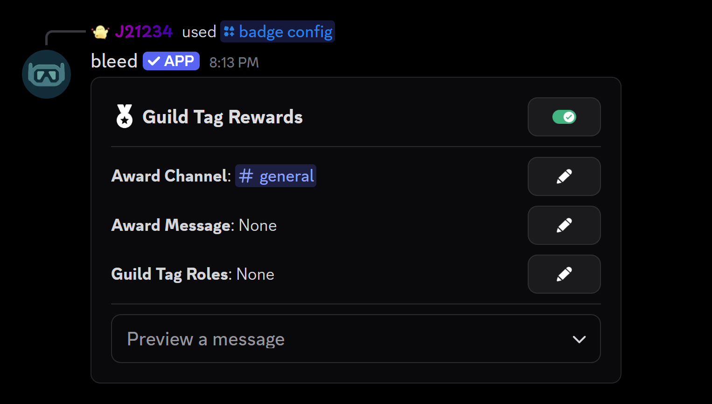

## What are guild tag rewards?

Members can show your server's tag next to their name on Discord. Guild tag rewards give roles to members who wear your tag, and can send a message to thank them.

## Setting up guild tag rewards

Use the `/badge config` command to set up guild tag rewards. Turn them on with the toggle at the top of the message.

<Info>
  You must have the `Manage Server` permission to use these commands.
</Info>

<CodeGroup>
```javascript Syntax
/badge config
```
</CodeGroup>
<br />
<Frame>
  
</Frame>

| Setting | Description |
| --- | --- |
| **Award Channel** | The channel the award message is sent to. |
| **Award Message** | The message sent when a member starts wearing your tag. Use **Preview a message** to see it. |
| **Guild Tag Roles** | The roles given to members who wear your tag. |

<Tip>
  The award message can be raw text, [components](/resources/scripting/components) or [embeds](/resources/scripting/embeds) with dynamic [variables](/resources/scripting/variables).
</Tip>

## Syncing roles

If members started wearing your tag before you set up rewards, use the `/badge sync` command to give them their roles.

<CodeGroup>
```javascript Syntax
/badge sync
```
</CodeGroup>
