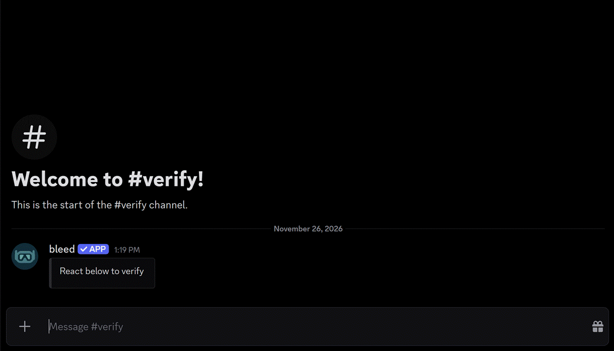
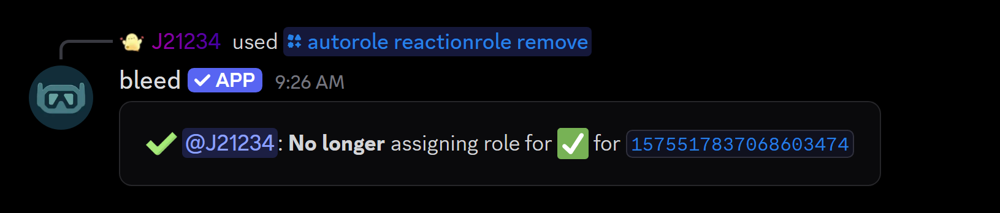
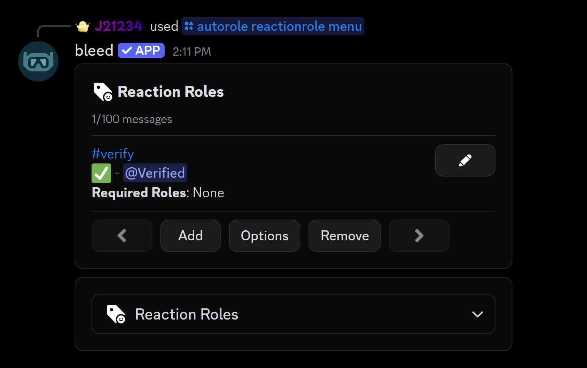

## What are reaction roles?

Reaction roles are roles that are assigned to members when they react to a message. This can be useful for letting members choose unique roles or as a way to verify themselves.

## Creating a reaction role

You can create multiple reaction roles for a single message with a different emoji for each role.

<Info>
  You can find the message link by **right-clicking** or **holding down** on the
  message and selecting **Copy Message Link**.
</Info>

<CodeGroup>
```javascript Syntax
/autorole reactionrole add message_link:<message_link> reaction:<reaction> role:<role>
```

```javascript Example
/autorole reactionrole add message_link:.../channels/... reaction:✅ role:@Member
```

</CodeGroup>
<br />
<Frame>
    
</Frame>

## Removing a reaction role

You can remove a reaction role by using the `/autorole reactionrole remove` command.

<Tip>
You can use the `/autorole reactionrole menu` command to view and manage all reaction roles in your server.
</Tip>
<CodeGroup>
```javascript Syntax
/autorole reactionrole remove message_link:<message_link> reaction:<reaction>
```

```javascript Example
/autorole reactionrole remove message_link:.../channels/... reaction:✅
```

</CodeGroup>
<br />
<Frame>
    
</Frame>

## Setting up a verification system

Reaction roles can be used to create a verification system where members must react to a message to gain access to the server.

<Info>
  In order for this to work, you'll need to create a role that will be assigned
  to members when they react to the message, such as a **Member** role.
</Info>

<Steps>
    <Step title="Create a role for verified members">
      Create a role that will be assigned to members when they react to the message.
    </Step>

    <Step title="Restrict access to channels">
       Restrict access to channels by removing the `@everyone` role from the channel
       and adding the verified role you created in step 1.
    </Step>

    <Step title="Create a message for members to react to">
       Create a message that members can react to in order to gain access to the
       server.
    </Step>

    <Step title="Add a reaction role to the message">
       Add a reaction role to the message with the verified role you created in step
       1.
    </Step>
</Steps>

## Managing reaction roles

You can use `/autorole reactionrole menu` to view, add, or remove up to **100** reaction role messages, configure required roles or rejoin restoration in **Options**, or switch between self-role menus using the bottom selector.

<Warning>
  Resetting all reaction roles **cannot** be undone and will remove **ALL** reaction roles from the server.
</Warning>

<CodeGroup>
```javascript Syntax
/autorole reactionrole menu
```
</CodeGroup>
<br />
<Frame>
  
</Frame>