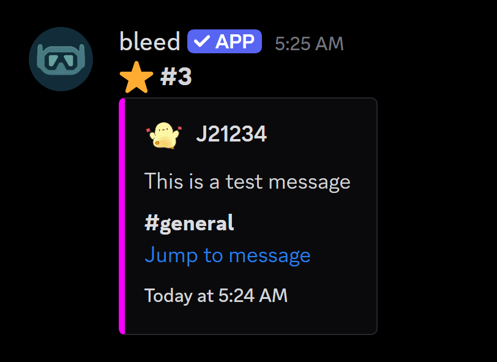
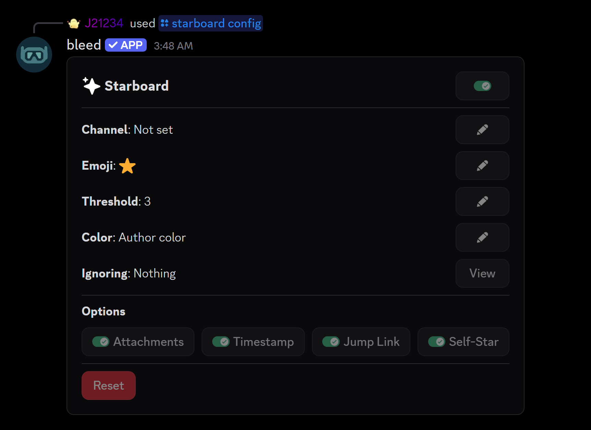

## What is Starboard?

The starboard is a channel where members can react to messages and after a certain number of reactions, the message will be reposted to the starboard channel.

<Frame>
  
</Frame>
<Info>
  You can create two starboards, both `starboard` and `clownboard` use the
  same structure.
</Info>

## Getting started

Use `/starboard config` (or `/clownboard config`) to turn the starboard on, set the channel, emoji, threshold, and embed color, manage ignored entries, toggle message options, or reset the configuration. Make sure you enable the starboard and set a channel before expecting messages to be reposted.

<CodeGroup>
```javascript Syntax
/starboard config
/clownboard config
```
</CodeGroup>
<br />
<Frame>
  
</Frame>

## Setting the starboard channel

Set the channel where starred messages will be reposted from `/starboard config`.

## Ignoring channels, roles, or members

You can ignore specific channels, roles, or members from `/starboard config` to prevent their messages from appearing on the starboard, as well as view or unignore them there.

## Customizing the starboard

### Changing the reaction threshold

You can change the minimum number of reactions a message needs to be reposted in `/starboard config`. The threshold can be from `3` to `100`, and is `3` by default.

### Changing the emoji to watch for

You can set the emoji that members need to react with for a message to be reposted in `/starboard config`.

<Info>
  By default, this emoji is set as `⭐` for the starboard and `🤡` for the
  clownboard.
</Info>

### Allowing self-starring messages

You can toggle whether members are allowed to star their own messages in `/starboard config`.

### Customizing the message displayed

You can customize the message sent to the starboard channel from `/starboard config`:

<AccordionGroup>
    <Accordion title="Changing the embed color">
        Set the default embed color for starboard posts using a hex code (such as `#ffffff`) or color name.
    </Accordion>
    <Accordion title="Toggling the embed timestamp">
        Choose whether a timestamp appears on starboard posts.
    </Accordion>
    <Accordion title="Toggling the message jump URL">
        Choose whether a jump URL link to the original message is included on starboard posts.
    </Accordion>
    <Accordion title="Toggling the message attachments">
        Choose whether attachments from the starred message are included on starboard posts.
    </Accordion>

</AccordionGroup>

## Resetting the starboard

You can clear individual settings back to their defaults or reset the entire starboard configuration from `/starboard config`.
