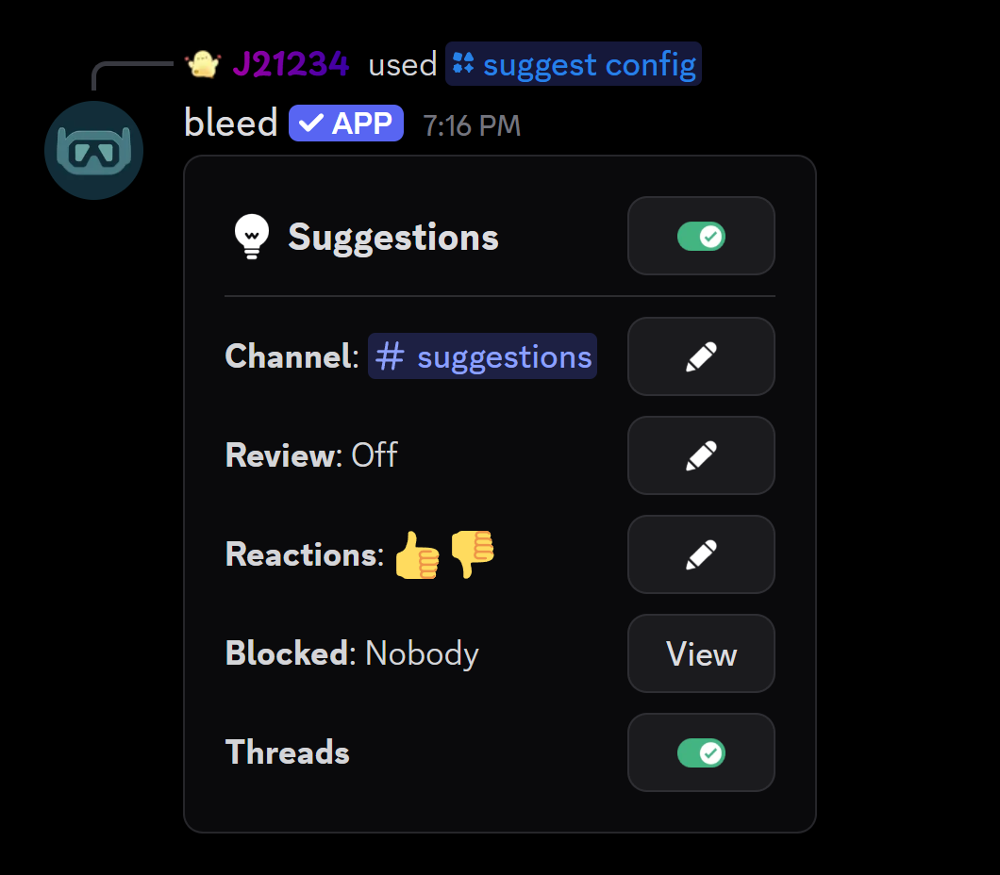

## Setting up suggestions

Use the `/suggest config` command to view and change your suggestion settings. Use the toggle at the top of the message to turn suggestions on or off.

<Info>
  You must have the `Manage Channels` permission to use this command.
</Info>

<CodeGroup>
```javascript Syntax
/suggest config
```
</CodeGroup>
<br />
<Frame>
  
</Frame>

| Setting | Description |
| --- | --- |
| **Channel** | The channel suggestions are posted to. |
| **Review** | When on, new suggestions wait in a **review channel** until staff approve them. |
| **Reactions** | The vote reactions added to each suggestion. By default, these are 👍 and 👎. |
| **Blocked** | Members who can't make suggestions. Use **View** to see them. |
| **Threads** | Opens a thread on each suggestion for discussion. |

## Making a suggestion

Members can make a suggestion using the `/suggest create` command.

<CodeGroup>
```javascript Syntax
/suggest create suggestion:<suggestion>
```

```javascript Example
/suggest create suggestion:Add a channel for sharing music
```
</CodeGroup>

## Responding to suggestions

Staff can change a suggestion's status or reply to it. These commands can only be used by members with a [staff role](/security/moderation#setting-staff-roles).

| Command | Status |
| --- | --- |
| `/suggest approve id:<id>` | Approved |
| `/suggest deny id:<id>` | Denied |
| `/suggest consider id:<id>` | In Consideration |
| `/suggest progress id:<id>` | In Progress |
| `/suggest reset id:<id>` | Pending |

<CodeGroup>
```javascript Syntax
/suggest reply id:<id> comment:<comment> silent:<True|False>
```

```javascript Example
/suggest approve id:4
/suggest reply id:4 comment:Great idea, we'll add it this weekend!
```
</CodeGroup>

<Info>
  Set `silent:True` on `/suggest reply` to sign the reply as **Staff** instead of with your name.
</Info>
