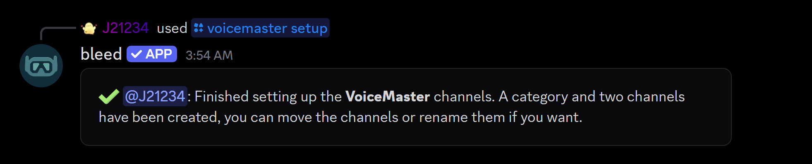
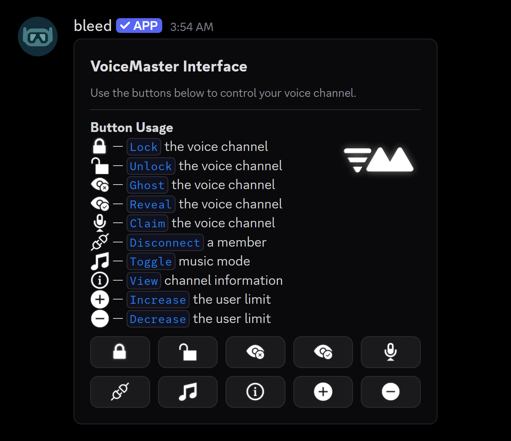
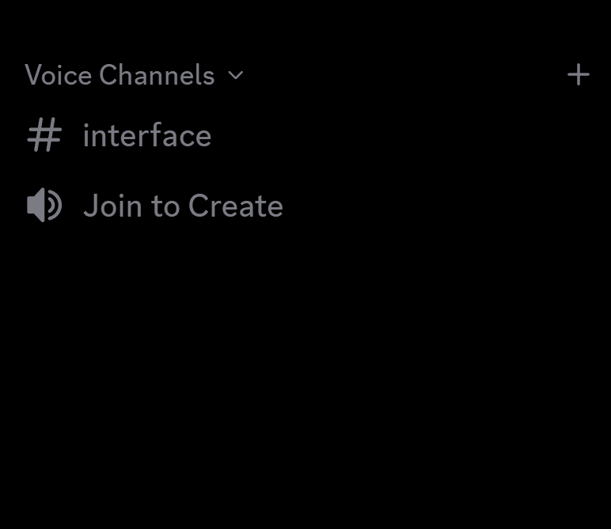
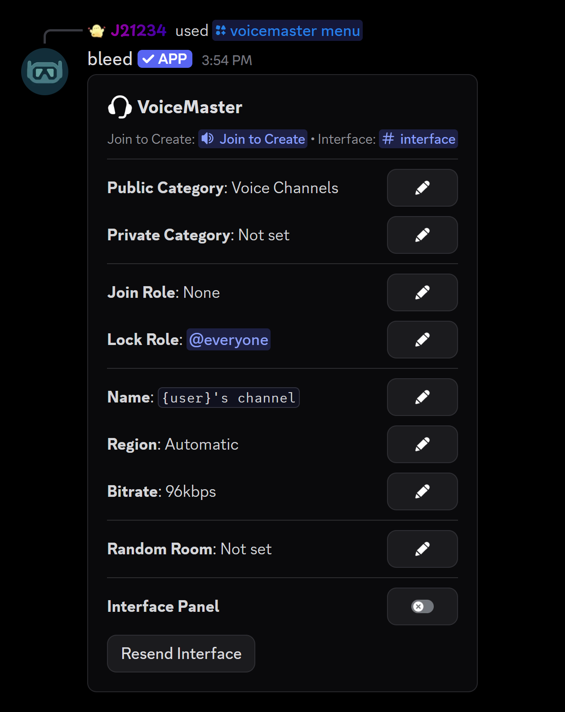
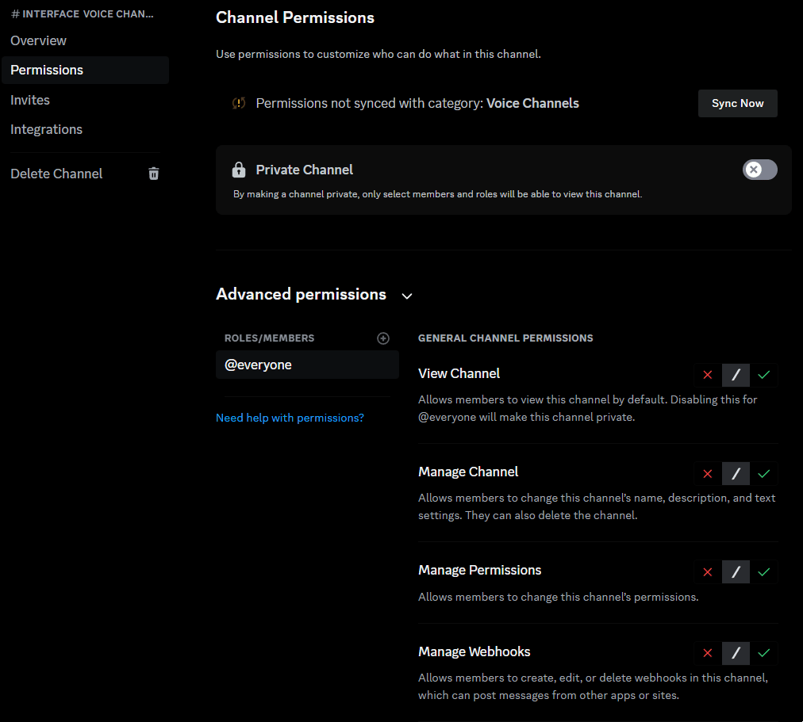

## Getting started

The first step to using **VoiceMaster** is to use the `/voicemaster setup` command.

<Tip>The created channels can be moved and renamed to your liking.</Tip>

<Info>
  Use `/voicemaster menu` to view and edit your server's VoiceMaster settings,
  including resending the interface panel if it is deleted.
</Info>

<Frame>
  
</Frame>

### What is the interface channel?

The `#interface` channel will contain an embed with buttons that allow members to customize their temporary voice channel. This channel should be locked to keep the embed message at the top of the channel.

<Frame>
  
</Frame>

### What is the Join to Create channel?

The **Join to Create** channel is where members will join to create their temporary voice channel. This channel is required for the **VoiceMaster** system to work.

<Frame>
  
</Frame>

## Customizing new voice channels

Use `/voicemaster menu` to customize how temporary voice channels are created—including the **Join to Create** and **Interface** channels, public and private categories, join and lock roles, default name, voice region, bitrate, **Random Room**, and whether an interface panel is posted in new channels. You can also use **Resend Interface** if the panel is deleted.

<CodeGroup>
```javascript Syntax
/voicemaster menu
```
</CodeGroup>

<Frame>
  
</Frame>

<AccordionGroup>
    <Accordion title="Redirecting voice channels">
        Redirect public or private voice channels to a specific category.
    </Accordion>
    <Accordion title="Setting a Random Room">
        Choose a voice channel as the **Random Room**. Members who join it are automatically moved to a random public voice channel.
    </Accordion>
    <Accordion title="Setting the default channel name">
        Set the default name for newly created voice channels.
        <Info>The name can use the `{user}`, `{user.name}` and `{user.display_name}` variables.</Info>
    </Accordion>
    <Accordion title="Setting the default channel bitrate">
        Set the default bitrate for new voice channels.
        <Info>The bitrate must be between `8` and `384`.</Info>
    </Accordion>
    <Accordion title="Setting the default channel region">
        Set the default voice region for new voice channels.
        <Info>
        The region must be one of the following
        <br />`brazil`, `hongkong`, `india`, `japan`, `rotterdam`, `russia`, `singapore`, `south-korea`, `southafrica`, `sydney`, `us-central`, `us-east`, `us-south`, `us-west`
        </Info>
    </Accordion>
    <Accordion title="Setting the default role">
        Locking and ghosting a voice channel changes this role's permissions. Set it if your server uses a member role instead of `@everyone`.
    </Accordion>
    <Accordion title="Posting an interface in new channels">
        Choose whether to post an interface panel inside every new voice channel.
    </Accordion>

</AccordionGroup>

## Granting a role to members

You can assign a role in `/voicemaster menu` that members receive when they join a temporary voice channel, which is automatically removed when they leave. This is helpful if you want your `#interface` channel to be visible only to members currently in a temporary voice channel.

### Setting up the permissions

If you're interested in making your `#interface` channel only visible to members inside a temporary voice channel, you would need to set the permissions accordingly.

You would need to deny the **View Channel** permission for the `@everyone` role and allow the **View Channel** permission for the role you set in the previous step.

<Frame>
  
</Frame>

## Customizing your voice channel

The following commands can be run directly, via `/voicemaster config` (while you own an active VoiceMaster voice channel), or from the `#interface` channel.

### Renaming your voice channel

You can use the `/voicemaster name` command to change the name of your voice channel.

<Info>This command can only be used **once** every **10 minutes**.</Info>

<CodeGroup>
    ```javascript Syntax
    /voicemaster name name:<name>
    ```

    ```javascript Example
    /voicemaster name name:J2's VC
    ```

</CodeGroup>

### Limiting the number of members

You can use the `/voicemaster limit` command to set a limit on the number of members that can join your voice channel.

<CodeGroup>
    ```javascript Syntax
    /voicemaster limit limit:<limit>
    ```

    ```javascript Example
    /voicemaster limit limit:5
    ```

</CodeGroup>

### Making your voice channel private

You can lock & hide your voice channel with the following commands.

- `/voicemaster lock` - Prevents anyone from joining the voice channel.
- `/voicemaster unlock` - Allows anyone to join the voice channel.
- `/voicemaster ghost` - Hides the voice channel from the channel list.
- `/voicemaster unghost` - Reveals the voice channel in the channel list.

<Card title="Subscription Required" icon="medal" iconType="duotone" horizontal>
  You must have a [Tier 2 Subscription](/overview/donator-perks) to use the
  `/voicemaster ghost` and `/voicemaster unghost` commands.
</Card>

#### Permitting members to join

You can use the `/voicemaster permit` command to allow specific members or roles to join your voice channel.

<CodeGroup>
    ```javascript Syntax
    /voicemaster permit target:<member|role>
    ```

    ```javascript Example
    /voicemaster permit target:@jonathan
    ```

</CodeGroup>

Use the `/voicemaster reject` command to stop a member or role from joining your voice channel.

<CodeGroup>
    ```javascript Syntax
    /voicemaster reject target:<member|role>
    ```

    ```javascript Example
    /voicemaster reject target:@jonathan
    ```

</CodeGroup>

### Granting a role to members in your voice channel

You can use the `/voicemaster role` command to set a role that members will receive when they join your voice channel.

<Info>You must have the `Manage Roles` permission to use this command.</Info>

<CodeGroup>
    ```javascript Syntax
    /voicemaster role role:<role>
    ```

    ```javascript Example
    /voicemaster role role:@gaming in bird
    ```

</CodeGroup>

## Related commands

<AccordionGroup>
    <Accordion title="Claiming ownership">
        If the owner of a voice channel leaves, you can use the `/voicemaster claim` command to take ownership of the voice channel.
    </Accordion>
    <Accordion title="Transferring ownership">
        You can use the `/voicemaster transfer` command to transfer ownership of a voice channel to another member.
        <CodeGroup>
            ```javascript Syntax
            /voicemaster transfer member:<member>
            ```

            ```javascript Example
            /voicemaster transfer member:@jonathan
            ```
        </CodeGroup>
    </Accordion>
    <Accordion title="Setting the channel as a music channel">
        You can use the `/voicemaster music` command to mute everyone but yourself in your voice channel.
        <CodeGroup>
            ```javascript Syntax
            /voicemaster music setting:<On|Off>
            ```

            ```javascript Example
            /voicemaster music setting:On
            ```
        </CodeGroup>
    </Accordion>
    <Accordion title="Setting a channel status">
        You can use the `/voicemaster status` command to set the status shown on your voice channel.
        <CodeGroup>
            ```javascript Syntax
            /voicemaster status status:<status>
            ```

            ```javascript Example
            /voicemaster status status:playing valorant
            ```
        </CodeGroup>
    </Accordion>
    <Accordion title="Changing your channel's bitrate">
        You can use the `/voicemaster bitrate` command to change your voice channel's bitrate.
        <CodeGroup>
            ```javascript Syntax
            /voicemaster bitrate kbps:<bitrate>
            ```

            ```javascript Example
            /voicemaster bitrate kbps:96
            ```
        </CodeGroup>
    </Accordion>
    <Accordion title="Viewing your channel's settings">
        You can use the `/voicemaster info` command to view your voice channel's settings.
    </Accordion>
    <Accordion title="Resetting VoiceMaster">
        <Warning>This will delete the VoiceMaster channels and configuration.</Warning>
        You can use the `/voicemaster reset` command to remove VoiceMaster from your server.
    </Accordion>

</AccordionGroup>
