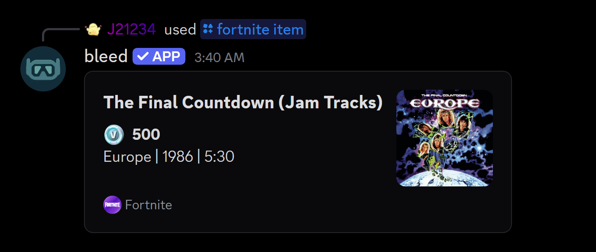
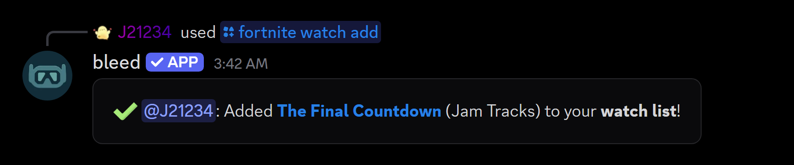
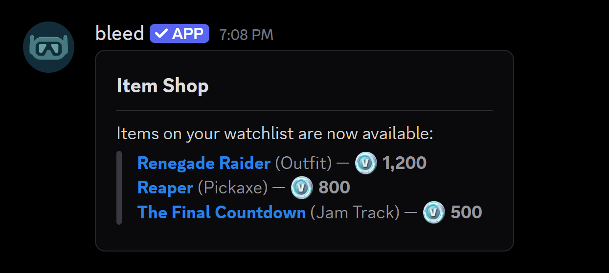
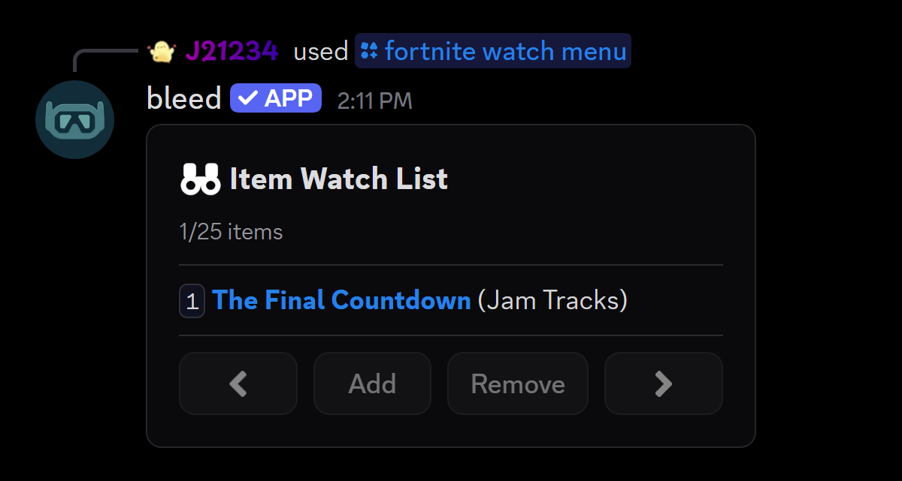
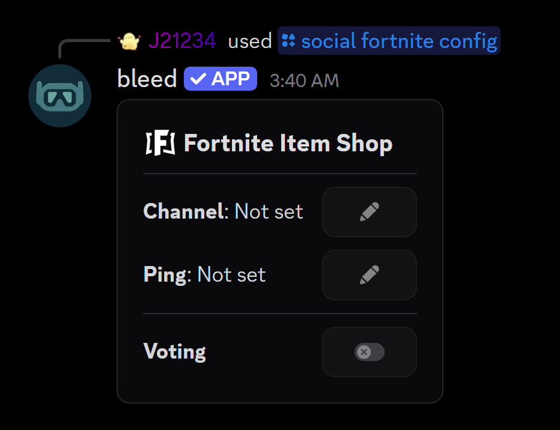

## Viewing information about a cosmetic

You can use the `/fortnite item` command to view information about a cosmetic in Fortnite.

<CodeGroup>
    
    ```javascript Syntax
    /fortnite item name:<cosmetic>
    ```
    
    ```javascript Example
    /fortnite item name:The Final Countdown
    ```

</CodeGroup>
<br />
<Frame>
    
</Frame>

## Receiving reminders for cosmetics

You can use the `/fortnite watch add` command to be notified when a cosmetic is in the shop.

<Info>If you no longer want to receive reminders for a cosmetic, you can use the `/fortnite watch remove` command.</Info>
<CodeGroup>
    
    ```javascript Syntax
    /fortnite watch add item:<cosmetic>
    /fortnite watch remove item:<cosmetic>
    ```
    
    ```javascript Example
    /fortnite watch add item:The Final Countdown
    /fortnite watch remove item:The Final Countdown
    ```

</CodeGroup>
<br />
<Frame>
    
</Frame>
When the cosmetic is available in the shop, you will receive a message in your DMs.
<Frame>
    
</Frame>

### Managing watched cosmetics

You can use `/fortnite watch menu` to view, add, or remove up to **25** watched cosmetics.

<CodeGroup>

```javascript Syntax
/fortnite watch menu
```

</CodeGroup>
<br />
<Frame>
    
</Frame>

## Receiving shop rotation updates

You can view the daily shop rotation anytime with `/fortnite shop`, or use `/social fortnite config` (requires `Manage Server`) to configure daily Fortnite Item Shop updates for your server. From **Fortnite Item Shop**, you can edit **Channel**, edit **Ping** (the role pinged when the shop updates), and toggle **Voting** reactions on the shop message.

<CodeGroup>

```javascript Syntax
/social fortnite config
```

</CodeGroup>
<br />
<Frame>
    
</Frame>
