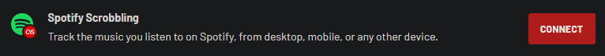
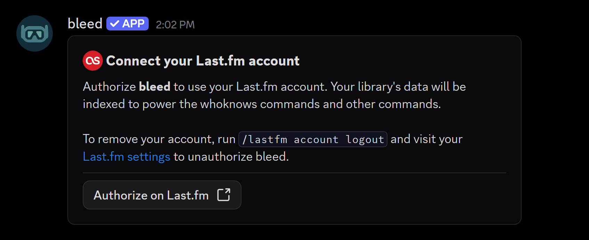

## What is Last.fm?

Last.fm is a website which tracks the music you listen to and provides statistics based on your listening history. You can register for a Last.fm account by clicking [here](https://www.last.fm/join).

## Creating a Last.fm account

<Steps>
  <Step title="Registration">
    Visit the [Last.fm registration page](https://www.last.fm/join) and fill in
    the required information.
  </Step>
  <Step title="Verification">
    Verify your email address by clicking the link sent to your
    [inbox](https://gmail.com/).
  </Step>
</Steps>

After creating your account, you'll likely want to connect your **Spotify account**
to automatically scrobble your listening activity. You can do this by visiting the
[Last.fm connections](https://www.last.fm/settings/applications) page and clicking
the **Connect** button next to **Spotify Scrobbling**.

<Frame>
  
</Frame>

## Connecting your Last.fm account

Use the `/lastfm account login` command, and follow the instructions sent in your direct messages.

<Frame>
  
</Frame>
<Warning>
  bleed will automatically cache your library, please be patient before using
  any commands that rely on your library, as it may take a few seconds to fully
  index your library.
</Warning>
<Info>
  Your library will be automatically refreshed every **24 hours**. You can also
  manually refresh your library early with the `/lastfm account update` command.
</Info>

If you no longer wish to use the **Last.fm integration**, you can use the `/lastfm account logout` command to disconnect your account from bleed.

## Customizing your now playing

Use the `/fm` command to show what you're listening to. You can customize it with the following commands.

<AccordionGroup>
    <Accordion title="Changing the color">
        Use the `/lastfm config color` command to set the color of your now playing.
        <CodeGroup>
        ```javascript Syntax
        /lastfm config color value:<color>
        ```

        ```javascript Example
        /lastfm config color value:#658a95
        ```
        </CodeGroup>
    </Accordion>
    <Accordion title="Using your own album artwork">
        Use the `/lastfm config url` command to submit your own artwork for an album cover with either a `link` or an `attachment`, or set `remove:True` to remove your submitted artwork for that album.
        <CodeGroup>
        ```javascript Syntax
        /lastfm config url album:<album> link:<link> attachment:<file> remove:<True|False>
        ```
        </CodeGroup>
    </Accordion>
    <Accordion title="Setting the server's vote reactions">
        Members with the `Manage Server` permission can use the `/lastfm config react` command to set the reactions added to now playing messages in the server.
        <CodeGroup>
        ```javascript Syntax
        /lastfm config react upvote:<emoji> downvote:<emoji>
        ```

        ```javascript Example
        /lastfm config react upvote:🔥 downvote:🗑️
        ```
        </CodeGroup>
    </Accordion>
    <Accordion title="Custom layouts and personal reactions">
        Donators (Tier 1+) can write a custom now playing layout with `/lastfm mode set` (optionally setting `reply:True` to send your track as a reply), view or reset it with `/lastfm mode view` and `/lastfm mode clear`, and set their own reactions with
        `/lastfm config customreactions`. See [donator perks](/overview/donator-perks) for more information.
    </Accordion>
</AccordionGroup>

## Server management

<AccordionGroup>
    <Accordion title="Custom Now Playing commands">
        Members can set a personal custom Now Playing command with `/lastfm custom set` (set `public:True` to allow all members to use it) and view it with `/lastfm custom view`. Members with the `Manage Server` permission can remove a custom command with `/lastfm custom remove`, or view, blacklist, and clean up custom commands in `/lastfm custom menu`.
        <CodeGroup>
        ```javascript Syntax
        /lastfm custom menu
        /lastfm custom set name:<name> public:<True|False>
        /lastfm custom view
        /lastfm custom remove member:<member>
        ```
        </CodeGroup>
    </Accordion>
    <Accordion title="Hiding members from whoknows">
        Members with the `Manage Server` permission can hide or unhide a member from appearing on `whoknows` commands with `/lastfm hide add` and `/lastfm hide remove`. You can also use `/lastfm hide menu` to view and manage hidden members.
        <CodeGroup>
        ```javascript Syntax
        /lastfm hide menu
        /lastfm hide add member:<member>
        /lastfm hide remove member:<member>
        ```
        </CodeGroup>
    </Accordion>
</AccordionGroup>

## Known Issues

### Out of Sync

**Last.fm** and **Spotify** struggle to stay in sync, causing outdated information to be displayed.

- Restart your **Spotify application** to force a refresh.
- Disconnect and reconnect your **Spotify account** in the [Last.fm connections](https://www.last.fm/settings/applications).

### Last.fm Failure

If you see an unexpected error message, it's possible that **Last.fm** is currently down.

- Check the [Last.fm status page](https://status.last.fm/) for more information.
- If the issue persists, please join our [support server](/discord) for further assistance.
