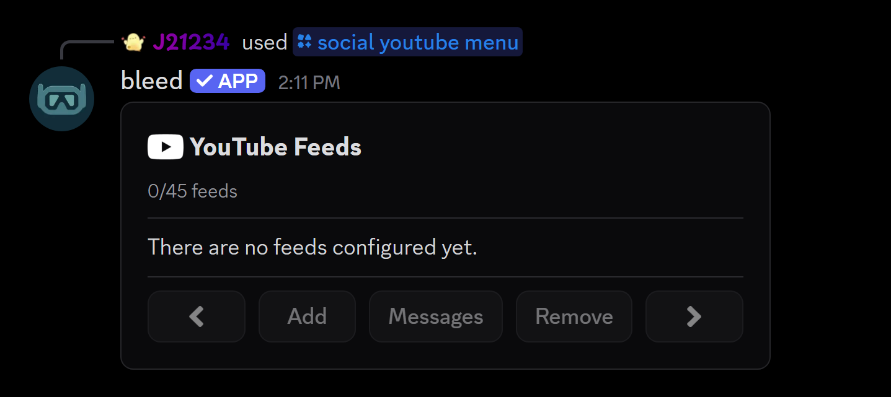

## Supported Platforms

There are nine social notification commands, each with the same subcommands.

- **TikTok** - Dispatched whenever a new video is uploaded.
- **Instagram** <Badge stroke color="yellow" icon="medal">Tier 3</Badge> - Dispatched whenever a new post or story is uploaded.
- **YouTube** - Dispatched whenever a new video or short is uploaded.
- **Twitter / X** (`/social x`) - Dispatched whenever a new tweet is posted by a user.
- **Subreddit** - Dispatched whenever a new post is made in a subreddit.
- **SoundCloud** - Dispatched whenever an artist releases a song or album.
- **Pinterest** - Dispatched whenever a new pin is saved to a board.
- **Twitch** & **Kick** - Dispatched whenever a streamer goes live.

## Commands

The following examples use YouTube, but the same `add`, `remove`, and `menu` subcommands apply to the other social notification platforms (with platform-specific option names such as `handle` for X, `streamer` for Twitch/Kick, `username` for Instagram/TikTok/SoundCloud, `name` for Subreddit, and `user` plus an optional `board` for Pinterest—leave `board` empty to follow all pins).

<AccordionGroup>
    <Accordion title="Creating a new feed">
        Use the `/social youtube add` subcommand to receive notifications for a specific user.
        <Tip>
        For **YouTube**, you can use a **channel URL** or a **username**.
        </Tip>
        <CodeGroup>
        ```javascript Syntax
        /social youtube add creator:<url or username> channel:<channel>
        ```

        ```javascript Example
        /social youtube add creator:NileRed channel:#notifs
        ```
        </CodeGroup>
    </Accordion>
    <Accordion title="Removing a social feed">
        Use the `/social youtube remove` subcommand to no longer receive notifications for a specific user.
        <Tip>For **YouTube**, the `creator` parameter will suggest the creators you have added as you type.</Tip>
        <CodeGroup>

        ```javascript Syntax
        /social youtube remove creator:<creator> channel:<channel>
        ```

        ```javascript Example
        /social youtube remove creator:NileRed channel:#notifs
        ```
        </CodeGroup>
    </Accordion>
    <Accordion title="Managing feeds">
        Use `/social youtube menu` (or the matching `menu` command for another platform, such as `/social tiktok menu` or `/social instagram menu`) to view, add, or remove monitored feeds, customize notification messages and pingable mentions via **Messages** (or **Options** on Pinterest and Subreddit), change platform options, and clear feed settings.
        <Info>
          Feed limits per server vary by platform: **YouTube**, **Twitch**, **Kick**, and **Pinterest** support up to **45** feeds; **SoundCloud** up to **35**; **X** up to **8**; **Instagram** and **Subreddit** up to **5**; and **TikTok** up to **2**. Adding an Instagram feed (including via `/social instagram menu`) requires a [Tier 3 subscription](/overview/donator-perks), and customizing or clearing **TikTok** notification messages requires a [Tier 2 subscription](/overview/donator-perks).
        </Info>
        <Tip>
        When customizing notification messages, enable the **pingable** option if you want a role or user mention in the message to notify them.
        </Tip>
        <CodeGroup>
        ```javascript Syntax
        /social youtube menu
        ```
        </CodeGroup>
        <Frame>
            
        </Frame>
    </Accordion>

</AccordionGroup>

## Message Variables

The **SoundCloud** and **YouTube** variables that can be used in custom notification messages can be found on the [variables](/resources/scripting/variables) page.

## Platform Options

Platform-specific feed options are managed inside each platform's `menu` command:

<AccordionGroup>
    <Accordion title="Twitter/X Retweets">
        Toggle notifications for retweets in `/social x menu`.
        <CodeGroup>
        ```javascript Syntax
        /social x menu
        ```
        </CodeGroup>
    </Accordion>
    <Accordion title="Pinterest Embeds">
        Toggle embeds for Pinterest notifications in `/social pinterest menu`.
        <CodeGroup>
        ```javascript Syntax
        /social pinterest menu
        ```
        </CodeGroup>
    </Accordion>
    <Accordion title="TikTok Live">
        Toggle notifications for when a TikTok user goes live in `/social tiktok menu`.
        <CodeGroup>
        ```javascript Syntax
        /social tiktok menu
        ```
        </CodeGroup>
    </Accordion>
    <Accordion title="Instagram Stories">
        Toggle notifications for a user's Instagram stories in `/social instagram menu`.
        <CodeGroup>
        ```javascript Syntax
        /social instagram menu
        ```
        </CodeGroup>
    </Accordion>
    <Accordion title="Subreddit Embed Color">
        Set or clear the embed color for subreddit posts in `/social subreddit menu`.
        <CodeGroup>
        ```javascript Syntax
        /social subreddit menu
        ```
        </CodeGroup>
    </Accordion>

</AccordionGroup>

## Important Notes

<Card title="YouTube Channel Incorrect" icon="youtube">
Sometimes **YouTube** provides the incorrect channel from the username.
This is because the channel isn't a known result on YouTube. If this happens, you can use the **channel URL** instead of the **username** to fix this issue.

</Card>

<Card title="Slight Delay in Notifications" icon="clock">
Most social notifications are monitored at an interval.
This can cause a slight delay in the notification being dispatched, however **YouTube** and **Twitch**
notifications should be dispatched instantly whenever a new video or stream goes live.

</Card>

<Card title="Customizing the Message" icon="message">
You can't customize the full embed layout for social notifications.
However, you can customize the **message content** that is dispatched from each platform's `menu` command (such as `/social youtube menu`), toggle embeds for Pinterest in `/social pinterest menu`, and set or clear the embed color for subreddits in `/social subreddit menu`.

</Card>