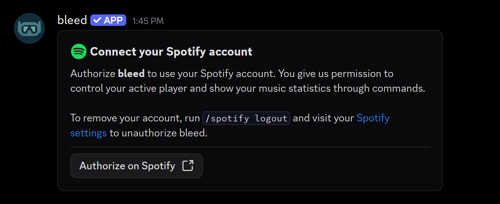
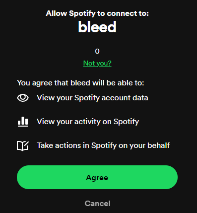
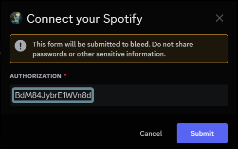
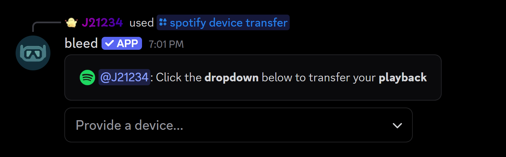

## Connecting your Spotify account

<Steps>
  <Step title="Start the Process">
    Use the `/spotify login` command, and follow the link provided in the
    response.
    <Frame>
      
    </Frame>
  </Step>
  <Step title="Grant Access">
    After following the link, you will be asked to grant access to your
    **Spotify** account.
    <Frame>
      
    </Frame>
  </Step>
  <Step title="Submit Code">
    Once you've granted access, you will be given a code to submit in Discord.
    <Frame>
      
    </Frame>
  </Step>
</Steps>

If you no longer wish to use the **Spotify integration**, you can use the `/spotify logout` command to disconnect your account from bleed.

## Controlling your Spotify Playback

<Warning>
  You must be a **Spotify Premium** subscriber to control your playback with
  bleed.
</Warning>

### Playing a track

You can use the `/spotify play` command to immediately start playing a track, or
if you'd like to queue a track for later, use the `/spotify queue` command.

<Info>
  You can also use the member option to play the track they're currently listening
  to.
</Info>

<CodeGroup>

```javascript Syntax
/spotify play query:<track> or member:<user>
```

```javascript Example
/spotify play query:Steve Lacy is it cool? (feat. SZA)
/spotify play member:@jonathan
```

</CodeGroup>

### Adjusting the volume

You can use the `/spotify volume` command to adjust the volume of the active
device.

<CodeGroup>
    
    ```javascript Syntax
    /spotify volume percent:<percentage>
    ```
    
    ```javascript Example
    /spotify volume percent:50
    ```

</CodeGroup>

### Seeking to a specific position

You can use the `/spotify seek` command to seek to a specific position in the
current track.

<CodeGroup>
    
    ```javascript Syntax
    /spotify seek position:<minutes:seconds or seconds>
    ```
    
    ```javascript Example
    /spotify seek position:1:30
    ```

</CodeGroup>

### Changing the playback device

You can use the `/spotify device transfer` command to change the device that **Spotify** is
playing on. Use `/spotify device list` to see your available devices.

<Frame>
  
</Frame>

### Interacting with the queue

The following commands can be used to interact with the queue

| Command            | Description                         |
| ------------------ | ----------------------------------- |
| `/spotify next`     | Skip to the next track in the queue |
| `/spotify previous` | Play the previous track             |
| `/spotify pause`    | Pause the current track             |
| `/spotify resume`   | Resume the current track            |
| `/spotify shuffle`                                     | Set queue shuffling (`On` or `Off`; defaults to `On` if `state` is empty) |
| `/spotify repeat mode:<Playlist or Album\|Track\|Off>` | Repeat the playlist/album, current track, or turn repeat off              |

## Non-Premium Commands

The following commands can be used without a **Spotify Premium** subscription

<AccordionGroup>
    <Accordion title="Liking the current track">
        You can use the `/spotify like` command to like the current track.
        <Tip>
            You can also use the `/spotify unlike` command to remove the like.
        </Tip>

    </Accordion>
    <Accordion title="Viewing your top artists and tracks">
        You can use the `/spotify topartists` and `/spotify toptracks` commands to
        view your top artists and tracks for a specified time frame.
        <Info>
        The optional `duration` timeframe accepts `Overall (1 Year)`, `Semi-Annually (6 Months)`, or `Monthly (1 Month)` (defaults to overall if left empty).
        </Info>
        <CodeGroup>
            ```javascript Syntax
            /spotify topartists duration:<timeframe>
            /spotify toptracks duration:<timeframe>
            ```

            ```javascript Example
            /spotify topartists duration:Monthly (1 Month)
            /spotify toptracks duration:Semi-Annually (6 Months)
            ```
        </CodeGroup>
    </Accordion>
    <Accordion title="Searching for a track">
        You can use the `/spotify search` command to find a track on Spotify (no Spotify login or Premium required).
        <CodeGroup>
            ```javascript Syntax
            /spotify search track:<track>
            ```

            ```javascript Example
            /spotify search track:Blinding Lights
            ```
        </CodeGroup>
    </Accordion>
    <Accordion title="Playing your current track in a voice channel">
        You can use the `/spotify vc` command to play your current track in a
        voice channel.
    </Accordion>

</AccordionGroup>
