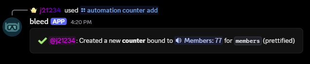
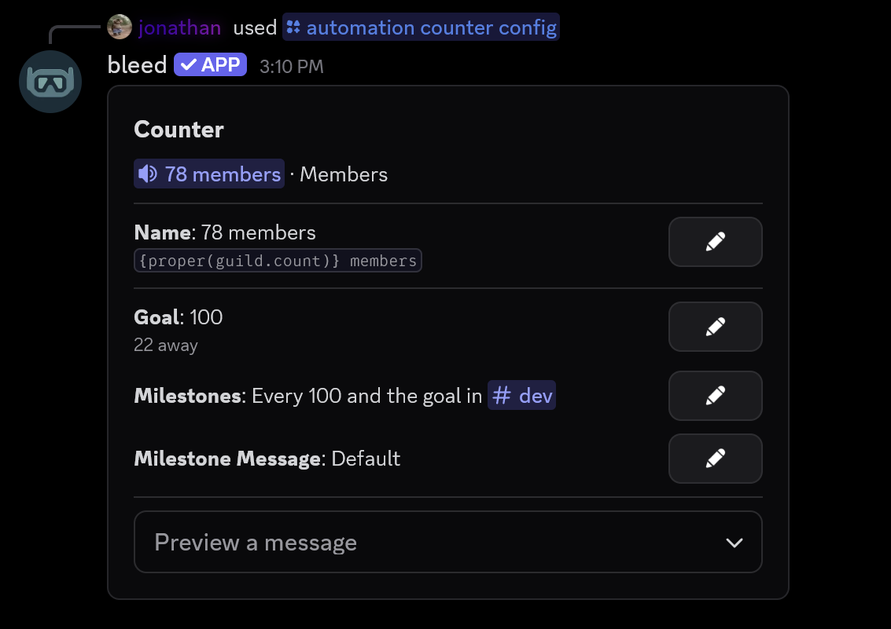
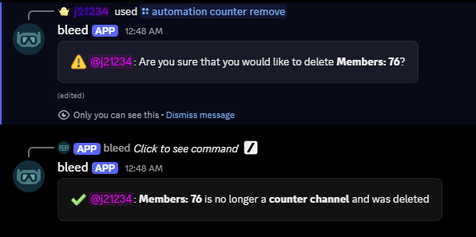

## Overview

Counters allow you to show important info in your server. This can be useful for showing your members significant milestones.

## Adding a counter

You can add a counter using the `/automation counter add` command.

<Info>
  Available counter options are `members`, `users_only`, `bots_only`, `pending_members`, `voice_members`,
  `all_channels`, `text_channels`, `voice_channels`, `categories`, `announcement_channels`,
  `staging_channels`, `boosts`, `booster_count`, crypto coins and unix timestamps.
</Info>

<Info>
  Available crypto coins are `bitcoin`, `litecoin`, `ethereum`, `dogecoin`, `monero`, `zcash`, `polkadot`,
  `solana`, `xrp` and `tron`. You can also use a ticker such as `btc`, or add a currency such as `btc-eur`.
</Info>

<Info>
  Available counter types are `voice` (suggested), `text`, `category`, `announce`,
  and `stage`.
</Info>

<Tip>
  You can create a fun and visible countdown using a UNIX timestamp.
</Tip>

<CodeGroup>

```javascript Syntax
/automation counter add option:<option> channel_type:<type> prettify:<True|False> currency:<currency> name:<name>
```

```javascript Examples
/automation counter add option:members channel_type:voice prettify:True
/automation counter add option:members channel_type:voice name:{proper(guild.count)} members
/automation counter add option:btc channel_type:voice currency:eur
```

</CodeGroup>
<br />
<Frame>
    
</Frame>
<br />

## Naming a counter

You can choose what a counter's channel is called with the `name` parameter of the `/automation counter add` command. The name must contain at least one of the variables below, such as `{proper(guild.count)} members`. You can also change the name later from the `/automation counter config` command.

<Frame>
    
</Frame>

<Info>
  If you do not set a name, bleed will replace the number in the channel's current name. Crypto counters
  without a name will use `{bitcoin.ticker}: {bitcoin.price}` with their own coin.
</Info>

<Warning>
  Variables must be written exactly as shown. If a variable is misspelled, the name will not be saved and bleed will suggest the correct variable.
  Channel names can be up to **100** characters long once the variables are filled in.
</Warning>

<AccordionGroup>
  <Accordion title="Server">
    | Variable                              | Output                                   |
    | ------------------------------------- | ---------------------------------------- |
    | `{guild.name}`                        | The guild's name                         |
    | `{guild.count}`                       | The guild's member count                 |
    | `{guild.human_count}`                 | The guild's human count                  |
    | `{guild.bot_count}`                   | The guild's bot count                    |
    | `{guild.pending_count}`               | The guild's pending member count         |
    | `{guild.voice_member_count}`          | The guild's voice member count           |
    | `{guild.boost_count}`                 | The guild's boost count                  |
    | `{guild.booster_count}`               | The guild's booster count                |
    | `{guild.boost_tier}`                  | The guild's boost tier (e.g. `Level 2`)  |
    | `{guild.channels_count}`              | The guild's channel count                |
    | `{guild.text_channels_count}`         | The guild's text channel count           |
    | `{guild.voice_channels_count}`        | The guild's voice channel count          |
    | `{guild.category_channels_count}`     | The guild's category count               |
    | `{guild.announcement_channels_count}` | The guild's announcement channel count   |
    | `{guild.stage_channels_count}`        | The guild's stage channel count          |
    | `{guild.role_count}`                  | The guild's role count                   |
    | `{guild.emoji_count}`                 | The guild's emoji count                  |
  </Accordion>
  <Accordion title="Crypto">
    <Info>
    Replace `bitcoin` with `litecoin`, `ethereum`, `dogecoin`, `monero`, `zcash`, `polkadot`, `solana`, `xrp` or `tron`. Prices use the counter's `currency` and are updated every **5 minutes**.
    </Info>

    | Variable           | Output                                                     |
    | ------------------ | ---------------------------------------------------------- |
    | `{bitcoin.price}`  | The coin's price in the counter's currency                 |
    | `{bitcoin.change}` | The coin's 24 hour change (e.g. `▲2.1%`)                   |
    | `{bitcoin.ticker}` | The coin's ticker (e.g. `BTC`)                             |
    | `{bitcoin.symbol}` | The coin's symbol (e.g. `₿`), or its ticker if it has none |
    | `{bitcoin.name}`   | The coin's name (e.g. `Bitcoin`)                           |
  </Accordion>
  <Accordion title="Goal and countdown">
    <Info>
    The goal variables require a [goal](#setting-a-goal). `{countdown}` can only be used on a countdown counter.
    </Info>

    | Variable         | Output                                            |
    | ---------------- | ------------------------------------------------- |
    | `{goal}`         | The counter's goal                                |
    | `{goal.left}`    | The amount left until the goal (`0` once reached) |
    | `{goal.percent}` | The counter's progress (e.g. `84%`)               |
    | `{countdown}`    | The counter's countdown                           |
  </Accordion>
</AccordionGroup>

<Tip>
  `{proper(...)}` adds commas to number variables, for example `{proper(guild.count)}` will display as `1,234`.
  It cannot be used on `{guild.name}`, `{guild.boost_tier}`, `{goal.percent}`, `{countdown}` or the crypto
  `change`, `ticker`, `symbol` and `name` variables.
</Tip>

## Setting a goal

You can set a goal for a counter, such as `5000` or `1.5k`, from the `/automation counter config` command.

<CodeGroup>

```javascript Syntax
/automation counter config channel:<channel>
```

```javascript Example
/automation counter config channel:#members
```

</CodeGroup>
<br />
<Frame>
    
</Frame>

## Setting up milestones

You can have bleed send a message when a counter reaches its goal, or every time it passes a certain amount, such as every `100` members. Milestones can be set up from the `/automation counter config` command.

<Info>
  Milestones are only sent for new highs, so a count that drops and comes back will not be announced twice.
  Crypto counters can also send milestones when the price goes down.
</Info>

<Frame>
    
</Frame>

### Customizing the milestone message

You can customize the milestone message from the `/automation counter config` command.

<Tip>
The `message` can be raw text, [components](/resources/scripting/components) or [embeds](/resources/scripting/embeds) with the variables below. Leave it empty to use the default message, such as **Members** reached **1,000**.
</Tip>

| Variable              | Output                            |
| --------------------- | --------------------------------- |
| `{counter.name}`      | The counter channel's name        |
| `{counter.channel}`   | The counter channel's mention     |
| `{counter.direction}` | `up` or `down`                    |
| `{counter.value}`     | The counter's value               |
| `{counter.milestone}` | The milestone it crossed          |
| `{counter.goal}`      | The counter's goal, if it has one |

<Info>
  Every number can also be used with `proper()`, such as `{proper(counter.value)}`. The [server variables](#naming-a-counter)
  can be used as well, and crypto counters can use their own coin's variables, such as `{bitcoin.change}`.
</Info>

<Warning>
  The goal variables, `{countdown}` and other coins' variables cannot be used in milestone messages. Use `{counter.goal}` instead.
</Warning>

## Removing a counter

You can remove a counter using the `/automation counter remove` command.

<Info>
  You can remove a counter and choose to either keep the channel or delete it. If you choose to keep the channel, the channel will remain but the counter will no longer update.
</Info>

<CodeGroup>

```javascript Syntax
/automation counter remove channel:<channel> action:<keep|delete>
```

```javascript Example
/automation counter remove channel:#members action:delete
```

</CodeGroup>
<br />
<Frame>
    
</Frame>
