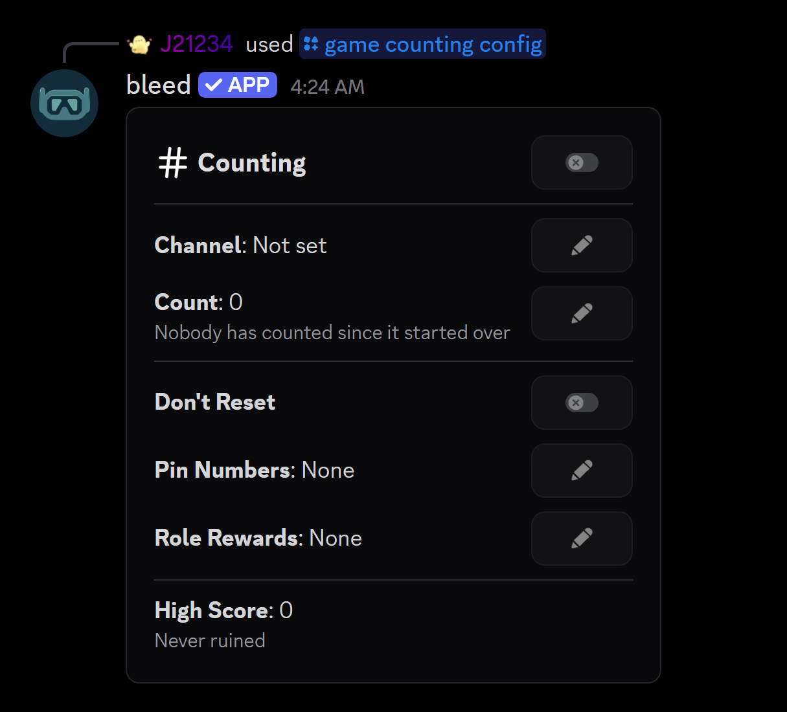

## What is counting?

Counting is a game where members count up one number at a time in a counting channel. Sending the wrong number ruins the count and starts it over, so your server has to work together to set a new high score.

## Setting up counting

Use the `/game counting config` command to set up counting. Use the **Channel** button to choose the counting channel, then turn counting on with the toggle at the top of the message.

<Info>
  You must have the `Manage Server` permission to use this command.
</Info>

<CodeGroup>
```javascript Syntax
/game counting config
```
</CodeGroup>
<br />
<Frame>
  
</Frame>

| Setting | Description |
| --- | --- |
| **Channel** | The channel members count in. |
| **Count** | The current number. You can change it with the pencil button. |
| **Don't Reset** | When on, a wrong number doesn't start the count over. |
| **Pin Numbers** | Numbers that are pinned when the count reaches them. |
| **Role Rewards** | Roles that are given out when the count reaches a number. |
| **High Score** | The highest number your server has reached, and when the count was last ruined. |
