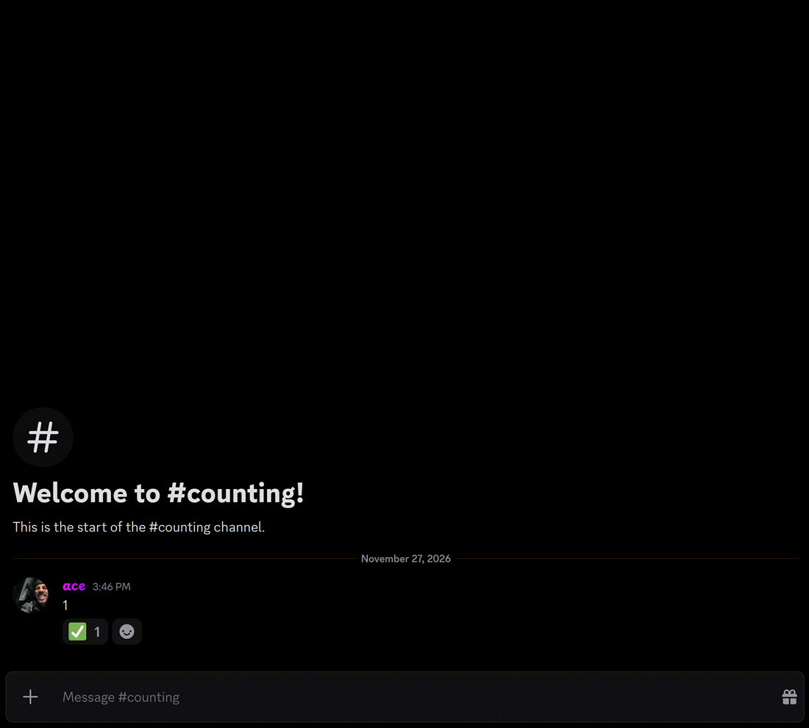
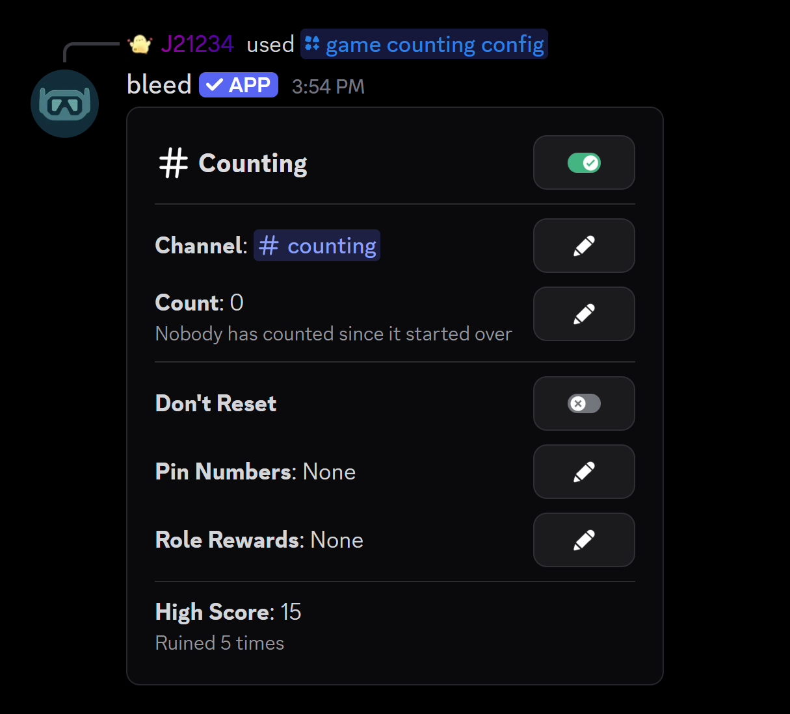
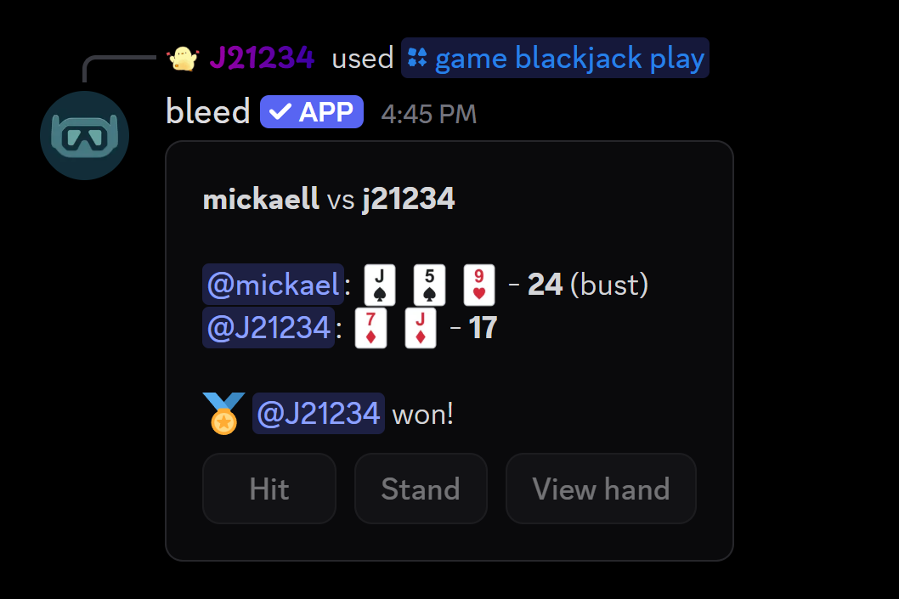
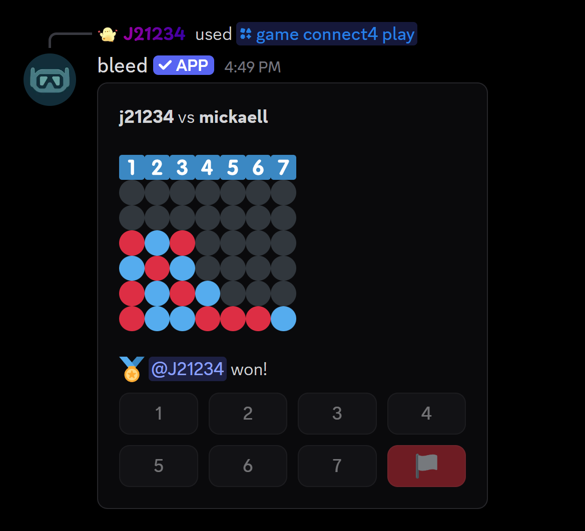
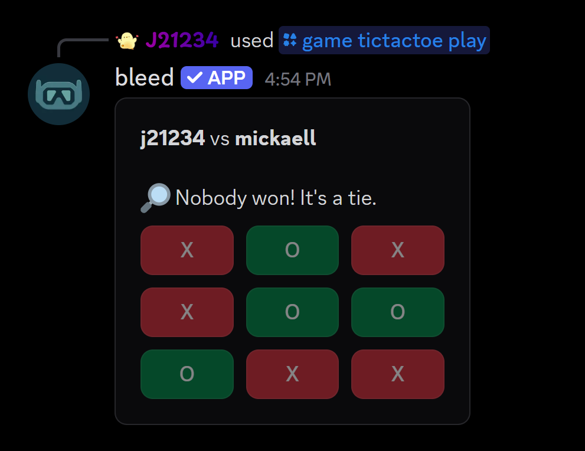
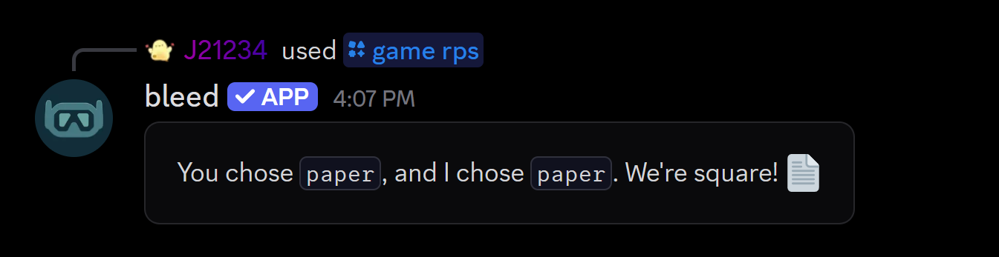
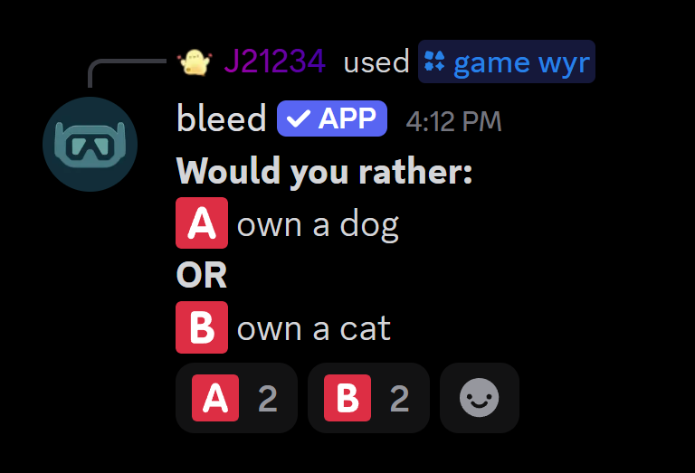
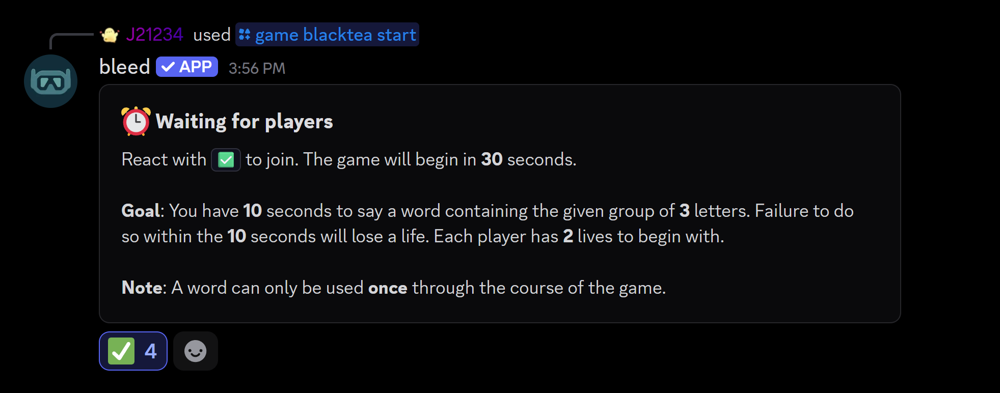
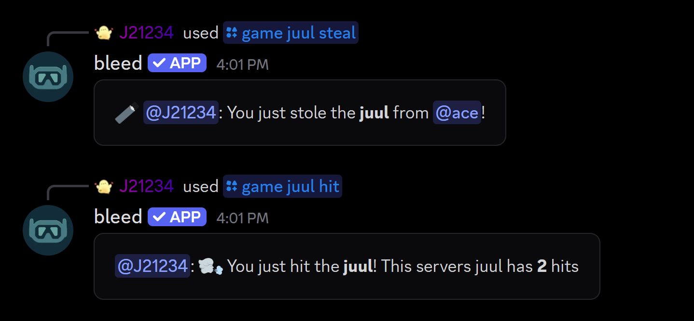
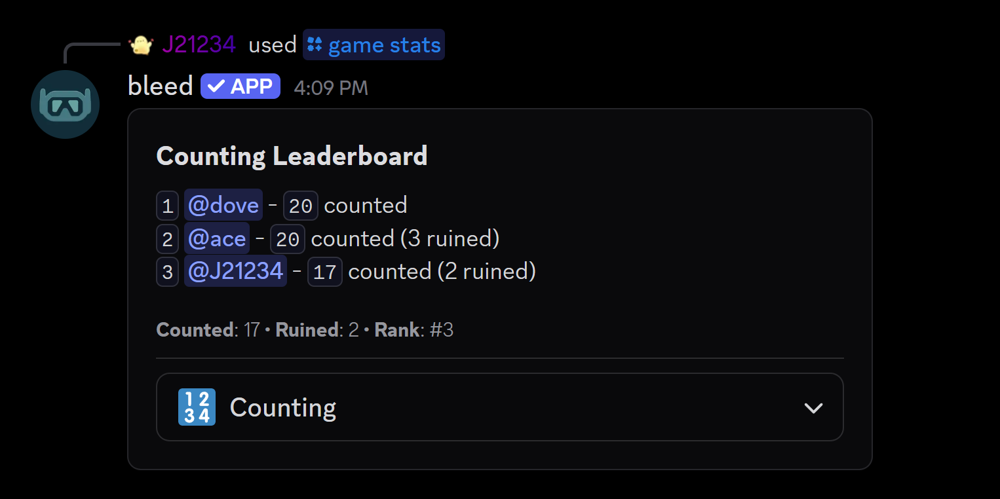

## Overview

bleed has games you can play with bleed itself or with other members. Every game command starts with `/game`.

## Counting

Counting is a game where members count up one number at a time in a counting channel. Members can also send math that equals the next number, such as `2+2` for **4** or `sqrt(169)` for **13**. bleed reacts to every correct number. Sending the wrong number ruins the count and starts it over, so your server has to work together to set a new high score.

<Tip>
  Counting understands `+`, `-`, `*`, `/`, `^` (powers), `%` (remainder), `!` (factorial), `sqrt()` and parentheses, so `(3!+4)*3/2` counts as **15**.
</Tip>

<Frame>
  
</Frame>

### Setting up counting

Use the `/game counting config` command to set up counting. Use the **Channel** button to choose the counting channel, then turn counting on with the toggle at the top of the message.

<Info>
  You must have the `Manage Server` permission to use this command.
</Info>

<CodeGroup>
```javascript Syntax
/game counting config
```
</CodeGroup>
<br />
<Frame>
  
</Frame>

| Setting | Description |
| --- | --- |
| **Channel** | The channel members count in. |
| **Count** | The current number. You can change it with the pencil button. |
| **Don't Reset** | When on, a wrong number doesn't start the count over. |
| **Pin Numbers** | Numbers that are pinned when the count reaches them. |
| **Role Rewards** | Roles that are given out when the count reaches a number. |
| **High Score** | The highest number your server has reached, and when the count was last ruined. |

## Playing against a member

Challenge another member to **Blackjack**, **Connect 4** or **Tic-tac-toe**. Every match counts toward that game's [leaderboard](#viewing-stats-and-leaderboards).

<CodeGroup>
```javascript Syntax
/game blackjack play member:<member>
/game connect4 play member:<member>
/game tictactoe play member:<member>
```

```javascript Example
/game connect4 play member:@jonathan
```
</CodeGroup>

### Blackjack

Both players are dealt two cards that only they can see. On your turn, press **View hand** to see your cards, **Hit** to draw another card, or **Stand** to end your turn. Going over **21** is a bust, and running out of time loses the game. Once both players are done, bleed shows both hands and the higher total wins.

<Frame>
  
</Frame>

### Connect 4

Take turns pressing a column button from **1** to **7** to drop a piece into the board. The first player to line up four pieces in a row, column or diagonal wins. Either player can press 🏳️ to forfeit.

<Frame>
  
</Frame>

### Tic-tac-toe

Take turns pressing a square on the 3×3 board. The first player has **30** seconds to make the first move. Three in a row wins, and a full board with no winner is a tie.

<Frame>
  
</Frame>

## Rock paper scissors

Play rock paper scissors against bleed. Pick **Rock**, **Paper** or **Scissors** with `choice`, or leave it empty and bleed picks for you.

<CodeGroup>
```javascript Syntax
/game rps choice:<Rock|Paper|Scissors>
```

```javascript Example
/game rps choice:Paper
```
</CodeGroup>
<br />
<Frame>
  
</Frame>

## Would you rather

Ask the server a would you rather question. Write your own two options separated by a comma, or leave `choices` empty for a random question. Members vote by reacting with 🅰️ or 🅱️.

<CodeGroup>
```javascript Syntax
/game wyr choices:<option 1, option 2>
```

```javascript Example
/game wyr choices:own a dog, own a cat
```
</CodeGroup>
<br />
<Frame>
  
</Frame>

## Blacktea

Blacktea is a word game for everyone in the channel. After the game starts, members have **30** seconds to react with ✅ to join. Each turn, bleed gives a player three letters, and they have **10** seconds to send a word that contains them. Taking too long costs a life, and every player starts with **2** lives. A word can only be used once per game, and the last player left wins.

<CodeGroup>
```javascript Syntax
/game blacktea start
/game blacktea end
```
</CodeGroup>
<br />
<Frame>
  
</Frame>

<Tip>
  Use `/game blacktea end` to stop a game early.
</Tip>

## Juul

Your server shares one juul, and only the member holding it can take a hit or change its flavor. Anyone else can steal it, and whoever has it can pass it on. bleed keeps count of the server's total hits.

| Command | What it does |
| --- | --- |
| `/game juul hit` | Take a hit. You need to be holding the juul. |
| `/game juul steal` | Take the juul from whoever has it. |
| `/game juul pass` | Give the juul to another member. |
| `/game juul flavor` | Insert a new pod. You need to be holding the juul. |
| `/game juul toggle` | Lock or unlock the server's juul. |

<CodeGroup>
```javascript Syntax
/game juul hit
/game juul steal
/game juul pass member:<member>
/game juul flavor flavor:<flavor>
/game juul toggle
```

```javascript Example
/game juul pass member:@jonathan
/game juul flavor flavor:Mango
```
</CodeGroup>
<br />
<Frame>
  
</Frame>

<Info>
  The flavors are **Classic Menthol**, **Cool Cucumber**, **Classic Tobacco**, **Mango**, **Virginia Tobacco**, **Cool Mint**, **Fruit Melody**, **Creme Brulee** and **THC**.
</Info>

## Viewing stats and leaderboards

Use `/game stats` to see the server's leaderboards along with your own stats. Pick a game from the menu to switch between **Tic-Tac-Toe**, **Connect 4** and **Blackjack** (wins, losses and matches), **Counting** (numbers counted and ruined) and **Juul** (hits and who holds it). Add `member` to see someone else's stats.

<CodeGroup>
```javascript Syntax
/game stats member:<member>
```

```javascript Example
/game stats member:@jonathan
```
</CodeGroup>
<br />
<Frame>
  
</Frame>
