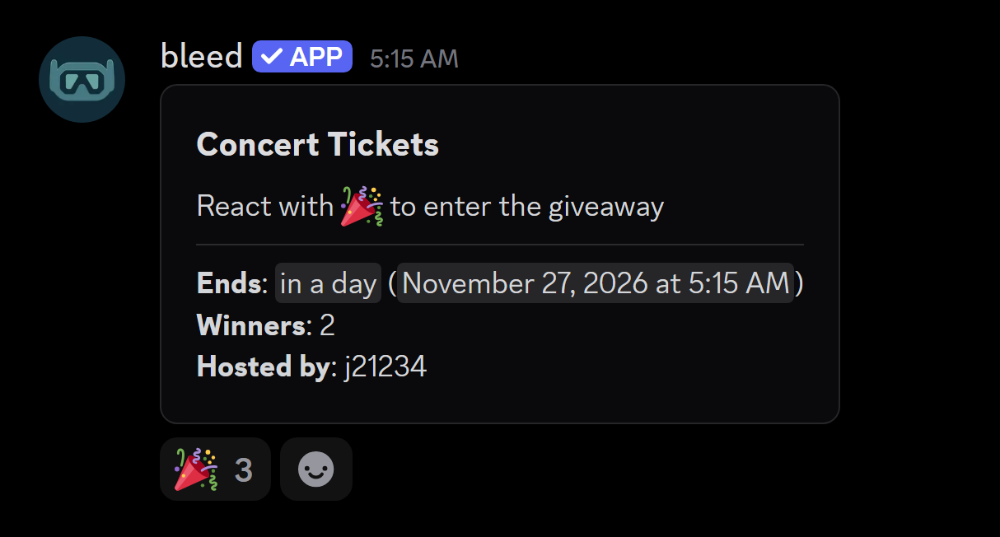
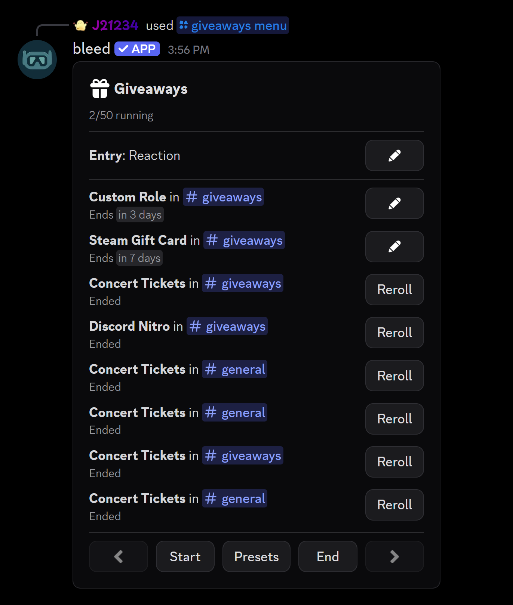
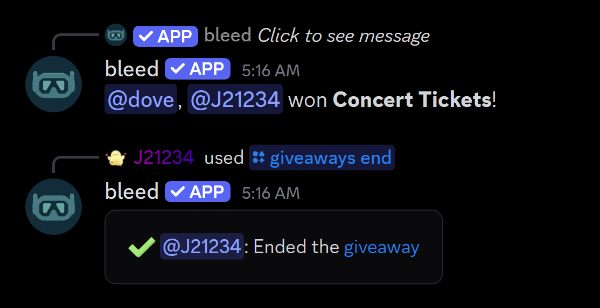
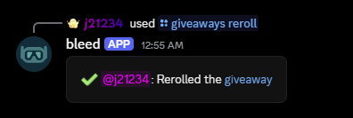
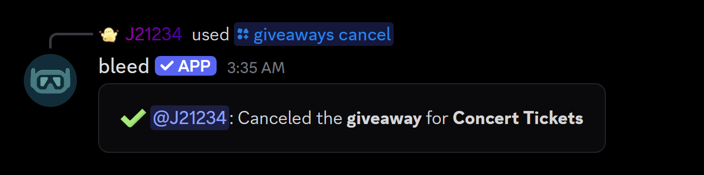

## Starting a Giveaway

You can start a giveaway with the `/giveaways start` command.

<Info>
  All parameters are optional—defaults use `1` winner, the current channel, `🎉`, and the server's entry mode (`reaction` or `button`, defaulting to `reaction`). You can also pass a `preset` (other options override it) or custom embed/components scripts for `message`, `end_message`, and `win_message`, or customize giveaways afterward in `/giveaways menu`.
</Info>

<CodeGroup>
```javascript Syntax
/giveaways start duration:<duration> prize:<prize> winners:<winners> channel:<channel> preset:<preset> message:<message> end_message:<end_message> emoji:<emoji> entry:<reaction|button> win_message:<win_message>
```

```javascript Example
/giveaways start duration:24h prize:Concert Tickets channel:#giveaways winners:2
```

</CodeGroup>
<br />
<Frame>
    
</Frame>

## Managing and editing giveaways

You can manage up to **50** running giveaways from `/giveaways menu`—switch the **Entry** mode (defaults to **Reaction**), start a new giveaway (minimum **15 seconds** duration), manage **Presets**, end a giveaway early, or edit active giveaways.

<CodeGroup>
```javascript Syntax
/giveaways menu
```
</CodeGroup>
<br />
<Frame>
    
</Frame>

<AccordionGroup>
    <Accordion title="Changing the details">
        Edit the giveaway host, prize, duration, number of winners, whether winners are hidden when the giveaway ends, or roles awarded to the winners.
    </Accordion>
    <Accordion title="Customizing the embed">
        Customize the giveaway embed description, thumbnail, image, or color.
    </Accordion>
    <Accordion title="Setting requirements">
        Set required roles, minimum or maximum level requirements (using bleed's [leveling system](/configuration/level-rewards)), or a minimum account age and server stay in days.
    </Accordion>
</AccordionGroup>

## Ending a Giveaway

You can end a giveaway early with the `/giveaways end` command.

<CodeGroup>
```javascript Syntax
/giveaways end giveaway:<name>
```

```javascript Example
/giveaways end giveaway:Concert-Tickets
```

</CodeGroup>
<br />
<Frame>
    
</Frame>

## Rerolling a Giveaway

You can reroll the winners of a giveaway with the `/giveaways reroll` command. Leave `giveaway` empty to reroll the last ended giveaway in this channel, and leave `winners` empty to draw the giveaway's original winner count.

<CodeGroup>
```javascript Syntax
/giveaways reroll giveaway:<name> winners:<number_of_winners>
```

```javascript Example
/giveaways reroll giveaway:Concert-Tickets winners:3
```

</CodeGroup>
<br />
<Frame>
    
</Frame>

## Canceling a Giveaway

You can cancel a giveaway with the `/giveaways cancel` command.

<Warning>
  This will not draw any winners and will delete the giveaway message.
</Warning>

<CodeGroup>
```javascript Syntax
/giveaways cancel giveaway:<name>
```

```javascript Example
/giveaways cancel giveaway:Concert-Tickets
```

</CodeGroup>
<br />
<Frame>
    
</Frame>
