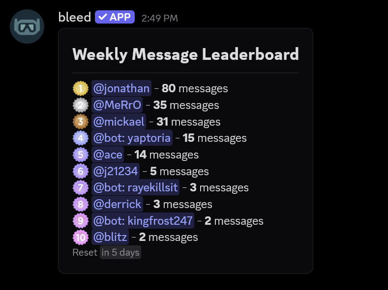
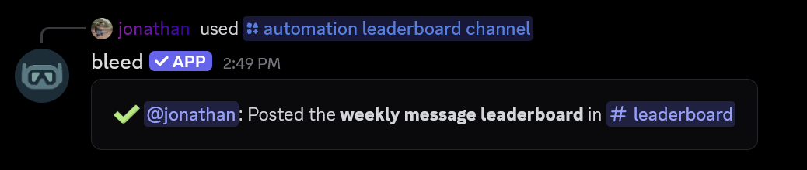
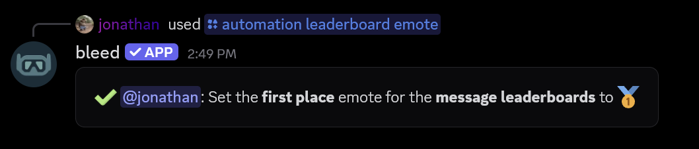
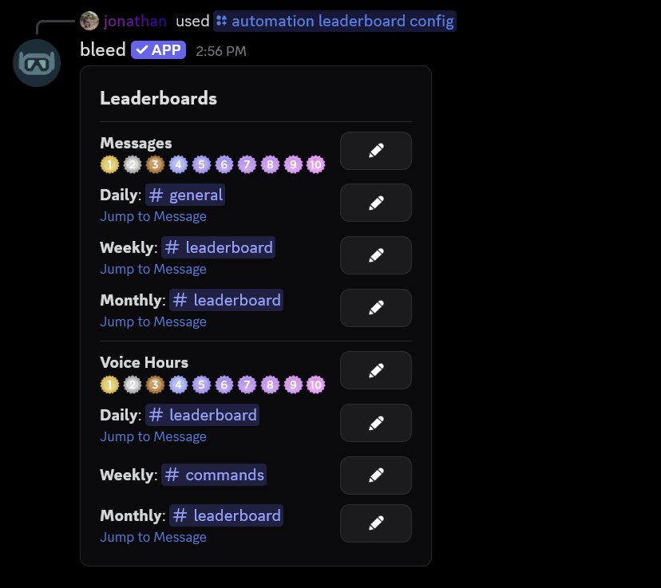

## Overview

Leaderboards show the **top 10** most active members in your server, either by messages sent or by time spent in voice channels. This can be useful for rewarding your most active members. The leaderboard will automatically update every **10 minutes**.

<Frame>
  
</Frame>

<Info>
  Leaderboards can be `daily`, `weekly` or `monthly`. Every leaderboard resets at **midnight UTC**,
  weekly leaderboards reset every **Friday** and monthly leaderboards reset on the **1st** of each month.
</Info>

## Setting up a leaderboard

You can set up a leaderboard using the `/automation leaderboard channel` command.

<Info>
  You must have the `Manage Server` permission to use this command. bleed needs the **View Channel**,
  **Send Messages** and **Embed Links** permissions in the channel.
</Info>

<CodeGroup>

```javascript Syntax
/automation leaderboard channel type:<message|voice> timeframe:<daily|weekly|monthly> channel:<channel>
```

```javascript Example
/automation leaderboard channel type:message timeframe:weekly channel:#leaderboard
```

</CodeGroup>
<br />
<Frame>
  
</Frame>

## Customizing the message

You can customize the leaderboard message using the `/automation leaderboard message` command.

<Tip>
This command will open a Discord modal where you can enter your message. The `message` can be raw text, [components](/resources/scripting/components) or [embeds](/resources/scripting/embeds) with dynamic [variables](#variables). If you no longer want a custom message, you can re-run the command and leave the modal empty.
</Tip>

<CodeGroup>

```javascript Syntax
/automation leaderboard message type:<message|voice> timeframe:<daily|weekly|monthly>
```

```javascript Example
/automation leaderboard message type:message timeframe:weekly
## {leaderboard.timeframe} {leaderboard.type} Leaderboard
{user.first.emote} {user.first.mention} - **{proper(user.first.message_count)}** messages
{user.second.emote} {user.second.mention} - **{proper(user.second.message_count)}** messages
{user.third.emote} {user.third.mention} - **{proper(user.third.message_count)}** messages
-# Reset <t:{next_reset}:R>
```

</CodeGroup>

### Variables

<Info>
  Replace `first` with any rank up to `tenth`, like `{user.third.mention}`. The ranks are `first`, `second`,
  `third`, `fourth`, `fifth`, `sixth`, `seventh`, `eighth`, `ninth` and `tenth`.
</Info>

<Warning>
  Variables must be written exactly as shown. `{user.three.name}` and `{user.first.messages_count}` are not
  variables and will appear as raw text in the message.
</Warning>

<AccordionGroup>
  <Accordion title="Every leaderboard">
    | Variable                    | Output                                                       |
    | --------------------------- | ------------------------------------------------------------ |
    | `{user.first.name}`         | The user's username                                          |
    | `{user.first.display_name}` | The user's display name                                      |
    | `{user.first.id}`           | The user's ID                                                |
    | `{user.first.mention}`      | The user's mention                                           |
    | `{user.first.avatar}`       | The user's avatar URL                                        |
    | `{user.first.emote}`        | The rank's emote                                             |
    | `{last_reset}`              | The last reset in UNIX                                       |
    | `{next_reset}`              | The next reset in UNIX                                       |
    | `{leaderboard.type}`        | The leaderboard's type (`Message` or `Voice`)                |
    | `{leaderboard.timeframe}`   | The leaderboard's timeframe (`Daily`, `Weekly` or `Monthly`) |
  </Accordion>
  <Accordion title="Message leaderboards">
    | Variable                             | Output                               |
    | ------------------------------------ | ------------------------------------ |
    | `{user.first.message_count}`         | The user's message count             |
    | `{proper(user.first.message_count)}` | The user's message count with commas |
  </Accordion>
  <Accordion title="Voice leaderboards">
    | Variable                          | Output                                  |
    | --------------------------------- | --------------------------------------- |
    | `{user.first.hour_count}`         | The user's hours in voice (e.g. `12.5`) |
    | `{proper(user.first.hour_count)}` | The user's hours in voice with commas   |
  </Accordion>
</AccordionGroup>

<Tip>
  If a rank has not been reached yet, its line will not be shown. For example, a leaderboard with **4** active members will only show **4** lines.
</Tip>

<Tip>
  `{last_reset}` and `{next_reset}` can be used with Discord timestamps. For example, `<t:{next_reset}:R>`
  will display as **in 3 days**.
</Tip>

Every `{guild.*}` [variable](/resources/scripting/variables) can be used as well, such as `{guild.name}`.

## Changing the rank emotes

You can change the emote displayed next to a rank using the `/automation leaderboard emote` command.

<Info>
  Emotes are shared between the daily, weekly and monthly leaderboards of the same type. If you no longer want a custom emote, you can re-run the command without an emote.
</Info>

<CodeGroup>

```javascript Syntax
/automation leaderboard emote type:<message|voice> rank:<1-10> emote:<emote>
```

```javascript Example
/automation leaderboard emote type:message rank:1 emote:🥇
```

</CodeGroup>
<br />
<Frame>
  
</Frame>

## Viewing the configuration

You can use the `/automation leaderboard config` command to view all of your server's leaderboards. The buttons on this message allow you to change the channel, message and emotes of each leaderboard.

<Frame>
  
</Frame>

## Related commands

<AccordionGroup>
  <Accordion title="Changing every rank emote">
    You can use the `/automation leaderboard emotes` command to change all **10** emotes at once. This command will open a Discord modal where you can enter one emote per line.
    <CodeGroup>
    ```javascript Syntax
    /automation leaderboard emotes type:<message|voice>
    ```

    ```javascript Example
    /automation leaderboard emotes type:voice
    ```
    </CodeGroup>
  </Accordion>
  <Accordion title="Previewing a leaderboard">
    You can use the `/automation leaderboard view` command to privately preview a leaderboard.
    <CodeGroup>
    ```javascript Syntax
    /automation leaderboard view type:<message|voice> timeframe:<daily|weekly|monthly>
    ```

    ```javascript Example
    /automation leaderboard view type:voice timeframe:daily
    ```
    </CodeGroup>
  </Accordion>
  <Accordion title="Resending a leaderboard">
    If the leaderboard message was deleted, you can use the `/automation leaderboard resend` command to post it again.
    <CodeGroup>
    ```javascript Syntax
    /automation leaderboard resend type:<message|voice> timeframe:<daily|weekly|monthly>
    ```

    ```javascript Example
    /automation leaderboard resend type:message timeframe:weekly
    ```
    </CodeGroup>
  </Accordion>
  <Accordion title="Removing a leaderboard">
    You can use the `/automation leaderboard remove` command to remove a leaderboard.
    <Warning>This will also remove the leaderboard's custom message.</Warning>
    <CodeGroup>
    ```javascript Syntax
    /automation leaderboard remove type:<message|voice> timeframe:<daily|weekly|monthly> delete_message:<True|False>
    ```

    ```javascript Example
    /automation leaderboard remove type:message timeframe:weekly delete_message:True
    ```
    </CodeGroup>
  </Accordion>
  <Accordion title="Viewing the variables">
    You can use the `/automation leaderboard variables` command to view every [variable](#variables) inside of Discord.
  </Accordion>
</AccordionGroup>
