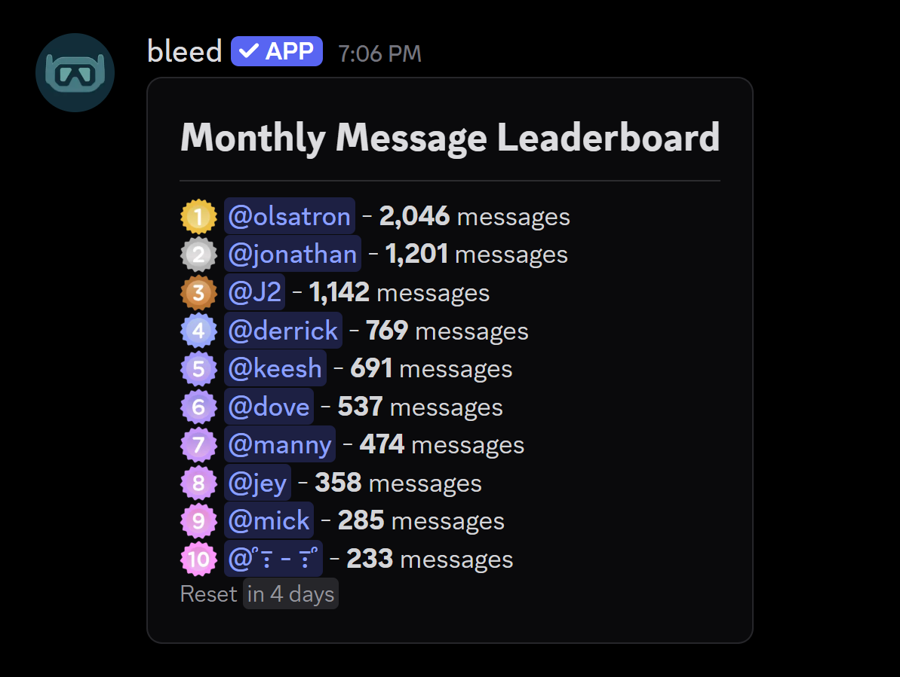
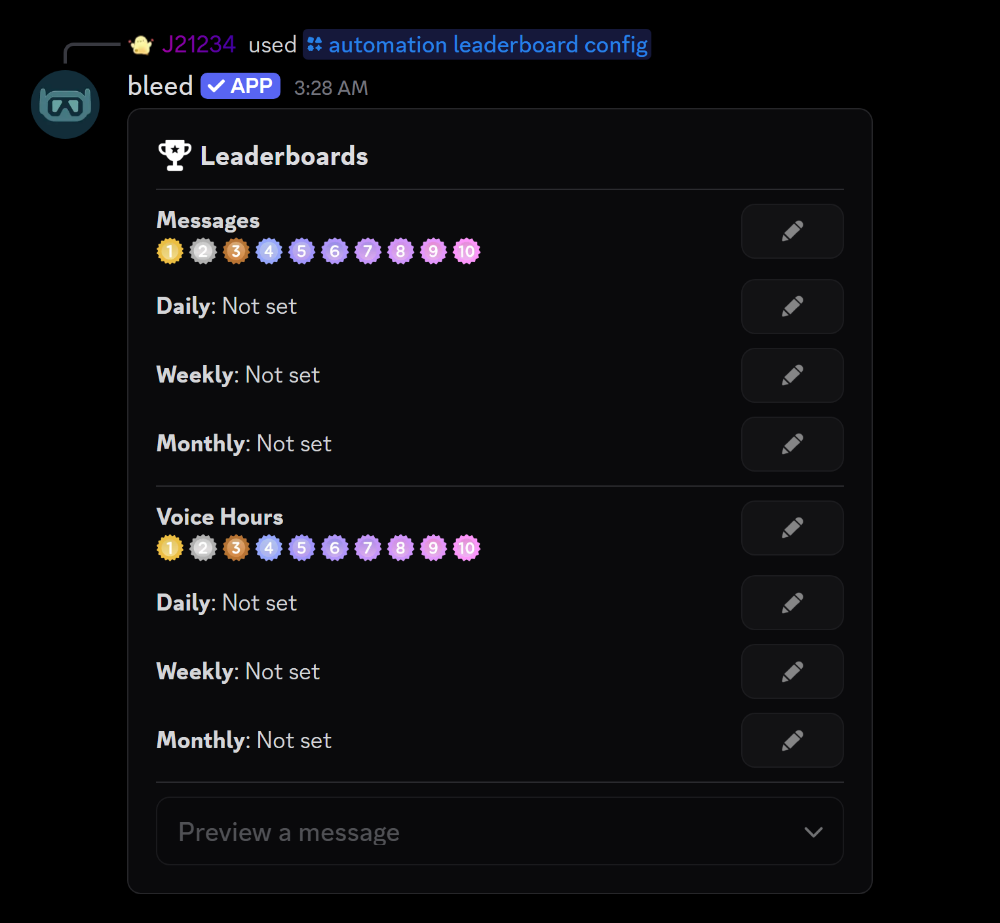

## Overview

Leaderboards show the **top 10** most active members in your server, either by messages sent or by time spent in voice channels. This can be useful for rewarding your most active members. The leaderboard will automatically update every **10 minutes**.

<Frame>
  
</Frame>

<Info>
  Leaderboards can be `daily`, `weekly` or `monthly`. Every leaderboard resets at **midnight UTC**,
  weekly leaderboards reset every **Friday** and monthly leaderboards reset on the **1st** of each month.
</Info>

## Setting up a leaderboard

You can set up, view, preview, resend, or remove daily, weekly, and monthly message and voice leaderboards using the `/automation leaderboard config` command.

<Info>
  You must have the `Manage Server` permission to use this command. bleed needs the **View Channel**,
  **Send Messages** and **Embed Links** permissions in the channel.
</Info>

<Warning>Removing a leaderboard will also remove its custom message.</Warning>

<CodeGroup>

```javascript Syntax
/automation leaderboard config
```

</CodeGroup>
<br />
<Frame>
  
</Frame>

## Customizing the message

You can customize a leaderboard's message from `/automation leaderboard config`.

<Tip>
You can enter raw text, [components](/resources/scripting/components), or [embeds](/resources/scripting/embeds) with dynamic [variables](#variables). Leave it empty to reset to the default message.
</Tip>

<CodeGroup>

```text Example
## {leaderboard.timeframe} {leaderboard.type} Leaderboard
{user.first.emote} {user.first.mention} - **{proper(user.first.message_count)}** messages
{user.second.emote} {user.second.mention} - **{proper(user.second.message_count)}** messages
{user.third.emote} {user.third.mention} - **{proper(user.third.message_count)}** messages
-# Reset <t:{next_reset}:R>
```

</CodeGroup>

### Variables

<Info>
  Replace `first` with any rank up to `tenth`, like `{user.third.mention}`. The ranks are `first`, `second`,
  `third`, `fourth`, `fifth`, `sixth`, `seventh`, `eighth`, `ninth` and `tenth`.
</Info>

<Warning>
  Variables must be written exactly as shown. `{user.three.name}` and `{user.first.messages_count}` are not
  variables and will appear as raw text in the message.
</Warning>

<AccordionGroup>
  <Accordion title="Every leaderboard">
    | Variable                    | Output                                                       |
    | --------------------------- | ------------------------------------------------------------ |
    | `{user.first.name}`         | The user's username                                          |
    | `{user.first.display_name}` | The user's display name                                      |
    | `{user.first.id}`           | The user's ID                                                |
    | `{user.first.mention}`      | The user's mention                                           |
    | `{user.first.avatar}`       | The user's avatar URL                                        |
    | `{user.first.emote}`        | The rank's emote                                             |
    | `{last_reset}`              | The last reset in UNIX                                       |
    | `{next_reset}`              | The next reset in UNIX                                       |
    | `{leaderboard.type}`        | The leaderboard's type (`Message` or `Voice`)                |
    | `{leaderboard.timeframe}`   | The leaderboard's timeframe (`Daily`, `Weekly` or `Monthly`) |
  </Accordion>
  <Accordion title="Message leaderboards">
    | Variable                             | Output                               |
    | ------------------------------------ | ------------------------------------ |
    | `{user.first.message_count}`         | The user's message count             |
    | `{proper(user.first.message_count)}` | The user's message count with commas |
  </Accordion>
  <Accordion title="Voice leaderboards">
    | Variable                          | Output                                  |
    | --------------------------------- | --------------------------------------- |
    | `{user.first.hour_count}`         | The user's hours in voice (e.g. `12.5`) |
    | `{proper(user.first.hour_count)}` | The user's hours in voice with commas   |
  </Accordion>
</AccordionGroup>

<Tip>
  If a rank has not been reached yet, its line will not be shown. For example, a leaderboard with **4** active members will only show **4** lines.
</Tip>

<Tip>
  `{last_reset}` and `{next_reset}` can be used with Discord timestamps. For example, `<t:{next_reset}:R>`
  will display as **in 3 days**.
</Tip>

Every `{guild.*}` [variable](/resources/scripting/variables) can be used as well, such as `{guild.name}`.

## Changing the rank emotes

You can customize individual rank emotes or set all **10** emotes at once from `/automation leaderboard config`.

<Info>
  Emotes are shared between the daily, weekly and monthly leaderboards of the same type.
</Info>
