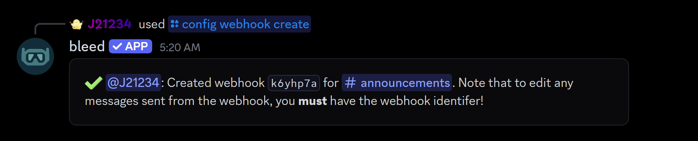
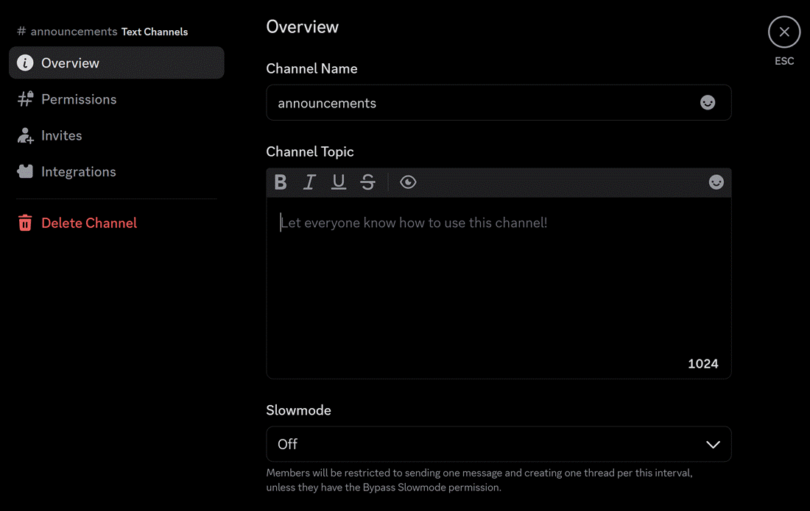
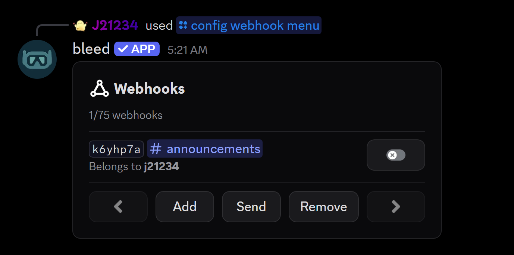

## What is a webhook?

A webhook is a way to post a message with a custom username and avatar to a channel.

<Info>
  Webhooks support [components](/resources/scripting/components) and [embeds](/resources/scripting/embeds) with dynamic
  [variables](/resources/scripting/variables).
</Info>

## Creating a webhook

You can use the `/config webhook create` command to create a webhook.

<Info>The webhook identifier is important for referencing the webhook in other commands.</Info>
<CodeGroup>
```javascript Syntax
/config webhook create name:<name>
```

```javascript Example
/config webhook create name:webster-hook
```

</CodeGroup>
<br />
<Frame>
  
</Frame>

### Customizing the webhook

If you want to change the webhook's username or avatar, you can open the **Webhooks** tab in the channel's integrations settings.

<Frame>
  
</Frame>

## Managing webhooks and messages

Use `/config webhook menu` to view, add, or remove up to **75** webhooks, see each webhook's identifier, channel, and owner, toggle webhook locks, and send or edit webhook messages. Webhooks support embeds and components.

<CodeGroup>
```javascript Syntax
/config webhook menu
```
</CodeGroup>
<br />
<Frame>
  
</Frame>

## Related commands

<AccordionGroup>
    <Accordion title="Deleting a webhook">
        You can use the `/config webhook delete` command to delete a webhook.

        <CodeGroup>
        ```javascript Syntax
        /config webhook delete identifier:<identifier>
        ```

        ```javascript Example
        /config webhook delete identifier:0kuu3zp
        ```
        </CodeGroup>
    </Accordion>

</AccordionGroup>
