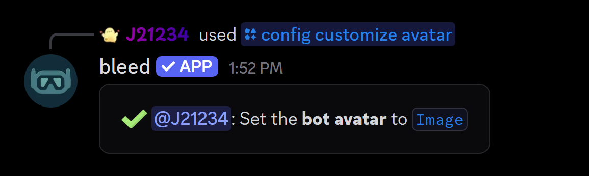
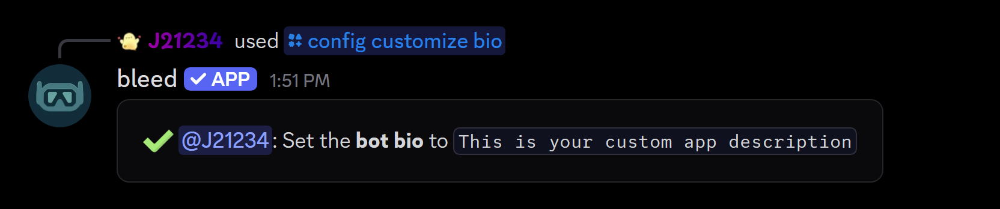
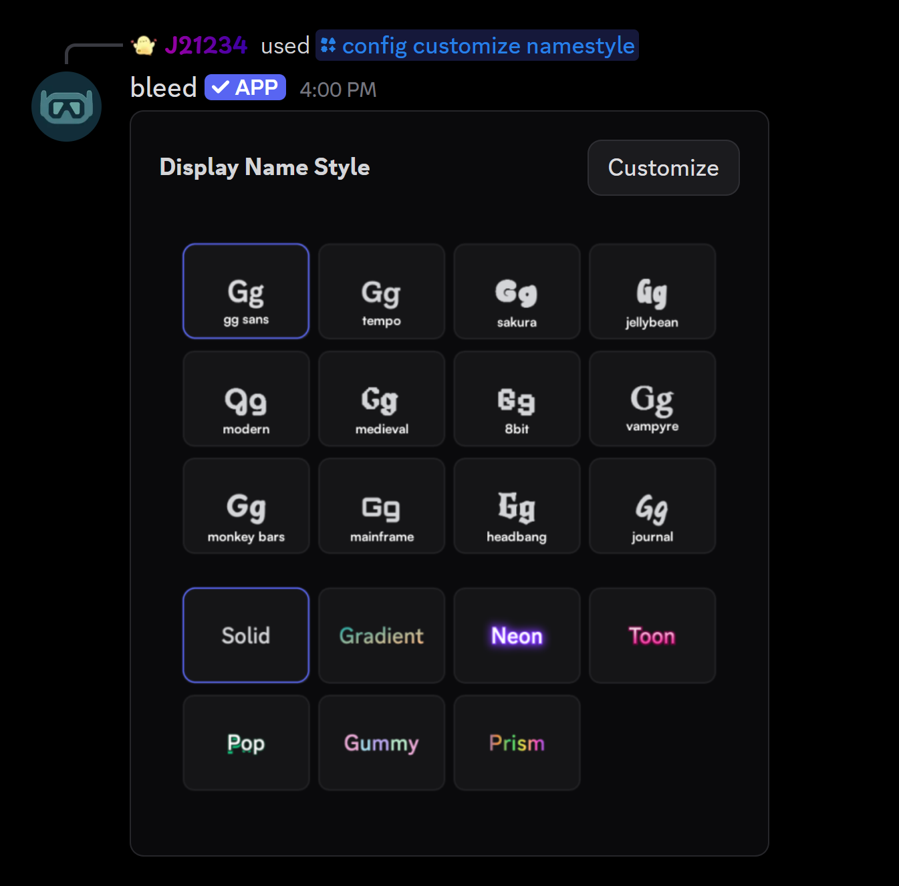
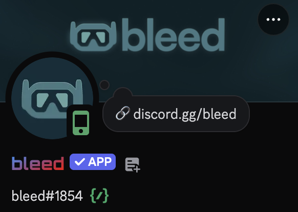

## Overview

Personalize bleed's appearance in your server by setting a custom avatar, banner, and/or bio to make your community stand out.

<Warning>
  This feature is actively monitored and logged. Uploading inappropriate content will lead to **immediate removal** of the bot from your server and **forfeiture of access**.
</Warning>

<Callout icon="key" color="#658A95" iconType="regular">Only the **server owner** can use these commands.</Callout>


## Customizing bleed's avatar

You can change bleed's avatar using the `/config customize avatar` command. Use `url` for an image link, `attachment` to upload an image, or leave both empty to remove the custom avatar.

<CodeGroup>

```javascript Syntax
/config customize avatar url:<url> attachment:<file>
```

```javascript Example
/config customize avatar url:https://bleed.bot/avatar.png
```

</CodeGroup>
<br />
<Frame>
    
</Frame>
<br />

## Customizing bleed's banner

You can change bleed's banner using the `/config customize banner` command. Use `url` for an image link, `attachment` to upload an image, or leave both empty to remove the custom banner.

<CodeGroup>

```javascript Syntax
/config customize banner url:<url> attachment:<file>
```

```javascript Example
/config customize banner url:https://bleed.bot/banner.png
```

</CodeGroup>
<br />
<Frame>
     
</Frame>


## Customizing bleed's bio

You can set bleed's bio using the `/config customize bio` command (up to `350` characters). Leave `text` empty to remove the custom bio.

<Info>
    If you do not manually include **https://bleed.bot/** or **discord.gg/bleed** in the bio, it will be automatically added at the bottom.
</Info>

<Warning>
    Intentionally hiding the automatically added **https://bleed.bot/** or **discord.gg/bleed** links in the bio will result in **immediate removal** of the bot from your server and **forfeiture of access**.
</Warning>
<CodeGroup>

```javascript Syntax
/config customize bio text:<text>
```

```javascript Example
/config customize bio text:bryce and j2 are so cool and funny
```

</CodeGroup>
<br />
<Frame>
     
</Frame>

## Customizing bleed's name style

You can customize bleed's name style using the `/config customize namestyle` command.

<Warning>
    Due to the way Discord renders name colors based on roles, name colors will not be visible in the member list or in chat. However, they will be visible when you preview bleed's profile in a server.
</Warning>

<CodeGroup>
```javascript Syntax
/config customize namestyle
```
</CodeGroup>

<div style={{ display: "flex", gap: "1rem", flexWrap: "wrap" }}>
  <div style={{ flex: "1 1 300px" }}>
    <Frame>
      
    </Frame>
  </div>
  <div style={{ flex: "1 1 300px" }}>
    <Frame>
      
    </Frame>
  </div>
</div>