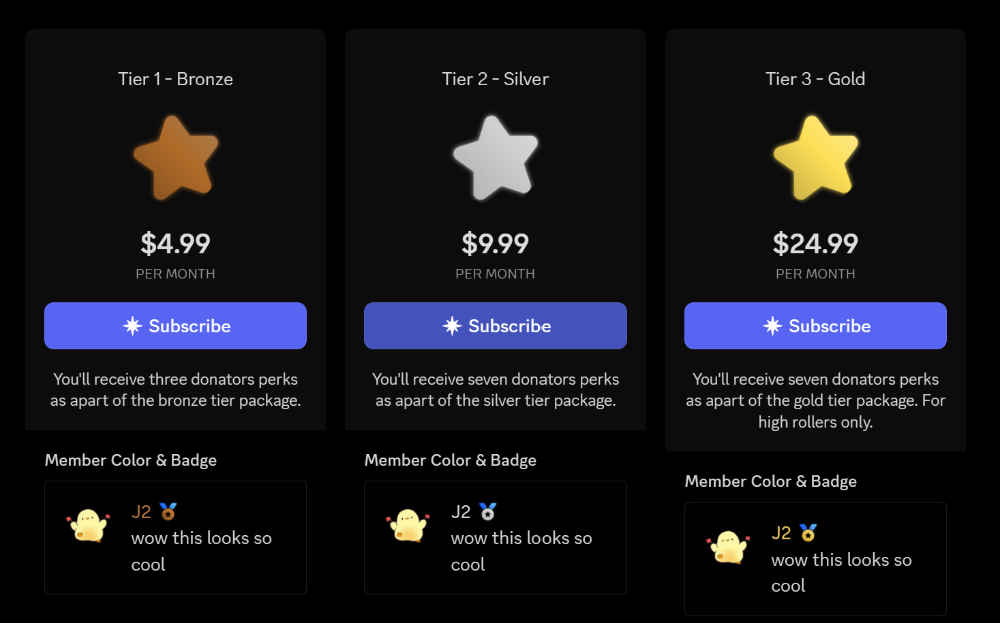

## How to obtain Donator Perks

Donator perks can be purchased via **server subscriptions** in our [Support Server](https://discord.gg/bleed) which can be found at the top of the channel list labeled as **Server Shop**.

<Frame>
  
</Frame>
<Warning>
  Purchases on **iOS** and **Android** devices cost extra due to **App
  Store** and **Google Play** fees.
</Warning>

<Tabs>
  <Tab title="Tier 3">
    <Info>
      **Tier 3** donator perks grant you **early access** to new commands before they are released.
    </Info>
<AccordionGroup>
    <Accordion title="User Installs">
      Add bleed to your Discord account to use its slash commands in DMs, group DMs, and servers that don't have bleed.
      <Tip>More information can be found in the [User Installs](/overview/user-installs) section.</Tip>
    </Accordion>
    <Accordion title="ChatGPT">
      Ask ChatGPT a question (optionally with an image attachment).
      <Info>This command requires boosting the [bleed Discord server](https://discord.gg/bleed).</Info>
      <CodeGroup>
      ```javascript Syntax
      /search chatgpt question:<question> attachment:<file>
      ```
      ```javascript Example
      /search chatgpt question:am i cute?
      ```
      </CodeGroup>
    </Accordion>
    <Accordion title="Last.fm Mode">
      Customize the embed or components layout of the `/fm` command. Running this command opens a Discord modal for your layout; set `reply:True` to send your track as a reply to your message.
      <CodeGroup>
        ```javascript Syntax
        /lastfm mode set reply:<True|False>
        /lastfm mode view
        /lastfm mode clear
        ```
        ```javascript Example
        /lastfm mode set
        // Entered in the modal:
        {container}
        {content: ### {track.name}
        by **{artist.name}** on *{album.name}*}
        {thumbnail: {album.cover}}
        {/container}
        {button: blurple && row && 1 && Like && reply: you like {track.name}}
        ```
      </CodeGroup>
    </Accordion>
    <Accordion title="Last.fm Custom Reactions">
      Customize the reactions that appear under the `/fm` command.
      <CodeGroup>
        ```javascript Syntax
        /lastfm config customreactions upvote:<emote> downvote:<emote>
        ```
        ```javascript Example
        /lastfm config customreactions upvote:👍 downvote:👎
        ```
      </CodeGroup>
    </Accordion>
    <Accordion title="Video to GIF conversion">
      Easily convert a video to a GIF.
      <CodeGroup>
        ```javascript Syntax
        /media gif url:<url> attachment:<file> quality:<quality> fps:<fps> fast_forward:<speed>
        ```
        ```javascript Example
        /media gif url:https://bleed.bot/backflip.mp4 quality:100 fps:30 fast_forward:2
        ```
      </CodeGroup>
    </Accordion>
    <Accordion title="Background Removal">
      Remove the background from an image.
      <CodeGroup>
        ```javascript Syntax
        /media filter transparent url:<url> attachment:<file> member:<member>
        ```
        ```javascript Example
        /media filter transparent url:https://bleed.bot/epic_face.png
        ```
      </CodeGroup>
    </Accordion>
    <Accordion title="Media Downloader">
      Download media from a link.
      <CodeGroup>
        ```javascript Syntax
        /utility dl url:<url>
        ```
        ```javascript Example
        /utility dl url:https://example.com/video.mp4
        ```
      </CodeGroup>
    </Accordion>
    <Accordion title="VoiceMaster Ghost">
      Hide or reveal your temporary VoiceMaster channel.
      ```javascript Syntax
      /voicemaster ghost
      /voicemaster unghost
      ```
    </Accordion>
    <Accordion title="Custom Prefix">
      Set or remove your own custom command prefix across all servers that utilize bleed.
      <CodeGroup>
        ```javascript Syntax
        /prefix self prefix:<prefix>
        /prefix selfremove
        ```
        ```javascript Example
        /prefix self prefix:j
        ```
      </CodeGroup>
    </Accordion>
    <Accordion title="Instagram Notifications">
      Stream posts & stories from an Instagram account to a text channel.
      <Tip>More information on this command can be found in the [Social Notifications](/integrations/social-notifications) section.</Tip>
      <CodeGroup>
        ```javascript Syntax
        /social instagram add username:<username> channel:<channel>
        ```
        ```javascript Example
        /social instagram add username:jonathan channel:#notifs
        ```
      </CodeGroup>
    </Accordion>
    </AccordionGroup>
  </Tab>
  <Tab title="Tier 2">
    <AccordionGroup>
    <Accordion title="User Installs">
      Add bleed to your Discord account to use its slash commands in DMs, group DMs, and servers that don't have bleed.
      <Tip>More information can be found in the [User Installs](/overview/user-installs) section.</Tip>
    </Accordion>
    <Accordion title="ChatGPT">
      Ask ChatGPT a question (optionally with an image attachment).
      <Info>This command requires boosting the [bleed Discord server](https://discord.gg/bleed).</Info>
      <CodeGroup>
      ```javascript Syntax
      /search chatgpt question:<question> attachment:<file>
      ```
      ```javascript Example
      /search chatgpt question:am i cute?
      ```
      </CodeGroup>
    </Accordion>
    <Accordion title="Last.fm Mode">
      Customize the embed or components layout of the `/fm` command. Running this command opens a Discord modal for your layout; set `reply:True` to send your track as a reply to your message.
      <CodeGroup>
        ```javascript Syntax
        /lastfm mode set reply:<True|False>
        /lastfm mode view
        /lastfm mode clear
        ```
        ```javascript Example
        /lastfm mode set
        // Entered in the modal:
        {container}
        {content: ### {track.name}
        by **{artist.name}** on *{album.name}*}
        {thumbnail: {album.cover}}
        {/container}
        {button: blurple && row && 1 && Like && reply: you like {track.name}}
        ```
      </CodeGroup>
    </Accordion>
    <Accordion title="Last.fm Custom Reactions">
      Customize the reactions that appear under the `/fm` command.
      <CodeGroup>
        ```javascript Syntax
        /lastfm config customreactions upvote:<emote> downvote:<emote>
        ```
        ```javascript Example
        /lastfm config customreactions upvote:👍 downvote:👎
        ```
      </CodeGroup>
    </Accordion>
    <Accordion title="Video to GIF conversion">
      Easily convert a video to a GIF.
      <CodeGroup>
        ```javascript Syntax
        /media gif url:<url> attachment:<file> quality:<quality> fps:<fps> fast_forward:<speed>
        ```
        ```javascript Example
        /media gif url:https://bleed.bot/backflip.mp4 quality:100 fps:30 fast_forward:2
        ```
      </CodeGroup>
    </Accordion>
    <Accordion title="Background Removal">
      Remove the background from an image.
      <CodeGroup>
        ```javascript Syntax
        /media filter transparent url:<url> attachment:<file> member:<member>
        ```
        ```javascript Example
        /media filter transparent url:https://bleed.bot/epic_face.png
        ```
      </CodeGroup>
    </Accordion>
    <Accordion title="Media Downloader">
      Download media from a link.
      <CodeGroup>
        ```javascript Syntax
        /utility dl url:<url>
        ```
        ```javascript Example
        /utility dl url:https://example.com/video.mp4
        ```
      </CodeGroup>
    </Accordion>
    <Accordion title="VoiceMaster Ghost">
      Hide or reveal your temporary VoiceMaster channel.
      ```javascript Syntax
      /voicemaster ghost
      /voicemaster unghost
      ```
    </Accordion>
    <Accordion title="Custom Prefix">
      Set or remove your own custom command prefix across all servers that utilize bleed.
      <CodeGroup>
        ```javascript Syntax
        /prefix self prefix:<prefix>
        /prefix selfremove
        ```
        ```javascript Example
        /prefix self prefix:j
        ```
      </CodeGroup>
    </Accordion>
    </AccordionGroup>
  </Tab>
  <Tab title="Tier 1">
    <AccordionGroup>
    <Accordion title="User Installs">
      Add bleed to your Discord account to use its slash commands in DMs, group DMs, and servers that don't have bleed.
      <Tip>More information can be found in the [User Installs](/overview/user-installs) section.</Tip>
    </Accordion>
    <Accordion title="ChatGPT">
      Ask ChatGPT a question (optionally with an image attachment).
      <Info>This command requires boosting the [bleed Discord server](https://discord.gg/bleed).</Info>
      <CodeGroup>
      ```javascript Syntax
      /search chatgpt question:<question> attachment:<file>
      ```
      ```javascript Example
      /search chatgpt question:am i cute?
      ```
      </CodeGroup>
    </Accordion>
    <Accordion title="Last.fm Mode">
      Customize the embed or components layout of the `/fm` command. Running this command opens a Discord modal for your layout; set `reply:True` to send your track as a reply to your message.
      <CodeGroup>
        ```javascript Syntax
        /lastfm mode set reply:<True|False>
        /lastfm mode view
        /lastfm mode clear
        ```
        ```javascript Example
        /lastfm mode set
        // Entered in the modal:
        {container}
        {content: ### {track.name}
        by **{artist.name}** on *{album.name}*}
        {thumbnail: {album.cover}}
        {/container}
        {button: blurple && row && 1 && Like && reply: you like {track.name}}
        ```
      </CodeGroup>
    </Accordion>
    <Accordion title="Last.fm Custom Reactions">
      Customize the reactions that appear under the `/fm` command.
      <CodeGroup>
        ```javascript Syntax
        /lastfm config customreactions upvote:<emote> downvote:<emote>
        ```
        ```javascript Example
        /lastfm config customreactions upvote:👍 downvote:👎
        ```
      </CodeGroup>
    </Accordion>
    </AccordionGroup>
  </Tab>
</Tabs>
