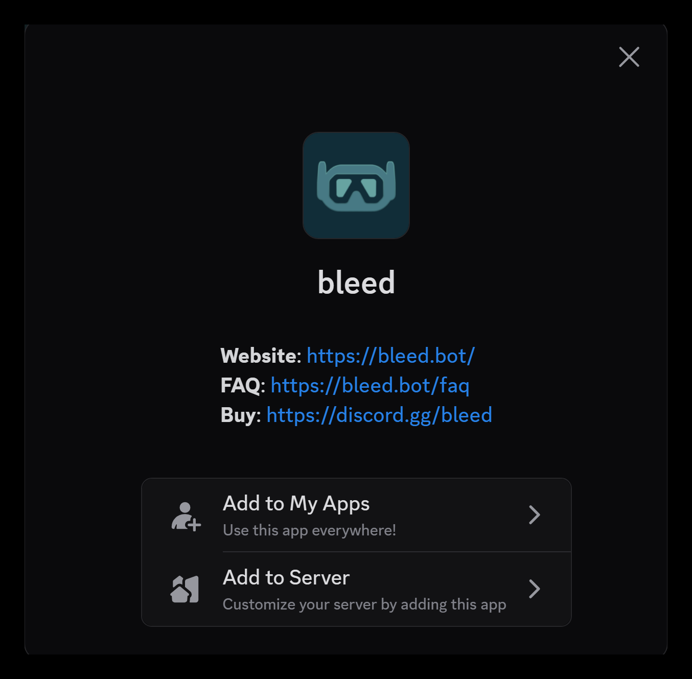

## Overview

You can add **bleed** directly to your Discord account as a user-installed app. Once installed, you can run bleed's slash commands in direct messages, group DMs, and any server—even servers that do not have bleed installed.

<Info>
  User-installed apps only work with **slash commands** (`/`). Adding bleed to your account does not let it read your messages or send messages as you; it only responds when you invoke a command.
</Info>

## Adding bleed to your account

<Steps>
  <Step title="Open bleed's app menu">
    Click bleed's profile in Discord and select **Add App**, or open the [bleed invite link](/invite).
  </Step>
  <Step title="Choose Add to My Apps">
    Select **Add to My Apps** instead of **Add to Server**, then click **Authorize**.
    <Frame>
      
    </Frame>
  </Step>
  <Step title="Run commands anywhere">
    Type `/` in any DM, group DM, or server and select bleed's icon to use your installed commands.
  </Step>
</Steps>

## Available commands

Most personal, lookup, media, utility, and fun commands are available with a user install:

- **Integrations:** `/lastfm`, `/spotify`, `/fortnite`, and `/roblox`
- **Search & lookups:** `/lookup`, `/search`, `/google`, `/image`, `/define`, `/lyrics`, `/shazam`, `/weather`, and `/inviteinfo`
- **Media & editing:** `/media` (filters, animations, captions, scenes, TTS, transcription) and `/ocr`
- **Personal & utilities:** `/avatar`, `/banner`, `/userinfo`, `/translate`, `/timezone`, `/remind`, `/birthday`, `/afk`, `/crypto`, `/utility`, `/help`, and `/ping`
- **Games & roleplay:** `/game` and `/roleplay`

## Differences from a server install

Because a user install runs through your account rather than as a member of a server, some features behave differently or remain server-only:

- **Slash commands only:** Prefix commands (such as `,av`) and message triggers require bleed to be in the server.
- **No server configuration or moderation:** Security systems (antinuke, antiraid, filters, moderation), tickets, logging, starboard, VoiceMaster, self-roles, and other server automation are only available when bleed is added to a server.
- **No server-scoped or voice features:** Commands that depend on a server or voice channel—such as music playback, `/spotify vc`, or server-wide leaderboards and configurations—cannot run in DMs or servers without bleed.
- **Managing or removing:** You can remove bleed from your account at any time in Discord under **User Settings** → **Authorized Apps**.

### Server-only commands

The commands below still appear when you type `/` with a user install, but bleed will reply that they only work in servers.

<AccordionGroup>
  <Accordion title="Server-only commands" icon="server">
    - **Birthdays:** `/birthday config` and `/birthday list`
    - **Games:** `/game blacktea start`, `/game blacktea end`, `/game counting config` and every `/game juul` command
    - **Last.fm:** `/lastfm board server`, `/lastfm board crowns`, `/lastfm board mostcrowns`, `/lastfm whoknows` (artist, album and track), `/lastfm playing`, `/lastfm hide`, `/lastfm custom` and `/lastfm config react`
    - **Spotify:** `/spotify vc`
  </Accordion>
</AccordionGroup>
