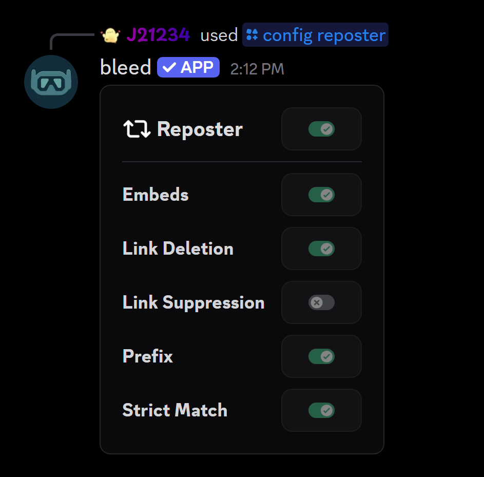

<CodeGroup>

```javascript Syntax
/access event set event:<event> setting:<setting> channel:<channel>
```


```javascript Example
/access event set event:Y/N setting:On channel:#general
```

</CodeGroup>

<Info>
  Leave `channel` empty to apply the setting to the current channel or thread. Requires **Manage Channels**.
</Info>

| Event                       | Description                                            |
| --------------------------- | ------------------------------------------------------ |
| `Y/N`                       | Toggle upvote/downvote reactions to messages.          |
| `V/S`                       | Toggle left arrow/right arrow reactions to messages.   |
| `AFK`                       | Toggle away messages when pinging AFK members.         |
| `Previous Message Triggers` | Toggle previous message reaction triggers.             |
| `Reaction Triggers`         | Toggle reaction triggers.                              |
| `Autoresponder`             | Toggle all auto responders.                            |
| `Command Failures`          | Toggle failed command execution messages.              |
| `Snipe`                     | Toggle messages from being sniped completely.          |
| `Stock`                     | Toggle stock ticker lookups in chat.                   |
| `Auto-mod Messages`         | Toggle bleed auto-mod messages upon user punishment.   |
| `Instagram`                 | Toggle Instagram reposting from members.               |
| `TikTok`                    | Toggle TikTok reposting from members.                  |
| `Grailed`                   | Toggle Grailed reposting from members.                 |
| `Twitch`                    | Toggle Twitch reposting from members.                  |
| `Streamable`                | Toggle Streamable reposting from members.              |
| `X (Twitter)`               | Toggle X (Twitter) reposting from members.             |
| `Medal`                     | Toggle Medal reposting from members.                   |
| `Threads`                   | Toggle Threads reposting from members.                 |
| `SoundCloud`                | Toggle SoundCloud reposting from members.              |
| `Tumblr`                    | Toggle Tumblr reposting from members.                  |
| `YouTube Shorts`            | Toggle YouTube Shorts reposting from members.          |
| `Kick`                      | Toggle Kick reposting from members.                    |
| `Reddit`                    | Toggle Reddit reposting from members.                  |

## Reposter configuration

You can use `/config reposter` to configure server-wide social media reposting behavior. From the **Reposter** menu, you can toggle **Reposter**, **Embeds**, **Link Deletion**, **Link Suppression**, **Prefix**, and **Strict Match**.

<CodeGroup>

```javascript Syntax
/config reposter
```

</CodeGroup>
<br />
<Frame>
    
</Frame>

## Related commands

- `/access event all event:<event> setting:<On|Off>` - Turn an event on or off in every text channel.
- `/access event list` - View every disabled event.


