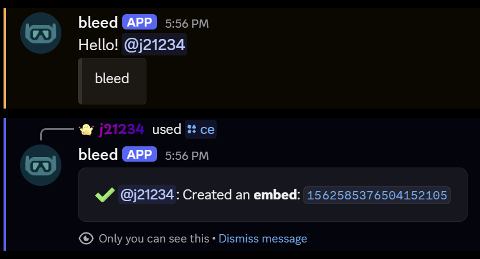

## Structure

Each parameter in the embed is represented by a key-value pair which is separated by a colon. For example, the `title` parameter will look like `{title: hello {user}}`. The `{user}` is a [variable](/resources/scripting/variables) which will be filled in with the user's username.

- `{` begins a parameter.
- `:` separates parameter from content.
- `$v` separates the parameters.
- `}` ends a parameter.

### Parameters

- `url` - The embed URL. (`https://..`)
- `color` - The embed color. (`#FFFFFF`)
- `title` - The embed title. (`hello {user}`)
- `description` - The embed description. (`hello {user}`)
- `image` - The embed image URL. (`https://..`)
- `thumbnail` - The embed thumbnail URL. (`https://..`)
- `timestamp` - The embed timestamp. (**NO ARGUMENTS**)

The following parameters require additional arguments which are separated by `&&`.

<AccordionGroup>
    <Accordion title="Author">
        - `name` - The author's name.
        - `icon` - The author's icon. **Optional**
        - `url` - The author's URL. **Optional**
        <CodeGroup>
            ```javascript Syntax
            {author: name && icon && url}
            ```

            ```javascript Example
            {author: {user} && {user.avatar}}
            ```
        </CodeGroup>
    </Accordion>
    <Accordion title="Field">
        - `name` - The field name.
        - `value` - The field value.

        <Info>Include **inline** at the end of the field to make it inline.</Info>

        <CodeGroup>
        ```javascript Syntax
        {field: name && value && inline}
        ```

        ```javascript Example
        {field: {user} && this is the value && inline}
        ```
        </CodeGroup>
    </Accordion>
    <Accordion title="Footer">
        - `text` - The footer text.
        - `icon` - The footer icon. **Optional**
        <CodeGroup>
            ```javascript Syntax
            {footer: text && icon}
            ```
            ```javascript Example
            {footer: {user}}
            {footer: {user} && {user.avatar}}
            ```
        </CodeGroup>
    </Accordion>
    <Accordion title="Button">
        - `style` - `blurple`, `gray`, `green` or `red`, or a link starting with `https://` for a link button. Styles must be lowercase.
        - `label` - The button label.
        - `emoji` - The button emoji (optional).
        - `enabled|disabled` - Whether the button can be clicked (optional, defaults to `enabled`).
        <Info>This is the embed button syntax. [Components](/resources/scripting/components) buttons use a different order.</Info>
        <CodeGroup>
            ```javascript Syntax
            {button: style && label && emoji && enabled|disabled}
            ```
            ```javascript Example
            {button: blurple && heyy && disabled}
            {button: https://example.com && click this}
            ```
        </CodeGroup>
    </Accordion>

</AccordionGroup>

### Variables

You can use dynamic variables in your embeds to display user-specific information. For example, `{user}` will be replaced with the user's username.

<Info>You can view the available variables by clicking [here](/resources/scripting/variables).</Info>

```javascript
{description: {guild.name}}$v{message: Hello! {user.mention}}
```
<Frame>

</Frame>

## Frequently Asked Questions

### How can I add a new line to my description parameter?

If you want to add a new line to your description parameter, you can press `SHIFT` + `ENTER` to create a new line.

### Why isn't my embed code working for some commands?

Some commands allow both raw text and embed code. Because of this, you'll need to specify if you're entering an embed. To do this, you'll need to begin your embed code with `{embed}$v` then proceed to write your embed code after as normal.

```javascript
/config welcome add channel:#welcome
{embed}$v{message: Welcome to {guild.name} {user.mention}}$v{description: Welcome}
```
