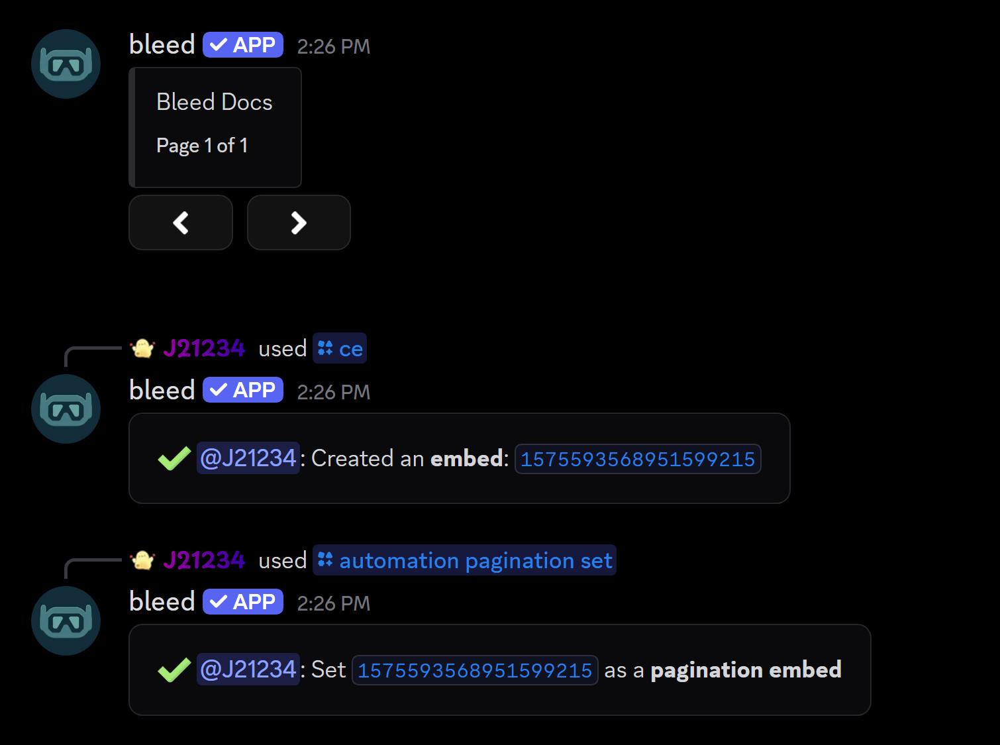
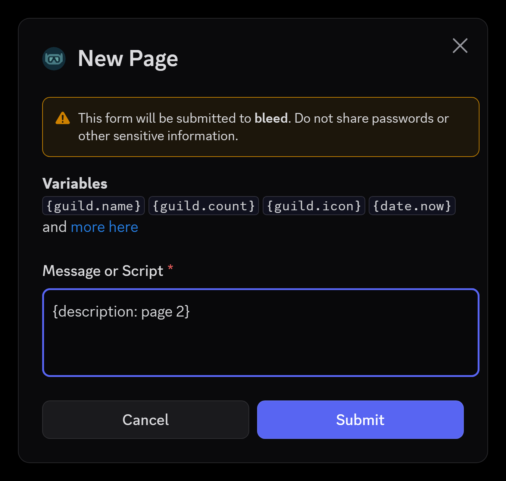
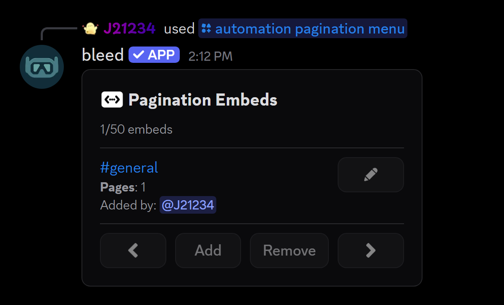

## Setup

<Warning>Only [components](/resources/scripting/components) and [embeds](/resources/scripting/embeds) created by bleed can be paginated.</Warning>
<Steps>
  <Step title="Set the embed">
    First, you must set the embed to work with pagination.
    <CodeGroup>
    ```javascript Syntax
    /automation pagination set message_link:<message_link>
    ```
    </CodeGroup>
    <Frame>
      
    </Frame>
  </Step>
  <Step title="Add the next page">
    You can now add further pages to your embed. This command works with adding
    any number of pages required.
    <CodeGroup>
    ```javascript Syntax
    /automation pagination add message_link:<message_link>
    ```
    </CodeGroup>
    This will open a modal where you can add the code for your next page.
    <Frame>
      
    </Frame>
  </Step>
  <Step title="Updating a paginated embed">
    Use `/automation pagination menu` (**Pagination Embeds**, up to **50** embeds with `<`, **Add**, **Remove**, `>`) to view, add, update, or remove paginated embeds.
    <CodeGroup>
    ```javascript Syntax
    /automation pagination menu
    ```
    </CodeGroup>
    <Frame>
      
    </Frame>
  </Step>
  <Step title="Removing a page">
    If you want to remove a page you have set up, you can use the command below.
    <CodeGroup>
    ```javascript Syntax
    /automation pagination remove message_link:<message_link> page:<page number>
    ```
    </CodeGroup>
    <Frame>
      
    </Frame>
  </Step>
</Steps>

## Related commands

<AccordionGroup>
  <Accordion title="Delete a paginated embed entirely">
    <CodeGroup>
    ```javascript Syntax
    /automation pagination delete message_link:<message_link>
    ```
    </CodeGroup>
  </Accordion>
  <Accordion title="Managing paginated embeds">
    Use `/automation pagination menu` to list all active paginations, edit pages, restore page buttons if they were removed, or reset all paginated embeds in your server.
    <CodeGroup>
    ```javascript Syntax
    /automation pagination menu
    ```
    </CodeGroup>
  </Accordion>
</AccordionGroup>
