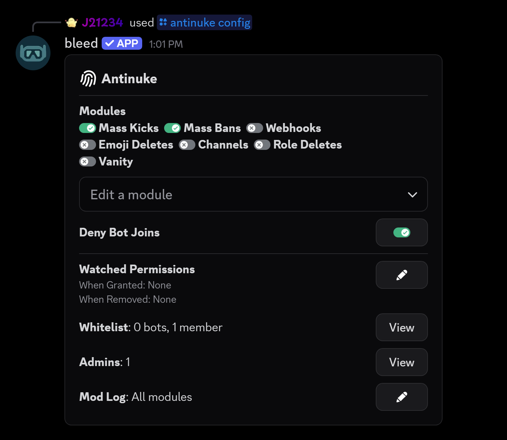
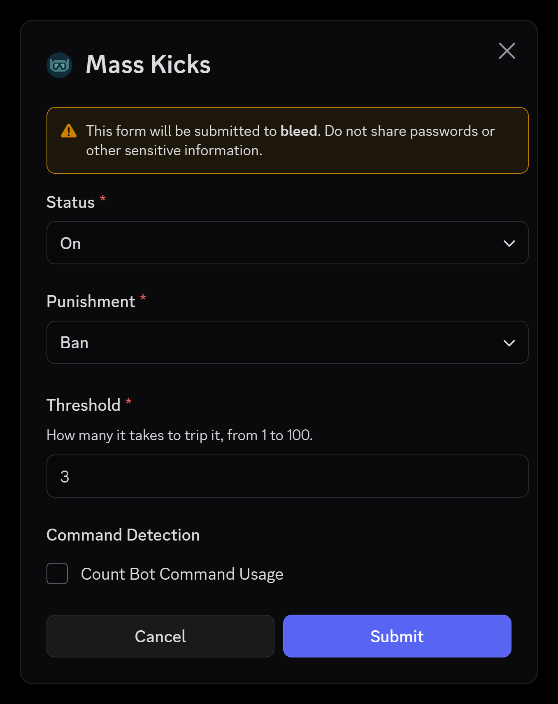
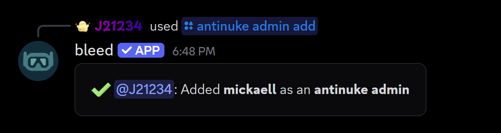
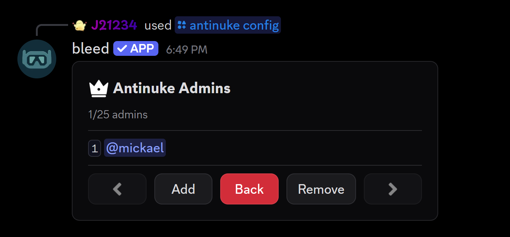
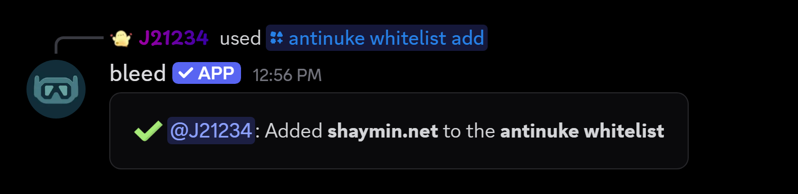

## Overview

### Why use an antinuke system?

It's important to have an antinuke system in place to prevent moderators from abusing their permissions. This is a security measure which keeps your server safe from any harmful actions.

### How does the antinuke work?

Antinuke sets a limit on the number of actions a moderator can perform in a certain time frame. If the limit is exceeded, the moderator will be punished and a message will be sent to the owner.

---

## Configuring the antinuke

<Tip>
  Discord recently implemented a new **mass ban** feature which can quickly ban
  **100\+ members**. It's **HIGHLY** recommended to utilize [fake
  permissions](/security/fake-permissions) to prevent moderators from using this
  feature.
</Tip>

### Configuring modules

Run `/antinuke config` to open the antinuke configuration panel. The panel shows
which modules are enabled and lets you select a module from the dropdown to
configure it, toggle **Deny Bot Joins**, edit **Watched Permissions**, or view
your **Whitelist** and **Admins**.

<Frame caption="The antinuke configuration panel shows enabled modules and lets you select a module to configure.">
  
</Frame>

Selecting a module from **Change antinuke module...** opens its form, where you
can set its status, punishment, threshold and command detection.

<Frame caption="The Mass Kicks module form.">
  
</Frame>


#### Managing antinuke admins

Initially, only the **server owner** can configure the antinuke. Use
`/antinuke admin add` to allow another user to manage it.

<Warning>
  This is a dangerous command and will allow the user to entirely alter the
  antinuke configuration.
</Warning>

<CodeGroup>

```javascript Syntax
/antinuke admin add user:<user>
```


```javascript Example
/antinuke admin add user:@jonathan
```

</CodeGroup>

<br />

<Frame>
  
</Frame>

To remove an antinuke admin, use `/antinuke admin remove`.
<CodeGroup>

```javascript Syntax    
/antinuke admin remove user:<user>
```

```javascript Example
/antinuke admin remove user:@j21234
```
</CodeGroup>

Use the **View** button beside **Admins** in `/antinuke config` to see every
antinuke admin.

<Frame>
  
</Frame>

#### Exempting users from the antinuke

You can exempt users from the antinuke with `/antinuke whitelist add` and
`/antinuke whitelist remove`.

<Warning>
  This is a dangerous command and will allow the user to bypass the antinuke
  entirely.
</Warning>

<CodeGroup>

```javascript Syntax
/antinuke whitelist add user:<user>
/antinuke whitelist remove user:<user>
```

```javascript Example
/antinuke whitelist add user:@jonathan
/antinuke whitelist remove user:@j21234
```

</CodeGroup>

<br />

<Frame>
  
</Frame>

### Available protections

#### Watching permission changes

Select the pencil button beside **Watched Permissions** in `/antinuke config` to
watch permission grants or removals. When a watched permission changes on a
role, bleed reverts the change, reports who made it, and can optionally punish
the member who made the change.

Available permission values are:

| Permissions          |
| -----------          |
| `administrator`      |
| `ban_members`        |
| `mention_everyone`   |
| `kick_members`       |
| `moderate_members`   |
| `manage_guild`       |
| `manage_channels`    |
| `manage_roles`       |
| `view_audit_log`     |
| `manage_webhooks`    |
| `manage_expressions` |
| `manage_nicknames`   |

#### Protection modules

Each module can be toggled on or off and configured in `/antinuke config`.
Thresholds define how many actions trigger the module, and punishment defines
what happens when it is triggered. For modules that support command detection,
enable it to include actions performed with bleed commands.

<Warning>
  bleed cannot revert a vanity URL change due to Discord limitations. It can
  only punish the member who made it.
</Warning>

<Info>
  To let a bot join while **Deny Bot Joins** is on, whitelist it first with
  `/antinuke whitelist add user:<bot>`.
</Info>

<Info>
  Thresholds count actions made within **9 seconds** and can be from `1` to
  `100`. It's recommended to keep thresholds between `1` and `6`. Available
  punishments are listed in the [punishments](/resources/syntax#punishments)
  section.
</Info>

<CardGroup cols={2}>
  <Card title="Mass Bans" icon="gavel">
    Stops members from being banned in bulk. Supports command detection.
  </Card>
  <Card title="Mass Kicks" icon="user-minus">
    Stops members from being kicked in bulk. Supports command detection.
  </Card>
  <Card title="Role Deletes" icon="id-badge">
    Stops roles from being deleted in bulk. Supports command detection.
  </Card>
  <Card title="Channels" icon="hashtag">
    Stops channels from being created or deleted in bulk.
  </Card>
  <Card title="Emoji Deletes" icon="face-smile">
    Stops emojis from being deleted in bulk.
  </Card>
  <Card title="Webhooks" icon="plug">
    Stops webhooks from being created in bulk.
  </Card>
  <Card title="Vanity" icon="link">
    Punishes members who change the server's vanity URL.
  </Card>
  <Card title="Deny Bot Joins" icon="robot">
    Kicks bots that were added without being whitelisted first.
  </Card>
</CardGroup>
