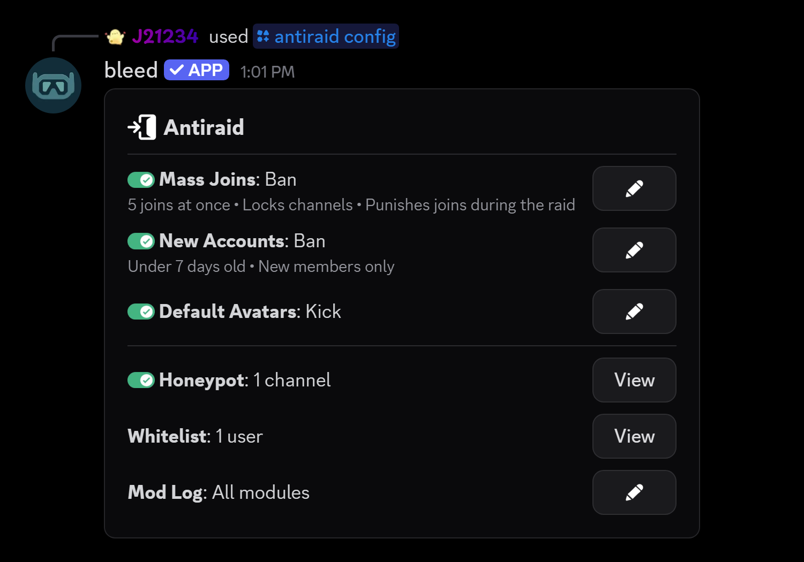
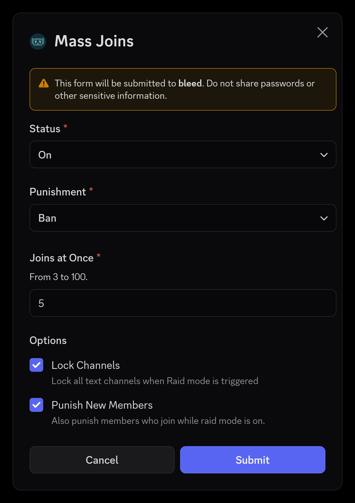
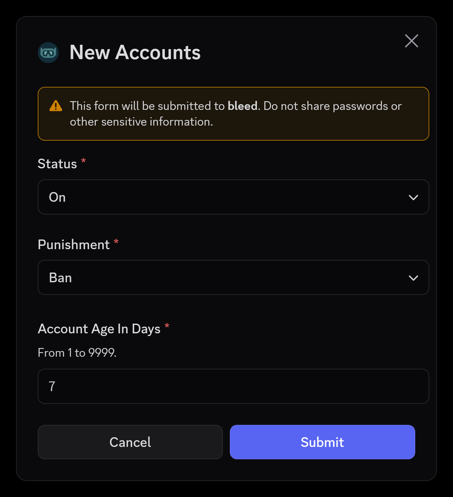
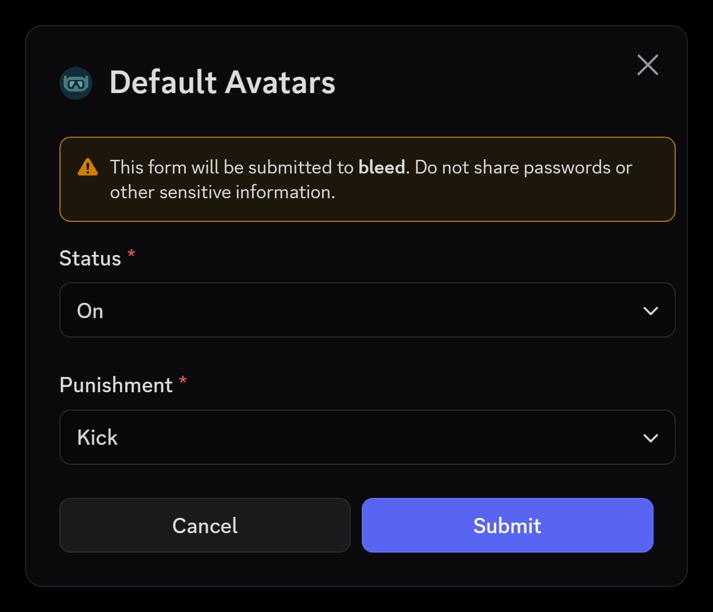
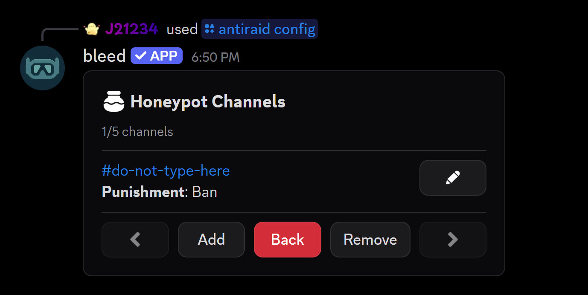
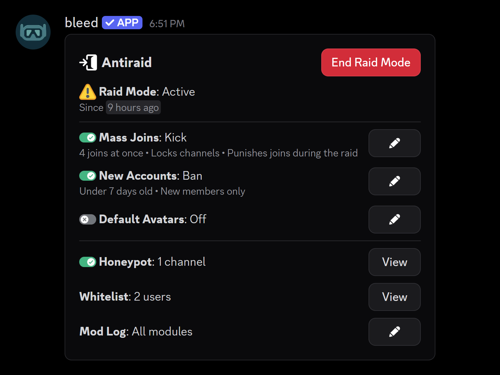

## Configuring antiraid

Use `/antiraid config` to view and configure your server's antiraid settings. Select the pencil button beside a module to edit it, or **View** to manage your honeypot channels and whitelist.

<CodeGroup>
```javascript Syntax
/antiraid config
```

```javascript Example
/antiraid config
```
</CodeGroup>

<Frame>
  
</Frame>

## Join protections

### Mass joins

This module triggers when the number of accounts joining the server exceeds the threshold within a short time frame. Select the pencil button beside **Mass Joins** in `/antiraid config` to set the punishment, threshold, and whether to lock channels and punish joins during the raid.

<Info>It's recommended to keep the threshold between `5` and `10` to stay safe.</Info>

<Warning>
  Whenever the threshold is reached, the server will be placed in a raid state.
  This will temporarily disable intensive events which bleed dispatches, such as
  **welcome** and **goodbye** messages.
</Warning>

<Frame>
  
</Frame>

### New accounts

This module triggers when an account joins the server that is younger than the specified age in days. Select the pencil button beside **New Accounts** in `/antiraid config` to configure it.

<Frame>
  
</Frame>

### Default avatars

This module triggers when an account joins the server without an avatar. Select the pencil button beside **Default Avatars** in `/antiraid config` to configure it.

<Frame>
  
</Frame>

## Honeypot

A honeypot is a bait channel. Anyone who posts in one of your honeypot channels will be punished (`Ban`, `Softban`, or `Jail`), making the feature useful for catching compromised accounts or automated spammers. Select **View** beside **Honeypot** in `/antiraid config` to add or remove up to **5** honeypot channels.

<Warning>
  Anyone who posts in a honeypot channel may be punished.
</Warning>

<Callout icon="shield" color="#658A95" iconType="regular">
  Managing honeypot channels requires the **Administrator** permission.
</Callout>

<Info>
  All honeypot punishments are recorded in your server's designated moderation log channel. You can view and configure your moderation log channel using `/settings config`.
</Info>

<Frame>
  
</Frame>

## Whitelist

Whitelisted users can join once without being filtered by antiraid. Use **View** beside Whitelist in `/antiraid config` to see the users on the list.

You can manage the whitelist from the panel or directly.

<CodeGroup>
```javascript Syntax
/antiraid whitelist add user:<user>
/antiraid whitelist remove user:<user>
```

```javascript Example
/antiraid whitelist add user:@jonathan
/antiraid whitelist remove user:@j21234
```
</CodeGroup>

<Frame>
  
</Frame>

## Responding to a raid

<Steps>
  <Step title="Remove accounts that joined during the raid">
    Use `/antiraid raid` to remove everyone who joined within a specified time
    window.

    <CodeGroup>
    ```javascript Syntax
    /antiraid raid within:<duration> action:<kick|ban> reason:<reason>
    ```

    ```javascript Example
    /antiraid raid within:1h action:ban reason:Raid cleanup
    ```
    </CodeGroup>

    To ban a set number of recent joiners, use `/ban` with `type:Recent Joins`.

    <CodeGroup>
    ```javascript Syntax
    /ban type:<Ban|Tempban|Hardban|Softban|Recent Joins> count:<number> reason:<reason> duration:<duration> silent:<True|False> delete_messages:<option>
    ```

    ```javascript Example
    /ban type:Recent Joins count:10 reason:Raid cleanup duration:1d silent:True delete_messages:Previous 6 hours
    ```
    </CodeGroup>

    <Info>
      Duration values must use the [proper format](/resources/syntax#formatting-a-duration).
    </Info>

  </Step>
  <Step title="End the raid state">
    After the threat has passed, run `/antiraid config` and select **End Raid
    Mode** to take the server out of its raid state. This re-enables intensive
    events, unlocks channels locked by the raid response, and allows accounts
    to join again.

    <Frame caption="While a raid is active, /antiraid config shows when it started and an End Raid Mode button.">
      
    </Frame>
  </Step>
</Steps>
