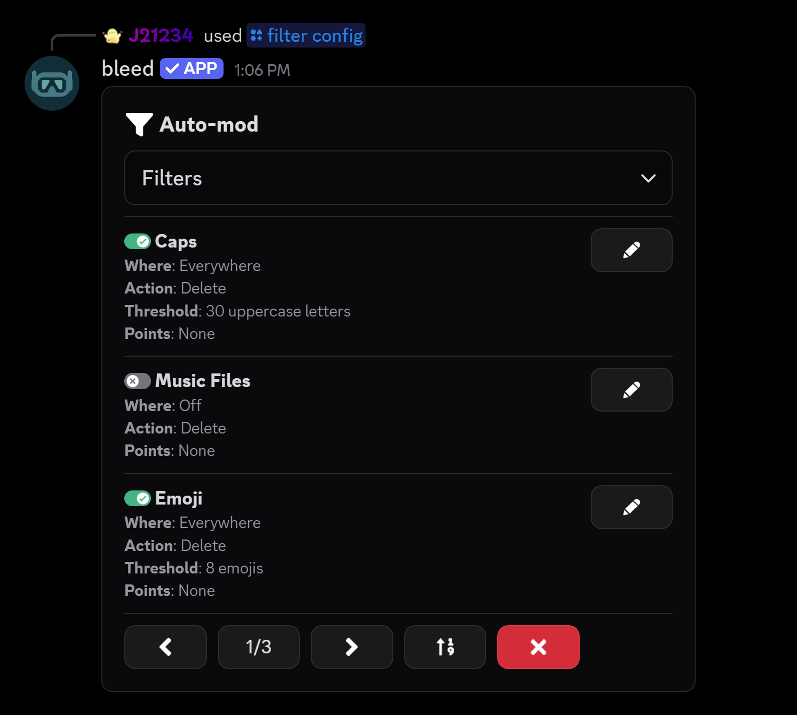
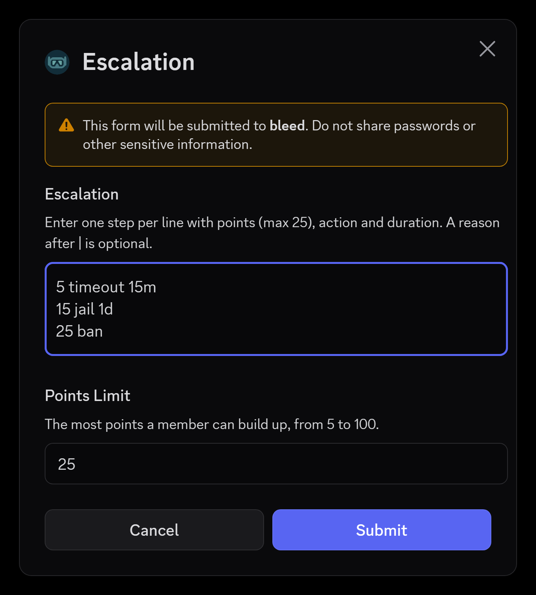

## Overview

Filters punish messages that break your rules. Triggering a filter can also add
points to the member, and enough points trigger the punishments in your
escalation ladder.

Filter types configured via `/filter config` cover `caps`, `musicfiles`, `emoji`, `links`, `spoilers`, `invites`, `massmention`, `spam`, and **Scam Images**. Words are handled separately with `/filter word menu`, and member names with `/filter names config`.

## Configuring filters

Use `/filter config` to open the **Auto-mod** panel, which has three views in the bottom selector:
- **Filters** — Turn filters on or off and edit each filter's action, threshold, exempt roles, and skipped channels.
- **Points & Escalation** — Set how many points triggers add and configure your punishment escalation ladder.
- **Snipe** — Choose which filtered content types are hidden from snipe.

Leave `type` empty to open the full panel, or pass a filter type to jump straight to it. Select the pencil button beside a filter to edit its action, timeout or jail length, threshold, exempt roles, and skipped channels.

<Info>
  Filter-specific options:

  - `invites`, `musicfiles`, and **Scam Images** have no threshold.
  - `spam` includes a **Window** setting (default `5` seconds) and only allows `delete` and `warn`.
  - `links` includes an **Allowed Sites** field (up to `100` domains, one per line) instead of **Skipped Channels**.
</Info>

<CodeGroup>
```javascript Syntax
/filter config type:<filter>
```

```javascript Examples
/filter config
/filter config type:caps
```
</CodeGroup>

<Frame>
  
</Frame>

## Turning a filter on or off

Use `/filter set` to turn a filter on or off without the form. Leave `channel`
empty to apply it everywhere. Leave `threshold` or `punishment` empty to use the
[defaults](#filter-defaults).

<CodeGroup>
```javascript Syntax
/filter set type:<filter> setting:<On|Off> channel:<channel> threshold:<number> punishment:<Delete|Warn|Timeout|Jail|Kick|Ban|Softban> duration:<duration>
```

```javascript Examples
/filter set type:Invites Filter setting:On
/filter set type:Caps Filter setting:On channel:#general threshold:20 punishment:Warn
```
</CodeGroup>

<Info>
  `duration` accepts values like `15m`, `1h`, or `7d`; see the
  [duration format](/resources/syntax#formatting-a-duration). A timeout needs a
  duration (up to `28d`). A jail with no duration lasts until the member is
  unjailed.
</Info>

## Clearing per-channel settings

Use `/filter clear` to remove a filter's per-channel settings. Leave `channel`
empty to clear every channel for that filter.

<CodeGroup>
```javascript Syntax
/filter clear type:<filter> channel:<channel>
```

```javascript Examples
/filter clear type:caps channel:#general
/filter clear type:links
```
</CodeGroup>

## Filter defaults

| Filter | Default threshold | Default punishment | Default points |
| --- | --- | --- | --- |
| `caps` | 30 uppercase letters | Delete | None |
| `musicfiles` | None | Delete | None |
| `emoji` | 8 emojis | Delete | None |
| `links` | 1 link to a site that is not allowed | Delete | None |
| `spoilers` | 1 `\|\|` spoiler mark | Delete | None |
| `invites` | None | Delete | None |
| `massmention` | 9 mentions | Ban | 1 a hit |
| `spam` | 5 messages in the spam window (5s window) | Delete | None |
| Scam Images (`Scam Filter` in `/filter set`) | None | Softban | 1 a hit |

## Exempt roles

Members with an exempt role are ignored by that filter, including the word
filter. Configure exempt roles inside `/filter config`. Requires **Manage
Channels**.

## Word filter

Block words and regex patterns, or allow words that would otherwise be caught.

<Note>
  `/filter word add` and `/filter word menu` require **Community** enabled on the server and an existing Discord AutoMod **Custom Keyword Rule**.
</Note>

| Command | Description | Permission |
| --- | --- | --- |
| `/filter word add` | Add a word to filter (up to 60 characters). | Manage Channels |
| `/filter word remove` | Remove a word from the filter. | Manage Channels |
| `/filter word menu` | View and manage filtered words, allowed words, and regex patterns. | Manage Channels |
| `/filter word reset` | Clear the legacy word list. | Manage Channels |
| `/filter word migrate` | Copy the legacy word list into Discord AutoMod. | Manage Channels |

<CodeGroup>
```javascript Syntax
/filter word add word:<word>
/filter word remove word:<word>
/filter word menu
/filter word reset
/filter word migrate
```

```javascript Examples
/filter word add word:scam
/filter word remove word:scam
```
</CodeGroup>

## Links whitelist

Allow specific sites through the links filter inside `/filter config` (for
example, `/filter config type:links`). Requires **Manage Channels**.

## Name filter

The name filter cleans fancy text, such as `𝓭𝓮𝓻𝓻𝓲𝓬𝓴`, and hoisting symbols out
of member names. It can clean names automatically, or every member's name at
once with `/filter names cleanup`. Requires **Manage Nicknames**.

<CodeGroup>
```javascript Syntax
/filter names config
/filter names cleanup
```
</CodeGroup>

<Info>
  Names cleaned by the name filter show up in your member update
  [log](/configuration/logging) with the reason **Name Filter**.
</Info>

## Snipe

Hide filtered content (`invites`, `links`, `images`, `word`, `files`, or
`music`) from snipe inside `/filter config`. Requires **Manage Channels**.

Server administrators can also turn snipe on or off for the server with
`/settings snipe`. Requires **Administrator**.

<CodeGroup>
```javascript Syntax
/settings snipe setting:<On|Off>
```

```javascript Examples
/settings snipe setting:Off
```
</CodeGroup>

## Filter points

Switch to **Points & Escalation** in `/filter config` to set how many points each trigger adds and which punishments members receive as points build up.

- **Escalation** — Select the pencil button to add escalation steps (`points action [duration] [| reason]`) and set the maximum **Points Limit** (`5`–`100`; starts at `0` until configured, so points are only counted).
- **Points** — Select the pencil button to choose whether points come from filters only or also mod actions, and set point values per trigger.
- **Expire, Deleted Messages & Next Punishment** — Choose when points expire (`1h` to `365d`, or never), whether deleted messages add points, and whether members are told their next punishment.

For a server that hasn't set anything up, **Points & Escalation** starts with these defaults:

| Setting | Default |
| --- | --- |
| Escalation | No steps configured (`0` points limit until set) |
| Points Source / Filter Hits | Filters only (`massmention` and `Scam Images` default to `1` a hit, others `None`) |
| Expire | Never |
| Deleted Messages | Add nothing |
| Next Punishment | Members are told |

<Info>
  The sample text in the empty boxes is only a placeholder and isn't saved.
  Escalation example: `5 timeout 15m`, `10 jail 1d`, `15 kick`, `25 ban`.
  Points example: `caps 1`, `massmention 3`, `warn 1`, `mute 2`, `jail 4`.
</Info>

<Frame caption="An example escalation setup. Members are timed out at 5 points, jailed at 15 and banned at 25.">
  
</Frame>

| Command | Description | Permission |
| --- | --- | --- |
| `/filter points member` | View a member's points. | Manage Channels |
| `/filter points clear` | Remove all or a specified number of a member's newest points. | Manage Channels |

<Info>
  Leave `amount` empty in `/filter points clear` to remove all of a member's
  points.
</Info>

<CodeGroup>
```javascript Syntax
/filter points member member:<user>
/filter points clear member:<user> amount:<1–100>
```

```javascript Examples
/filter points member member:@jonathan
/filter points clear member:@jonathan amount:2
```
</CodeGroup>
