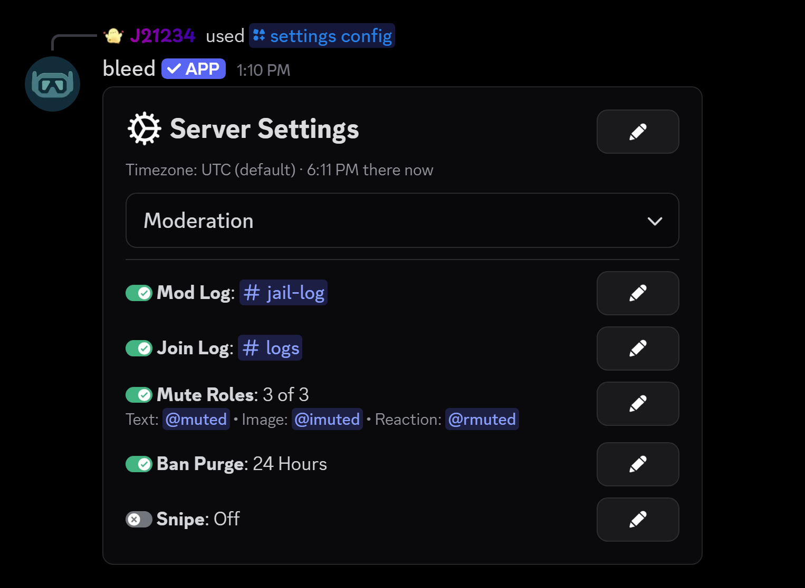
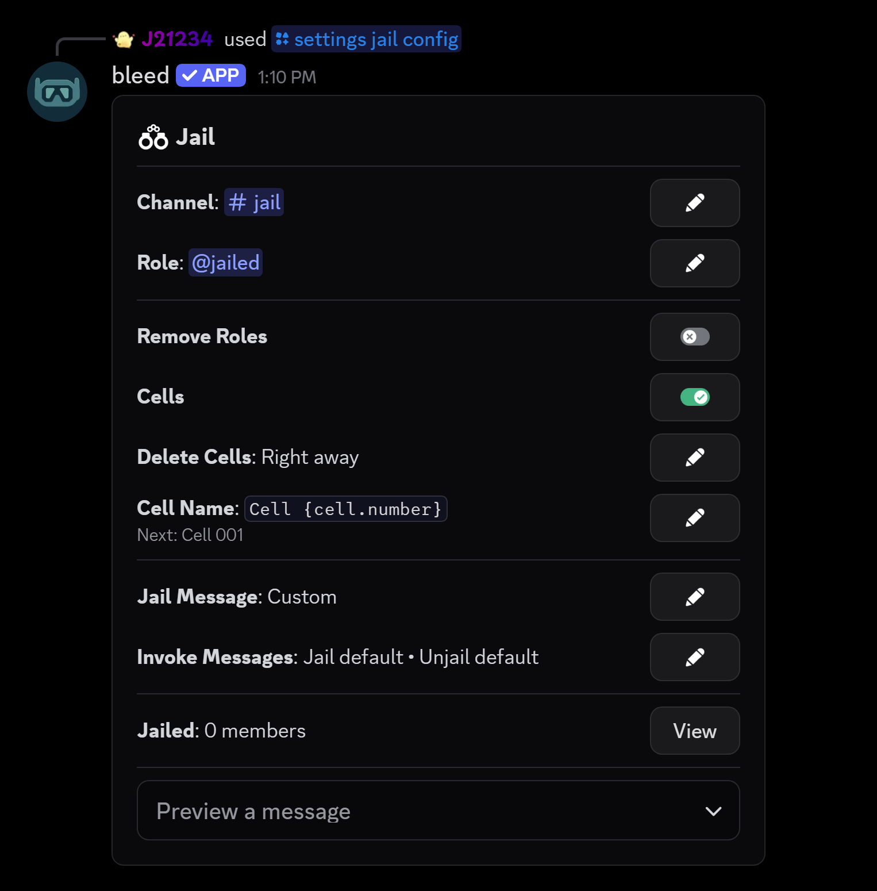
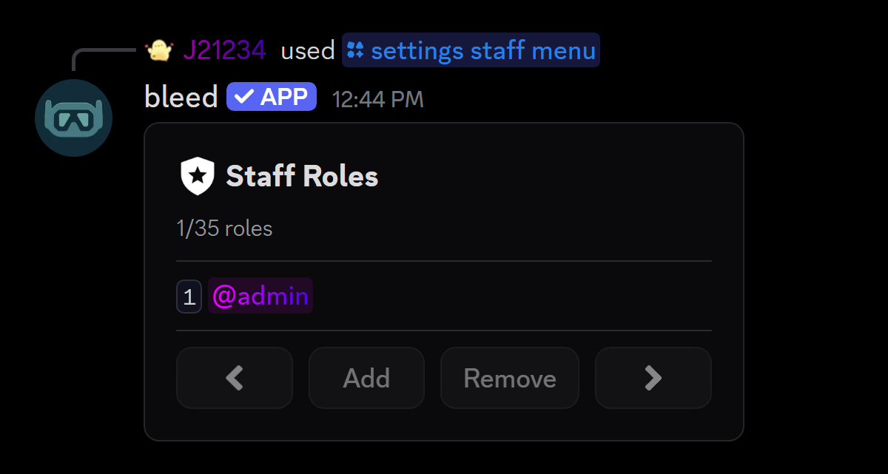

## Overview

Moderation commands require some basic setup before they can be used. This includes **moderation logs**, **mute roles**, and the **jailed role & channel**.

<Steps>
    <Step title="Creating the case logs & jail role">
        <Info>
            Jail is a feature similar to mute, but it restricts users from all channels except `#jail`.
        </Info>

        Use the `/config setup` command to create the `#jail-log` channel, the `#jail` channel and the jailed role.
    </Step>
    <Step title="Creating the necessary mute roles">
        <Info>
            This will create a **text mute**, **image mute**, and **reaction mute** role.
        </Info>
        Use the `/mute setup` command to create the necessary mute roles.
    </Step>

</Steps>

Upon completion of the setup, you'll notice a few new roles and channels in your server.

- **Muted** - Used to restrict users from sending messages.
- **Image Muted** - Used to restrict users from uploading attachments.
- **Reaction Muted** - Used to restrict users from reacting to messages.
- **Jailed** - Used to restrict users from all channels except the `#jail` channel.

<Info>
  The `#jail-log` channel logs all moderation actions done through bleed (e.g.
  `/ban` & `/kick`). The `#jail` channel is where users jailed by the `/jail add`
  command are restricted to.
</Info>

### Customizing moderation and jail settings

Use `/settings config` to open the **Server Settings** panel and switch to **Moderation** to configure your **Mod Log**, **Join Log**, **Mute Roles**, **Ban Purge** (`6 Hours`, `12 Hours`, `24 Hours`, `3 Days`, `7 Days`, or `Off`), and **Snipe**.

Use `/settings jail config` to customize your jail **Channel** and **Role**, toggle **Remove Roles** (strips removable roles when a member is jailed and restores them on unjail), edit the **Jail Message** and **Invoke Messages**, preview messages, view currently jailed members, and configure **Jail Cells**. Both commands require **Manage Server**.

<CodeGroup>
```javascript Syntax
/settings config
/settings jail config
```
</CodeGroup>

<Frame>
  
</Frame>

<Frame>
  
</Frame>

### Jail cells

By default, every jailed member shares the `#jail` channel. Turning on **Cells** in `/settings jail config` isolates each jailed member into their own private thread inside `#jail`.

- Jailed members can no longer send messages in `#jail` itself—only inside their cell thread with staff.
- **Cell Name** sets the thread name using variables such as `{cell.number}` and `{user.name}` (defaults to `Cell {cell.number}`, e.g. `Cell 001`).
- **Delete Cells** controls when a cell thread is deleted after the member is unjailed: `Off`, `Right away`, `After 1 hour`, `After 24 hours`, or `After 7 days`.

---

## Setting Staff Roles

It's important to set the staff roles in your server so bleed knows which roles to remove with the `/role stripstaff` command.

Use the `/settings staff menu` command to view, add, or remove up to **35** staff roles.

<CodeGroup>
```javascript Syntax
/settings staff menu
```
</CodeGroup>

<Frame>
  
</Frame>


## Invoke Messages

You can customize both the command response (which defaults to `👍`) and the direct message sent to the user upon punishment.

The `/invoke set` command opens a Discord modal where you can customize either the message or the DM sent to the user. You can preview a custom message with `/invoke view` or remove it with `/invoke clear`.

The following punishment types can be customized:

- `Ban`, `Tempban`, `Softban`, `Hardban`, `Unban`, `Kick`, `Warn`, `Jail`, `Unjail`, `Timeout`, `Untimeout`, `Mute`, `Unmute`, `Image Mute`, `Image Unmute`, `Reaction Mute`, and `Reaction Unmute`.

<Tip>
The invoke message can be raw text, [components](/resources/scripting/components), or [embeds](/resources/scripting/embeds) with dynamic [variables](/resources/scripting/variables).
</Tip>
<CodeGroup>
```javascript Syntax
/invoke set punishment:<punishment> target:<DM|Channel Message>
/invoke view punishment:<punishment> target:<DM|Channel Message>
/invoke clear punishment:<punishment> target:<DM|Channel Message>
```

```javascript Example
/invoke set punishment:Jail target:Channel Message
// Entered in the modal:
{user.mention} has been jailed for {reason}
```

</CodeGroup>
